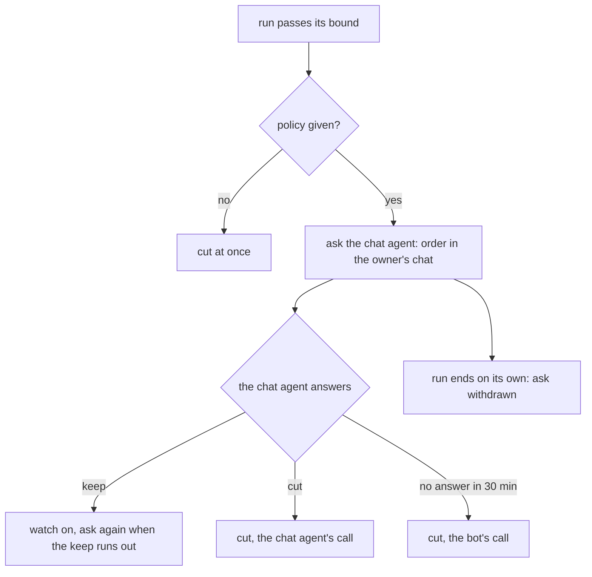
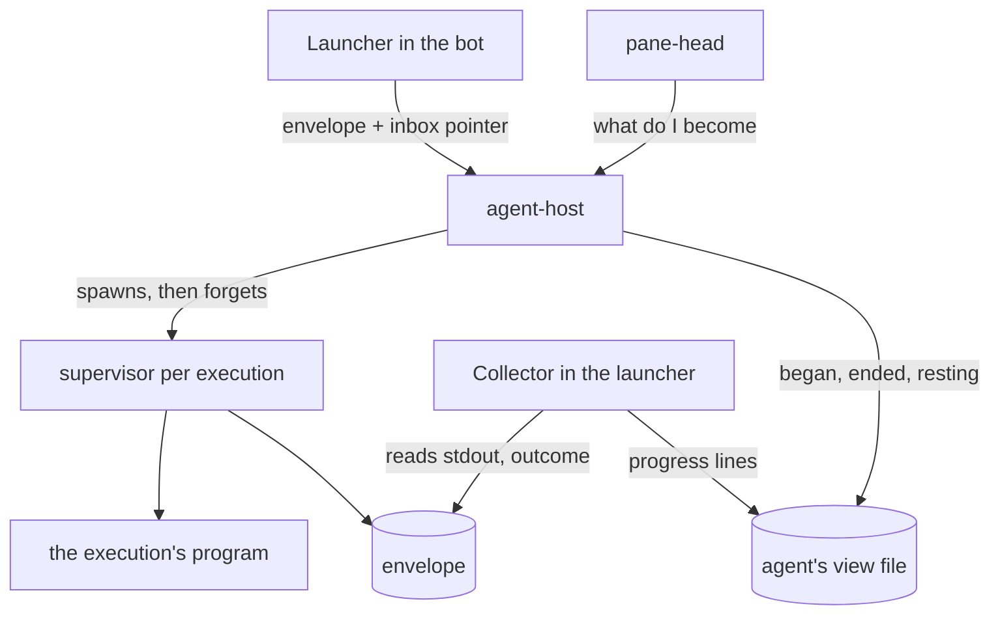

# Putting words into a running agent

Agency's agents run in panes under herdr. This document says what that channel is, and what works and
what does not. Everything here was actually run on the operations machine.


## Execution transport contract

The owner's words for the scope are:

> So from now on, no more starting agents from the command line or using agents over HTTP: everything goes through herdr, on the harnesses!

> Yes, literally everything. The harness is an adapter, so that can't be helped, but the path by which the bot controls an agent is herdr.

### Ownership and scope

- **Every model invocation runs through herdr, for every provider.** That is the chat agent's turns,
  every gate, chat compaction, chat and gate warming, workers, repository-managed co-work
  branches, editors, search and browse runners, their fallback attempts, keepalive and worker
  compaction.
- **There is one launch path, and nothing branches on the line.** No line, provider or caller
  keeps a process of its own beside it, and none calls a model over HTTP from the bot.
  - A gate's one request to a registered model with no tools is itself a command run in the gate's pane.
  - The harness adapters stay what they are: a harness is how a program is spoken to, and a
    bridge or a tap that a harness needs runs where the harness asks for it.
- **Ownership and placement are separate questions.**
  - A chat turn and a gate stay the bot's own runs: the bot waits for them, reads their answers,
    and a bot that stops has them stopped.
  - Where their process runs is the agent's pane, like everybody else's.
- **Not model invocations.** Utility commands, model discovery and service supervision need no
  agent pane of their own.
- **The agents table is authoritative** for names, kinds and standing workspaces. A name a run is
  launched under that has no row still gets a workspace of its own under that name. No roster is
  kept in the code: a row is written by whoever registers its agent — a companion from the seed its
  deployment hands in, a worker the owner adds — and what each agent is called on a screen is the
  console's own wording.

### A pane carries the real execution

A resident agent's pane runs its provider's interactive program, and its turns are read from the
records that program writes — transcript, hooks, status line, rollout — never from the screen
(「What a resident turn reads」). A host agent's pane runs a supervisor which starts the actual
harness as its owned child, shows the execution on its terminal, and captures exact stdout/stderr
separately for the harness reader; its headless commands keep their argv, tools, permissions,
effort, prompt construction and session policy. A pane that only tails an unrelated systemd
process is not execution through herdr. Codex retains its thread ids; dsh remains stateless. Do
not parse terminal rendering as the answer or infer success from the disappearance of a pane.

Use a private per-attempt directory (0700, files 0600) for the command envelope, input, raw
outputs and atomically published outcome. Only its opaque path travels to the agent's pane. Do not
put prompts, credentials or complete environments in labels or metadata.
Drain stdout and stderr concurrently; preserve byte boundaries through incremental decoding.
Display provider/model, lifecycle and readable progress without corrupting raw result data.
Existing harness readers remain responsible for reply, usage and session interpretation.

### One standing pane per agent

The owner's words:

> Don't keep throwing panes away; keep using them, one pane per agent.

> For example, if it is a Claude Code session, just show the screen with Claude Code running. Always make it possible to give it instructions directly there too; I asked for this so I can also see what it is doing and what it is thinking.

> Stand every agent provider up interactively. A request with no tools to a registered model can't be, so leave it as the exception. It is abstracted anyway, so it is the same interface.

- **Every agent has one pane that stays.** It is the head pane of the agent's standing workspace
  (「What goes where」). It does not come and go with the work, and the workspace holds nothing else
  of the agent's: no shell tab, no drawn status beside it, no pane opened for one turn.
- **What stands in that pane is one of two things.**
  - **A resident agent's pane is its program.** The provider's own interactive program — Claude
    Code's screen, Codex's screen — stands in the pane between turns and during them. A person
    attached to herdr reads the tool calls and the thinking as the program draws them, and can type
    into it at any time. Every turn of that agent, keepalive and fold included, goes into that one
    program.
  - **A host agent's pane shows its host's view** of the agent: each structured execution the agent
    host runs for it, as it begins, streams and ends (「The host」 below). No process of the agent's
    own stands in the pane.
- **The launcher says what the program is, the agent host decides, and the head becomes what it is
  told.** Only the line knows the agent's command — its model, its prompt file, its session — so the
  launcher writes the program into the agent's place before a turn: the command to start it on, the
  command to start it again on, which resumes the session the first one opened, the record whose
  existence says that session is open, and its identity.
  - **The head is `pane-head`,** a Rust program of a few megabytes. Each time the pane's loop starts it,
    it asks the agent host of its data root what this pane is to become, handing the agent's name, its
    pane and its own process.
  - **The agent host answers from the place.** Where a program is written and no live head holds it,
    it records the start — the identity, the head's own process, which the program will be, and how
    many times that identity has been started — records the pane as holding the program, and answers
    the command, the environment, the directory and the wait the restart bound asks. That record is
    what the launcher reads to know the program is up.
  - **The head waits the wait, lays the pane's terminal variables over the environment, and replaces
    itself with the program** (`exec`). Nothing of ours stays in the pane beside the program: the
    program is the pane's process, and the loop is its parent.
  - **Where no program is written, or a live head already holds it,** the agent host answers the view:
    the head replaces itself with a follower of the agent's view file, which the host writes
    (「The host」).
  - **A program could not be started** — the executable is not on the path — and the head tells the
    agent host why before it ends, which records it in the place as a failed start the turn waiting on
    it reads; the try counts as a start, so the restart bound holds a program that cannot come up.
  - **An agent host that does not answer** leaves the head saying so on the pane and ending; the loop
    asks again a second later.
  - **One program per place.** A second head in the same workspace that finds the program already held
    by a live head is answered the view instead of a second copy.
  - **A gate's pool is the one agent with more than one program:** each of its slots is a place of
    its own, with its own head and program, beside the gate's own place, which shows its host's view
    (「A gate's pool」).
  - **A head opened for a host lets go.** A head started with the host-head variable — a pane a bun
    launcher opened for a host beside the program — never races the program's own loop: it is answered
    the program only once nothing has held it for ten seconds, the view while no program is written,
    and, where a live head holds the program, told to let go, so the leftover pane ends.
  - **A view gives way to the program.** When a program is written into a place no live head holds, the
    agent host ends the follower in the agent's head pane, and the loop starts the head again, which is
    answered the program. It waits three seconds of the program standing unheld first — longer than a
    program's own loop takes to start it again — and ten for a head opened for a host.
  - **Where the answers are recorded.** Each head pane's record stands under the host's `heads/`, one
    directory per agent, one file per pane: the process, the birth, and whether it holds the program or
    the view.
  - **The prompt goes to the pane holding the program.** The agent host records the pane beside the
    program it started, and a turn puts its words there rather than into whichever head the workspace
    lists first.
  - **A head record of a process that is gone stands for nothing.** Each record carries the process and
    its birth, which after `exec` are the program's, so a record whose program has ended is read as
    absent and dropped at the next answer; nothing has to remove it.
  - **The head installs no signal handler.** Before its `exec` a signal that ends it — while it asks
    or while it waits out the restart bound — is an end like any other: the loop asks again a second
    later, and the start the host recorded names the head's own process, now gone, so it reads as
    absent. After its `exec` the program is the pane's process, so a person's Ctrl-C and the
    launcher's SIGTERM reach the program itself, with nothing between. The loop ignores no signal, so
    the program inherits none ignored.
  - **A session is resumed only once it exists.** A program that opens a session under a name it chose
    writes nothing of it until its first prompt: Claude Code started on `--session-id` and given nothing
    leaves no transcript, `--resume` of that name then exits with `No conversation found with session
    ID`, and the same `--session-id` starts again cleanly (measured). So the agent host answers the
    resuming command only once the record the launcher named exists, and the opening command until
    then; a program written with no record named is started again on its resuming command.
  - **Written with nothing to do.** An agent whose own launcher has a program to stand while no turn
    has asked for one has it written by the standing pass below, into a place that holds none, and the
    head starts it with nothing put in. The pass offers each agent to its launcher and writes what that
    launcher answers; which agents answer, and with what, is each launcher's own. The worker line is the
    one that answers (「A worker standing with nothing to do」). The heads, the launchers and the pass are
    agency's server's, the chat receiver's, and a head stood before the offer takes the program as a view
    gives way (below).
  - **Handed back.** Where the agent's provider declares no program or its line keeps no session, the
    launcher takes the program out of the place and ends it, and the head, starting again, is answered
    the view. The chat does this on every round it runs on the host, so a program written while its
    provider still declared one never keeps the pane.
- **The pane runs a loop, and the program stands inside it.** The pane's command is a shell loop
  that starts `pane-head` with the agent's name, under the mark `bmo-head-<agent>` by which a head pane
  is told apart from everything else. Where what the head became ends — the program crashed, a person
  typed its exit, the bot ended it to start a different command, the agent host ended a view — the
  loop starts the head again in the same pane, waiting a second between tries so a head that cannot
  come up does not spin.
  - **One exit is not started again:** the code `HEAD_STOPPED`, which only the head gives, when the
    agent host tells it to let go of the pane. Any other end, a program ended by a signal included, is
    started again; a pane closed from herdr takes its loop down with it by the hangup.
  - **Starting again is bounded.** The agent host keeps the times of the program's recent starts in
    the place. The first three within a minute start at once; each start after that waits twice as long
    as the one before, from two seconds up to thirty. The start is recorded before the wait, with the
    time it waits until, so the place reads as held meanwhile.
  - **A place that keeps dying is stood up anew.** Six starts within five minutes is a program in a
    loop, and the next turn does not put its prompt into it: the place is rebuilt first
    (「Stopping, falling back and standing up again」).
- **Every agent's pane is stood up, not waited for.** The chat receiver stands them all up as it
  attaches to herdr, on every reattachment and every ten minutes (`chat-providers.md`, 「Where the
  receiver runs」), so an agent that has not run since the machine
  came up has its pane and its program all the same, and a worker that has never been given a job
  stands its program all the same.
- **A head of another kind is replaced once nothing runs on it.** A head loop that starts anything
  but `pane-head` — a head a herdr kept standing from an earlier deployment — is closed by the
  standing pass once no open execution names its pane, and `pane-head` is stood in its place. A pane at work keeps its head
  until a later pass finds it idle: closing it would end the program standing in it.
  - **A name with no row is covered too.** Message sending, a voice briefing, a watch and a co-work
    role launch under a name the store keeps no agent for, and their workspaces carry that name as
    their agent's token. The pass reads every such name off herdr's workspaces of this data root and
    replaces their heads of another kind the same way, so no head of another kind outlives the pass.
  - **A workspace whose token herdr lost still counts.** A restarted herdr revives workspaces with
    their labels and panes but no tokens, so a workspace with no agent token counts under the name
    its head carries in its mark. The workspace is then found by the label this data root gives that
    name, so another root's revived workspace is left alone. A workspace of a person's own, with no
    head in it, counts under no name.
- **The leftovers go with it.** A pane of the agent's workspace with no run in it and no command of
  its own — a shell a rebuilt herdr left, a pane whose loop let go — is closed as the panes are
  stood up. A worker's dev server runs its own command and is kept, and so is a standing pane — one
  whose command line carries the standing mark (`bmo-standing-*`), such as a companion's follow pane
  (`docs/companions.md`, 「What a turn shows」).
- **A job's end sweeps the whole of herdr the same way.** When a job ends, and on agency's own clock
  every ten minutes, agency reads every workspace and every pane in it, on this machine and on each ready work node whose
  link the node service reports up. Every agent standing counts, a pane a consumer claims among them
  (`docs/api.md`, 「Hooks」, the pane claims). A pane carrying a run, a head (`bmo-head-*`, the
  head script), a node's pane (`bmo-node-*`), a dev server or a standing pane (`bmo-standing-*`) is kept whatever else is true, since what
  it runs is an agent's or a node's standing process. In a workspace this system marked — one carrying
  an agent's or a node's token — a pane carrying none of those is closed, and a workspace of an agent
  that no longer stands, left with nothing kept in it, is closed whole. A standing agent's workspace is
  left to the standing pass.
  - **A resting worker's workspace is closed whole** where no pane of it carries a run: its head and
    its program stand for a worker that takes no work (`jobs.md`, 「There can be more than
    one job worker」). One with a run in it waits for the next sweep.
  - **What the sweep will not close is told, not closed.** A workspace of an agent that no longer
    stands but still carries something, and a workspace no token marks whose panes carry nothing, are
    published as one `herdr-leftovers` event — how many panes, in which workspaces, and whether each is
    marked (`docs/api.md`, 「Events」). An unmarked workspace may be a person's own terminal, so closing it
    is the call of whoever the consumer tells, after asking. The same picture is published once.

### Which agents are resident

- **Every agent runs as an interactive program in a pane; none runs in print mode**
  (`docs/agents.md`, 「No print mode」). Where each kind stands on the way there is that document's
  「The stages」.
- **An agent is resident when its current provider declares an interactive surface and its line
  keeps a session.** That is every conversational agent — the chat agent and every companion
  (`docs/agents.md`, 「Conversational agents」) — every worker, and each co-work place of the pool.
  Their turns follow one another on one program: the chat's rounds come off one common queue, a
  companion's turns in its rooms take the agent's own lock in turn, and a worker's turns are held one
  at a time by its pane lock (「A worker's pane lock」).
  - A companion keeps a session in each room it answers, and its one program goes on in the session of
    the room its turn is for: a turn for another room changes the command, which starts the program
    again on that room's session in the same pane (「The interactive surface a provider declares」).
- **A run that keeps no session is a run apart:** every editor's batch, the search and browse runs,
  research branches, the news page's writer and their keepalive pings each stand the interactive
  program in a pane of their own, opened for the run and closed with it, so two runs of one agent at
  once are two panes (`docs/agents.md`, 「Runs apart」).
- **A gate on Claude Code stands a pool of resident programs,** since its judgements are independent
  calls that overlap (「A gate's pool」 below; `gates.md`, 「A gate on Claude Code」).
  - Each judgement stands alone, two of them for the same gate may run at once for two rooms, and a
    gate runs under a deadline of a minute or a few.
  - One interactive program holds one conversation and takes one turn at a time, so it would queue
    one room's judgement behind another's and carry one judgement's words into the next. A pool takes
    overlapping judgements in programs of their own and clears each program's conversation between
    them.
  - A gate on any other road stays a host agent: one request asked in its host and shown in its pane.
- **The registry's provider stands Claude Code on the gateway.** What stands in the pane of an
  agent on a registered model is Claude Code's interactive program pointed at agency's gateway under the
  registration's name, the words said to a worker going on in the session the program stands on, a
  conversational agent's turn going on in its scope's session, and every other turn the bot puts in
  opening a session of its own (`docs/own-llm.md`, 「Claude Code in the pane」). The registry's
  provider declares this, and nothing outside it names a registration.
- **A provider may declare no surface,** and an agent is then a host agent for as long as it runs on
  that provider: its calls run as structured executions of the agent host and its pane shows their
  view.
- **Resident or not is read off the declaration, never off a name.** The launcher asks the agent's
  current provider for its surface and the line for whether it keeps a session. The receiver, the
  conversation and the runners never read which provider they are talking to.

### A worker's pane lock

- **Two locks, two things guarded.** A checkout's job lock guards the directory — its files and its
  git index — and is taken by whatever does work there. A worker's pane lock guards that worker's one
  resident program, and is taken by whatever puts a turn of the bot's into it. Each worker has its
  own, named by the worker rather than by its directory.
- **Who takes which.**
  - A job takes its checkout's job lock, then its worker's pane lock, and holds both until the job is
    recorded. Waiting on the pane lock is waiting out a word's turn already running there.
  - The keepalive ping, the fold and the standing pass take the job lock and then the pane lock, both
    without waiting, and skip that round when either is held.
  - A word said to the worker takes the pane lock alone, without waiting (「The keepalive ping goes
    into the same program as the turns」).
- **So a word never waits on another worker.** Two workers pointed at one checkout share its job lock
  and nothing else: while one runs a job there, a word to the other goes into the other's own pane at
  once, and the two programs work in the one directory side by side. The owner tells a worker something on
  its screen to have it done now, which is why the checkout is not what a word waits on.
- **No cycle.** The job lock is always taken before the pane lock, and the word takes no job lock.

### A gate's pool

What a pool is for, how large it grows and when a program is cleared or ended is `gates.md`, 「A
gate on Claude Code」. How it stands on the places:

- **A slot is a place of its own,** named `gate-<gate>-<n>`, with its own workspace, head pane, loop and
  program, stood by the judgement that first needs it as any resident program is stood for a turn.
  Its settings are the place's own: the status line and the `Stop`, `StopFailure`,
  `UserPromptSubmit` and `SessionStart` hooks, and no shell guard, since a gate holds no shell. Its place keeps a record of
  which gate and slot it is and when a judgement last let it go.
- **A slot's lock is its own lock file,** taken without waiting by the judgement that goes into it and
  held until its program is clear again, so a slot takes one judgement at a time whichever process
  asks.
- **Which session a judgement is read from** is the last one the slot's program opened: the session id
  its session-start hook named after the program last started or was cleared. The command names
  none, so a program started again, by its loop or by a changed command, opens a new one.
- **Clean** is a program that has taken no prompt since that hook: no submit hook stands after it in
  the place.
- **The clearing is `/clear`,** put in as a command of the program's own with nothing before it; the
  hook it fires carries the source `clear`. A program is ended rather than cleared by stopping it at
  its process, and its loop starts it again.
- **A judgement's turn is looked at more often than a job's,** every fifth of a second instead of every
  second, and the status line's reading after it is waited for two seconds at most, since a
  judgement's answer is waited on by a room. A reading that does not come in that while leaves the
  judgement's tokens standing with no money, as for any resident turn.
- **A slot is a pane its gate claims** (`docs/api.md`, 「Hooks」, the pane claims), so it counts as
  standing for the sweep after a job's end and its workspace is never told as a leftover. The heads'
  pass takes down each slot its gate marks idle — its program released from the place and its
  workspace closed — where its lock is free; how long a slot stands unused before it is marked idle is
  the gate's.

### What an agent provider is made of

- **An `AgentProvider` is one road the owner chooses** — Claude Code, Codex, OpenRouter, the registry's — and it
  answers every question that differs between roads for itself. Nothing outside it keeps a list of
  those answers, and nothing branches on its name to find one.
- **The program it is carried on is its `AgentAdapter`:** how a run is put to that program and how
  its answer is read back. One adapter may carry several providers.
- **The adapter names the tools of its program whose calls wait long** — a shell command, a
  sub-agent, a fetch from the web — or none, which is the default. The list is the program's own:
  nothing outside the adapter holds a tool name. A road that serves the run's model on the node
  pool sends the list with every request, so an engine can hand its cards on while the run waits
  on such a tool (`docs/own-llm.md`, 「How requests go」).
  - Claude Code names `Bash`, `Agent`, `Task`, `WebFetch` and `WebSearch`, in its provider's
    policy file, which both sides read. Codex and dsh name none.
  - A tool the list does not name — a file read, a search, an MCP server's tool — is a short one.
- **It declares its logins, or that it holds none.** A provider whose runs agency puts on a login of
  its choosing says which logins it holds in walk order, which one it walks to now, and which one a
  reading with no login in hand is filed under. A run's login is an `AgentAccount`: the login's id,
  the name the owner gave it, and where its credential is reached. A provider that holds none has one road
  and nothing to name.
- **It picks its own two headline windows** — the session window and the weekly one — out of the
  windows filed under it, in its own vocabulary; a provider that publishes no window answers none.
- These are the pieces the usage path stands on (`docs/cache-fallback.md`): a reading is filed under
  an `AgentSlot`, the provider plus the login where it holds logins, and which slot is serving now
  has one answer, `activeAgent`.
- The chat providers — Telegram, the web console and the rest — are another thing:
  a chat provider supplies rooms, an agent provider supplies answers.

### The interactive surface a provider declares

A provider that can stand as a resident program declares its surface beside its harness; one that
cannot declares that it has none, and an agent on it is a host agent. A gate stands Claude Code's
surface in the programs of its pool (「A gate's pool」) and no other provider's: on any other road its
run is one request in the host (`docs/own-llm.md`, 「A request with no tools」). The surface answers,
in the provider's own terms:

- **How the resident program is started:** the line's command with the print-mode flags taken out,
  on the session the agent resumes, with what lets agency read the program while it stays up — for
  Claude Code, a settings file naming agency's status-line command and its `Stop`, `StopFailure`,
  `UserPromptSubmit` and `SessionStart` hooks, and on a conversational agent's program the shell guard, a `PreToolUse` hook on the shell
  that refuses a command starting Claude Code (`docs/agents.md`, 「No print mode」).
- **How one turn goes in:** `agent.prompt` for a program herdr recognises as an agent, the loop's
  own inbox for one it does not.
- **Whether words go into a turn that is working.** A surface that takes them says so; one that
  does not keeps them until the turn has ended.
- **How a turn's end, its answer, its tokens, its money and the account's windows are read** while
  the program keeps running.
- **How a working turn is interrupted.**
- **How the session is folded, and how it is cleared.**
- **Which session a standing program is on,** read off its command where the command names one, so
  a ping that warms a session goes into the program only where the program stands on it.
- **Whether it carries its own turns.** Codex's surface and the loop's run one of their turns from
  start to end themselves — the program stood up, the turn put in through the door, the record read
  until it ends — so whatever hands them a turn, the fallback walk above all, asks the surface for
  the turn rather than naming the program. Claude Code's lines run their own turns and its surface
  carries none.
  - Which door a provider's turns go through, and whether it takes words while a turn works, is its
    own file of agency's policy (`policy/providers/`), which agency's server's resident door and
    the TypeScript surfaces both read: the server puts a turn through the door the provider
    names there and never through one chosen by the provider's name.
- **Whether it stands with nothing put in.** A surface whose program can be stood from the agent's
  own line alone, before any turn has asked for it, says how: the command, with whatever a person's
  first turn at the program needs laid down beside it in the place. The loop's surface does — it
  lays the line's run down as the one a typed line goes out on — and the standing pass stands it for
  a worker pinned to its provider (「A worker standing with nothing to do」). Claude Code's standing
  program is its worker line's own; Codex's surface stands only with a turn.
- **Whether a standing program is its own,** read off the command the program was started on: Claude
  Code's and Codex's by the executable, the loop's by the loop script's file name and the provider it
  names, so a loop started from another tree, wherever that tree keeps the script, is still its own. A
  place holding a program no surface of the pinned provider owns is one the standing pass replaces
  (「A worker standing with nothing to do」).

- **The command is the program's identity.** Before every turn the launcher compares the command the
  surface would build now with the one the standing program was started on.
  - Any difference — provider, model, effort, login, the system-prompt file, the working directory
    — means the program is ended between turns and started again in the same pane on the new
    command. The pane stays.
  - The settings file the command hands the program counts by the status command it names now and
    every guard the place's own verb stands before a tool call, not by its path alone: a program
    keeps the status line and hooks it started with, so one whose settings came to call another
    command, or to guard its shell where it did not, is started again on it.
  - The hooks that only write the place's records are not part of the identity. A hook added beside
    them reaches each program the next time it is started for any other reason, and nothing is
    restarted for it.
  - This is also how the chat's check before every call (`unified-bmo.md`) lands on a resident
    program: a prefix that changed replaces the session and the program with it.
  - **A setting is never changed by typing a command into the program.** Claude Code's `/model`,
    typed through `agent.prompt`, stops on a confirmation of its own and then saves the model as the
    user's default for every new session, whatever setting sources the program was started with
    (measured). That is a write outside the agent.

| Provider | Resident program | A turn goes in by | Words mid-turn | Turn end, answer, tokens | Money and windows | Interrupt | Fold and clear |
|---|---|---|---|---|---|---|---|
| claude-code | Claude Code's interactive screen | `agent.prompt` | Taken, measured | Transcript, and the `Stop` or `StopFailure` hook | Status line | Escape, measured | `/compact` and `/clear`, measured |
| codex | Codex's interactive screen, resumed by its thread id | `agent.prompt` | Taken, measured | Rollout file | Rollout file: tokens and windows, no money | Escape, measured | A new thread from the handover summary |
| openrouter | agency's resident loop over dsh | The loop's inbox, or a line typed at its screen | Not taken | The loop's own record, tokens from dsh's session log | None | The loop ends its dsh child | No session to fold |
| registered | Claude Code's interactive screen on the gateway under the registration's name, its records under a home of the registration's own | `agent.prompt`; words said to a worker on the session the program stands on, a conversational agent's turn on its scope's session, every other turn on a session of its own | Not taken: they wait for the next turn | Transcript | None | Escape | `/compact` and `/clear`; a conversation is handed over by a turn asking for its note rather than folded, the program folds itself before the registration's window, and a turn at the limit fails |

### What a resident turn reads

- **Claude Code.**
  - **The turn's end and answer** come from the transcript in the order 「The order for putting in
    one turn and waiting for it to end」 gives. The `Stop` hook fires once per turn with the session
    id and the last assistant message (measured), and it is the end signal the reader waits on
    beside the transcript's own end line.
  - **An interrupted turn** writes the interrupted marker, and neither the `Stop` hook nor the end
    line (measured). The reader ends the turn on that marker.
  - **A turn a failed request ended** fires `StopFailure` in place of `Stop`. Claude Code hands it the
    error's kind (`rate_limit`, `overloaded`, `server_error`, `authentication_failed`,
    `max_output_tokens` and the rest of its own list), the details and the error text it wrote in the
    answer's place, and ignores what the hook answers.
    - The place writes it as a failed end. It closes the run as a stop does, counts as a turn's end
      wherever the ends are counted, and is never held.
    - The reader ends the turn as errored on it, or on the error in the answer's place, whichever
      it reads first, with the error's kind beside the text. The record's own error line carries the
      same kind, so a program started before the hook was added still ends its turn the same way.
  - **Tokens** are summed once per `message.id` over the turn's lines (「The session record and
    usage」).
  - **Money.** The status line's `cost.total_cost_usd` is the session's running total, and `/clear`
    starts it again from zero (measured). The program hands it over after each model response —
    once per tool step inside a turn — and about a second after the turn ends, and after an
    interrupted turn too; it does not call it at the moment a prompt is submitted, only with that
    turn's first response (measured, a four-tool turn: nine calls, the first 2.3 s after the
    submit). The last reading of a session equals the `totalCostUSD` its `cost-state` line settles,
    the title-making Haiku call included (measured).
    - A turn's money is the reading after its end minus the reading before its start: the whole
      turn, with no split by model.
    - The reader waits a bounded time after the turn's end for the status-line call that follows
      it. Following it means stamped later than the end: a reading stamped in the same millisecond
      as the `Stop` hook may be the program's call at startup or one inside the turn, and such a
      reading, with no windows in it or an earlier total, is never the one after the turn. Where
      that call does not come in time, or where it and the `Stop` hook name different sessions,
      the transcript's tokens stand and the turn's money is left empty rather than guessed.
    - The split by model is the `cost-state` line, which the program writes when its session
      changes or the program ends — at `/clear`, at `/exit`, on SIGTERM and as a pane closed — and
      never at `/cost`, at `/compact` or on an Escape that interrupts a turn (measured). It settles
      everything the session ran.
  - **Account windows.** The status line carries `rate_limits.five_hour` and `rate_limits.seven_day`,
    each a used percentage and a reset time. They are absent from the call at startup and present
    once a request has been made (measured), so a program that has made no request yet reports no
    windows, and the readers keep the last windows they had. They feed the rest and usage readers.
    - The place is the agent's, not the login's: every program that ever stands in it writes its
      readings into the same file. So the recorder stamps each reading with the login of the program
      that made it — the configuration home its own environment names, or a short fingerprint of the
      token it was handed, never the token — and the reader takes the reading after a turn only from
      that turn's own session.
    - The windows go to the registered account the stamp names, whichever login the turn was meant
      to go out on; a reading whose stamp names no registered account, or that carries none, gives
      the turn no windows at all. The login the turn's spend is written under is the stamped one too,
      and where there is none, the one the pane's own environment names.
  - **The model a turn ran on** is `message.model` on the turn's response lines. The downgrade check
    reads it there.
  - **Background work** is read as 「The session record and usage」 reads it: what a turn put in the
    background is followed to its finished notice. A `<task-notification>` that arrives after the
    turn ended starts a turn of its own (measured), and that turn belongs to the round or job turn
    that launched the work, which waits for it before it ends.
    - **A line can hold a turn's end while its own background work runs.** The `Stop` hook is handed
      `background_tasks`, every task of the session with its id, type, status and description, a
      shell command left going reading `running` (measured on the worker's own records). A line whose
      place settings ask for the hold has its stop hook answer a stop of a bot's run with a block
      while any task reads `running`, naming each task and the two ways out — wait for it on the file
      its output goes to, bounded, or stop it with `TaskStop` — so the program goes on in the same turn instead of
      ending it with the work cut off. A held stop is written into the place as a hold rather than a
      stop, so it neither closes the run nor counts as a turn's end.
    - **A line can also hold a turn's end while its final answer uses a banned word.** Where the
      place settings ask for it, a stop of a bot's run whose answer so far — the program's own
      `last_assistant_message` where the hook is handed one, the turn's text read off the session
      record otherwise — uses a term `WORDING.md` bans outside its quoted spans is answered with a
      block naming each term beside what to write, and the program writes the answer again in the
      same turn. For a job that answer is its report.
    - The hold is bounded: three holds in a row with no turn's end between them, whatever each was
      held for, and the next stop
      is let through as it stands, so a program that will not settle its work cannot be kept turning
      for ever; what it left running is then the runner's to judge, as below. A person's turn is
      never held.
    - The job worker's line asks for both holds; the chat line asks for neither, its answer being
      held to the same words by the round (`answer-checks.md`, 「The banned words」).
  - **Outage retries.** A request that fails is written as the program's own words in the answer's
    place (「The session record and usage」), and the `StopFailure` hook follows it. That ends a
    resident turn as failed and starts the fallback walk. The retries the program makes before it gives up are not read while they happen;
    whether they can be is not measured.
  - **Context.** The status line's `context_window` carries the tokens in use and the window's size.
  - **The status-line command is agency's:** the deploy tree's `bmo-agency agent-status`, which the hooks call
    too. It writes what the program hands it into the agent's place under the data root, where the
    readers take the figures from, and it prints the one line the program shows at the foot of its
    screen (「Runs and sessions in one pane」). On a work node it runs on the operations machine, where
    the place stands; the shell guard reads only the command it is handed and runs where it is called.
  - **The place's records are read from their end.** Each call is one line appended to the place's
    status record or its hooks record, and neither is cut while what they hold stands, so an agent's records
    grow to hundreds of megabytes. A companion's are cut where its conversation is taken: its reset empties both,
    and a turn the reset overtook takes its session's lines out of them (`docs/companions.md`, 「Starting it
    afresh」). Every reader wants only the lines since a moment — a turn's start, its end,
    the program's own start — and reads back from the end of the file only as far as that moment, one
    line at a time, never the whole file into memory.
    - A line is stamped as its call arrives, so the lines stand in their stamps' order but for two
      calls landing together; a reader goes on a minute past its moment before it stops.
    - The reading before a turn is the one exception: it is the session's last reading at or before
      the turn's start, however far back that lies, and a session's first turn has none, so that one
      reading goes back to the file's head, still one line at a time. Waiting for the reading after
      the turn reads back no further than a minute before the turn's end.
- **Codex.**
  - The rollout file the program writes under its sessions directory carries `task_started`,
    `task_complete` — with the error, when a turn failed — and `token_count` with the turn's usage
    and the `rate_limits` windows, written by the running process (measured on this machine's
    rollouts).
  - **The rollout is the turn's record as it goes.** Its response items carry the model's messages,
    its reasoning, each tool call — `function_call` and `custom_tool_call` — and what each handed
    back, matched to its call by `call_id`, and a `token_count` follows each request with that
    request's input, the cached share of it, output and reasoning (measured). The door hands every
    whole line the rollout gains after the prompt to whoever follows the turn, and the turn's log
    and its picture read those lines as they read Claude Code's record.
  - herdr recognises the program as an agent, and the program resumes a thread by its id (measured).
  - The interactive program has no `--ignore-user-config`; it refuses the flag as an unexpected
    argument (measured), so it reads a Codex home's `config.toml`. It runs under a Codex home of
    agency's own under the data root, named by `CODEX_HOME` on its command. The home's `config.toml` is
    agency's alone, so the user's configuration never rides along and nothing the program writes into
    its configuration lands in the user's. The login file and the sessions directory are links into
    the user's own Codex home: the program goes out on the login `exec` goes out on, resumes the
    threads `exec` opened, and writes its rollouts where every reader of a rollout looks.
  - Of the screens it raises before its input box, two are switched off by configuration:
    `check_for_update_on_startup=false` takes the update offer away and `features.hooks=false` the
    hooks review (measured). The folder trust stands even with a trust entry given as a `--config`
    override, and answering it writes a trust entry into the Codex home's `config.toml` (measured),
    so the launcher writes that same entry into agency's home for the directory before the program
    starts there, and the screen does not come up, with the sandbox and with the sandbox bypassed
    alike (measured). A prompt put in while a screen stands lands in that screen (measured), so a
    program still showing one when its turn is due is a turn left for a person, never a prompt
    typed into it. herdr reads the trust question as `idle` (measured), so its status does not
    say the question stands: the turn reads the screen for the question before the prompt goes in.
  - The program is spawned as itself rather than through a shell, so the shell function this
    machine defines under the same name, which adds sandbox and approval flags of its own, never
    stands in front of it.
  - A thread the program opens for itself has no id until its rollout names one. The program is
    started with no thread, and once the first turn's rollout names the thread, the program standing
    is relabelled as the program on that thread rather than started again. A program that falls
    over afterwards comes back resuming it, and the next turn resuming it finds it standing.
  - The account's windows a turn's last `token_count` carries are the same windows the account
    reading returns, named the same way. The bot's minute-by-minute reading of them takes them from
    the newest rollout where a turn wrote them within that minute, and asks the account otherwise,
    since an idle machine's rollouts say what the windows were rather than what they are.
  - An agent's own turn that the fallback walk gives to Codex is a turn of this program in the
    agent's pane, on the thread the walk resumes. A gate's, an ephemeral turn's and a summary's stay
    in the host.
  - Words put in with `agent.prompt` while a turn works are held on the screen and taken inside
    the same task: after the turn's next tool call, or, where the response ends with no tool call,
    as the task's next request (measured). Nothing is lost and no task of their own is opened, so
    the rollout carries them as a user message before the one `task_complete`, and that task's last
    message is the answer. The rollout records nothing of a word while it is held, and a task never
    completes with one still held, so an ended task has nothing left queued.
  - Escape interrupts a working turn (measured). The rollout writes `turn_aborted` with the reason
    `interrupted`, herdr reads the pane as `done`, the program stays up on the same thread, and the
    next prompt is answered on it. A command the turn started is not stopped: it runs on to its own
    end in one of the program's background terminals, and adds nothing to the thread when it does.
    Escape pressed while words are held aborts the task and opens a new one on those words at once
    (measured), so an interrupt ends the work only where nothing is held.
- **The registered models through Claude Code on the gateway.**
  - The program is Claude Code's own, pointed at agency's gateway under the registration's name — with
    its node, where the registration has several — with the gateway's key read by the program from
    its file on each request and its records under a configuration home of the registration's own
    that holds no login (`docs/own-llm.md`, 「How requests go」). So a program standing in a pane is
    the registration's where its records home is that registration's, and the Claude login's only
    where it is pointed at no other endpoint.
  - It is read the way Claude Code's program is: the turn goes in with `agent.prompt` and its answer
    is read out of the transcript. The words said to a worker go on in the session the program
    stands on, where the worker holds it on the same road, so the program stays standing between
    them. Every other turn the bot puts in opens a session of its own — the program is stood up
    again on it — since a registration's window may hold only tens of thousands of tokens and no
    earlier job is worth carrying into it. A person's lines typed after a turn go on in its session.
  - The home's first-run questions — the colour theme a home with no login asks for, and the folder
    trust — are answered in its configuration file before the program comes up, and the warning a
    worker's bypass mode stands on is passed over by the settings it is handed, as every login's own
    settings pass it.
  - A worker's program on a registered model is the worker line a Claude run takes, the model and
    endpoint aside (`docs/own-llm.md`, 「A worker on a registered model is composed as on Claude」).
- **OpenRouter through dsh.**
  - dsh has no terminal conversation of its own. Its `headless` profile answers one task and exits,
    its `web` profile keeps sessions but serves a browser, and herdr does not recognise it as an
    agent (measured). The `tui` profile its help names in an example ships in no release: booting it
    ends with `dsh: profile "tui" does not exist` on the pinned version and on the newest (measured).
  - So the resident program is agency's own loop. It stands in the pane, takes a turn from the bot
    through its inbox or a line typed at its screen, runs one dsh headless process for it, shows the
    reasoning dsh streams and then the answer, and writes the turn's start, each step dsh takes, its
    answer and its end to a record of its own.
  - dsh keeps no session agency resumes, so each turn carries its context as the chat's OpenRouter
    turns do.
  - A headless run streams its reasoning to stderr and prints the answer (measured). It writes a
    session log of its own in any case, zstd-compressed lines under its home's sessions directory,
    and that log carries each request's `usage` — input, output and total tokens, and the share read
    from the cache where the upstream reports one, outside the input — and every retry dsh made
    (measured, keyed runs on OpenRouter). So the loop records the turn's
    tokens from that log, and no money or windows, which nothing on this road reports.
    - The turn's answer carries the share read from the cache beside its input and output, and the
      turn's tokens count it, as the steps the progress line reads do. Where the upstream reports no
      such share, it is none.
    - A line of the log is `{ type, seq, time, data }`. A streamed chunk of type `usage` carries a
      request's figures, and a request the gateway refused writes a chunk of zeros (measured, three
      runs refused with 429 on the free models); a whole response carries its figures on its message.
      So each request is counted once — from the responses where the log has any, from the chunks
      otherwise — and a turn whose every request was refused has no usage.
    - The logs are filed by the directory the run worked in, under a home every dsh run of agency's
      shares, so a turn reads only its own directory's logs written since it started.
  - **The turn's steps go into the record as dsh takes them.** The session log is written as whole
    zstd frames, one for each batch of lines (measured on this machine's logs), so it reads while the
    child works. The loop reads the turn's logs at the resident turn policy's `loop_relay_ms` while
    the child runs, and once more after it ends, before the answer line.
    - Each response the model gave goes into the record as an `assistant` line in the shape Claude
      Code's record has — its reasoning, its words, each tool call and the request's tokens — and
      what each tool handed back as a `user` line, cut to `loop_relay_chars`, since the record is
      read whole on every look at a turn and a watching room needs only how the call ended.
    - So the door hands the turn's lines to whoever follows the turn as they are written, and the
      turn's log and its picture read them as they read Claude Code's record.
    - A reading that meets a frame still being written is dropped, and the next look reads it whole.
  - **The road each turn goes out on is the provider's own.** The loop asks its surface to open the
    turn's road before the dsh child starts and closes it when the child has ended. OpenRouter's key
    reaches the loop through its environment and never through the pane's input, and a turn with no
    key there is recorded as failed and nothing is asked of the screen.
  - **What the bot puts in.** A turn in the inbox is one file: the turn's id, the run's name and what
    it is, the turn's own wait, and the run with only the variables that belong to that turn — the
    address of the gateway tap the turn stands at, and the run's own variables. No key, no token and
    none of the rest of the bot's environment go into it. The loop's own command carries none of
    those turn variables, so its identity is the same from one turn to the next and it is started
    again only when the agent's command really changes.
  - **What a person types.** A line typed at the loop's screen and ended with Enter is a person's
    turn. It goes out on the run the bot last put in, which is the agent's own, kept beside the
    inbox with no secret in it, or on the worker's own line the standing pass laid down there before
    any turn came. A loop with neither says so and runs nothing. The record marks the turn as typed,
    under the name of direct input.
  - **One turn at a time.** A line typed while a turn works waits for it to end and then goes before
    the bot's next inbox turn; the bot's next turn waits in the inbox. So the bot reads its own turn
    out of the record by the id it put it in under, from its start line to the next turn's.
  - **The interrupt.** Escape, or Ctrl-C, at the loop's screen ends the dsh child the working turn
    runs, with its whole process group, since npx stands between the loop and dsh. The turn is
    recorded as interrupted. A key's own escape sequence — an arrow, a function key — is no
    interrupt.
  - **On the screen** a turn opens with a line naming it, what it is and when it started, dsh's
    reasoning follows dimmed as it streams, then the answer, and the loop ends each turn with a
    resting line saying since when.
  - An agent's own turn that the fallback walk gives to OpenRouter, or that goes out on OpenRouter as
    the provider a worker is pinned to, is a turn of this loop in the agent's pane. A gate's, an
    ephemeral turn's and a summary's stay in the host.

### Runs and sessions in one pane

- **A run** in a resident pane is one turn the bot put in — a round, a job's turn, a keepalive, a
  fold. **A session** is the program's own conversation, which runs across many of them.
- **Where a run starts.** The first line of every prompt the bot puts in names the run: its run
  name, what it is — the room, the job and its item, a keepalive — and the time it went in. On a
  Claude Code program that line is the typed lead, followed by the words saying the paste after it
  is the run's instruction (「The order for putting in one turn and waiting for it to end」). The
  transcript holds it at the head of that turn, and the screen draws the whole prompt, first line
  included, rather than a paste marker (measured, a 42-line prompt).
- **Where a run ends** is the program's own end of the turn on its screen, and the status line
  turning to rest. A run that spans more than one turn of the program — a word handed over after
  the model's last tool call opens a turn of its own — ends with the last of them: the end of a turn
  leaves the bot's run open while a word is still queued or a later turn is owed, counted by the ends
  the program reported, so the status line goes on naming the run through the turn that follows.
- **The status line is the state that is always shown.**
  - While a run is going it names the run and the time it started.
  - At rest it says the agent is resting and since when — the end of the last run — with that run
    named.
  - A person's turn is named as a person's.
  - The program calls it at startup, after each model response and after each turn, and never while
    idle or at the moment a prompt is submitted (measured). The line shows what the agent's place
    said at the program's last call, so it names a new run from that run's first response and turns
    to rest with the call after the turn.
- **A turn a person types** is a turn of the program like any other, since the pane is the
  program. A prompt submitted while the agent's place names no run of the bot's, and no word the bot
  handed its last run is still to arrive (「Words that arrive while a turn is working」), is a person's
  turn:
  - it is recorded under the agent as a turn of its own — the place's run names it a person's, the
    place's hook records hold its submit and its end, and the session's own record holds its words and
    its answer — and belongs to no round and no job;
  - its answer goes to no room;
  - on a line that declares it — the chat agent's line alone — the submit hook hands the line the composition a
    round of the owner's private chat would carry, as context beside it (`bmo-window.md`, 「A
    line typed into the chat agent's program」);
  - the bot's own turn does not touch the program while it works: while the place names a person's
    turn still open and the pane reads working or waiting on a question, the turn that arrives — a
    round, a job's turn, a keepalive — neither stands, replaces nor resets the program nor puts words
    in, and waits, bounded at thirty minutes, for that turn to end. Past the bound it goes on as it
    would, since a person's turn whose end was never recorded — an Escape fires no hook — must not
    hold the agent for ever.
  - A person typing into a turn the bot put in is a word into that turn, and the program takes it as
    it takes a pushed word; the round or job turn that is working reads the answer as it stands.
- **Where a session starts and ends** is drawn by the program itself: a program's opening screen,
  `/clear`'s empty screen, `/compact`'s compacted marker. A session the fresh-start path replaces
  is opened under a new name the round chose, which is a new command, so the program is started
  again in the same pane on it and its first turn carries the handover prompt; the program's opening
  screen is where the new session begins.
- **A host pane** follows the agent's view file, which shows each execution's readable progress as it
  streams — the thinking, the tool calls, the answer — headed by the run's name and closed by how it
  ended, and between executions a resting line saying since when the last one ended; a keepalive is an
  execution like any other. A view with no execution in it yet says only that the agent is resting.
  Raw output is the harness's data and stays in the envelope (「The host」).
  - The collector reads the running execution's output as it streams and writes what it has not
    written yet, each piece once, through its provider's own reader. It reads the output once more
    after the supervisor has closed it, and writes the end line only after that, so whatever that read
    finds — the unended last line included — stands above the end line.
  - So a program that prints its whole answer at once and ends inside a second — a gate's request
    with no tools on a registration, an OpenRouter gate run through dsh — still shows that answer. The
    registry's reader reads a typed event as Claude Code's and shows every other line as it stands.
  - Every line goes through the same flattening and width as a streamed one, whether the answer
    came as one line or many.

### A worker standing with nothing to do

The owner's words:

> Every worker that isn't awake just shows 'resting'. I'd like at least the conversation panel to be up. Put it up and just don't say anything to it.

> I should be able to send the first request from herdr rather than from here, and like this I can't send it.

- **Every worker stands its conversation screen, job or none.** Where a worker's place holds no
  program, the standing pass writes the program the worker's next job would start and nothing is put
  into it, so the pane shows Claude Code's own input box rather than the host's resting line, and a
  person attached to herdr can type the worker's first request there.
  - The program is the job's own line: the configured job model and effort, the login the job's walk
    offers now, the worker's checkout as its directory and the place's settings, so its status line and
    hooks write into the place exactly as a job's program does.
  - It stands on the worker's kept session for that model and login where one is recorded and
    resumable, and opens a fresh session under a name it chose otherwise.
  - It is not written while the worker's job lock or pane lock is held, while Claude Code is switched off or the
    worker's road is another provider's — its pin where it has one, the job key's road otherwise —
    for a checkout that is not there, or in a copy of the data root.
  - **A worker pinned to a provider whose surface stands with nothing put in** — agency's loop for
    OpenRouter, Claude Code on the gateway for a registered model — has that program written
    instead, on the job line's run for that provider: the registration the worker is pinned to, or
    the model its tier maps the job key to there, and the worker's checkout; the loop also has that
    run laid down as the one a line typed at it goes out on, and the registration's program stands on
    a session it opens itself, placed on a node, its home's first-run
    questions answered. The same conditions hold, but for Claude Code's switch, which is not asked. A
    worker pinned to a provider whose surface stands only with a turn has nothing written, and its
    pane stands as a host until one comes.
  - The checkout is trusted in the configuration file of the login the program goes out on before
    the program is stood up, and the worker's folder in every login's file on every such pass
    (「A first interactive run stops at the trust-this-folder check」).
  - A place that already holds a program keeps it where the worker has no pin, or where the
    program is its pin's provider's on whatever model or session: a worker that ran a job stands on
    that job's program between jobs, as it always has.
- **A pinned worker's pane holding another provider's program has it replaced at once,** without
  waiting for a turn on the pin.
  - What replaces it: the program the pin stands with nothing put in — the loop for OpenRouter,
    Claude Code on the gateway for a registered model, and Claude Code's standing program
    above for Claude Code. A pin whose
    surface stands only with a turn, Codex's, has the other program ended and the place handed back
    to the host, and its own program stands with the first turn on it.
  - The new program is written into the place before the old one is ended, so the head starts it in
    the same pane rather than falling back to the host between the two.
  - When: on every standing pass — the chat receiver's start, which follows every deployment, its
    reattachment to herdr and its ten-minute clock — and at once when a pin changes, from the console
    or from `bmo-agency agent`, and when a job ends. The pass is agency's server's, the chat receiver's
    (`chat-providers.md`, 「The job queue」), and it composes the worker's line as a job's turn
    does, so the program it stands is the one the turns find.
  - What is left alone for now and replaced on a later pass: a place whose checkout's job lock is
    held — a job or a ping at work there, whichever worker it is of — or whose own pane lock is held —
    a word being answered in it — and a pane at work on
    a person's turn, which herdr reads as working or blocked, or does not answer about, or where the
    loop's record holds a turn begun since the loop started and not ended. After a job's end the
    pass waits up to a minute for the ending runner to let the lock go.
  - A pin that cannot build its program — no tier mapping for the job key on that provider — leaves
    the place as it is.
  - A worker with no pin keeps whatever stands in its place, and a place with no program is stood as
    above.
  - Each replacement is one note in the worker's own log, naming the program ended and the pin's
    program stood, or that the pane went back to the host.
- **A person's first request is a person's turn** of that program (「Runs and sessions in one pane」):
  answered in the worker's own checkout, under the worker's own line and tools, recorded under the
  agent and in the session's own record, and sent to no room.
- **The session a person opened there becomes the worker's.** Once its record exists, the session the
  standing program opened is recorded as the worker's kept session on that program's model and login.
  That happens at the next standing pass, or before a job or a keepalive asks for the worker's session,
  whichever comes first, so the job that follows resumes it and reads what the person said.
- **A job goes into the same program, on the same session where it can.**
  - A job on the program's model and login continues its session: the kept one it resumes is the one
    the program stands on, and a job that would open a fresh session opens the one the standing
    program already opened while nothing has gone into it yet. Either way the command is the one
    standing and the program is not started again.
  - A job on another model or another login is another command, so the program is started again in
    the same pane on the job's command, between turns (「The interactive surface a provider
    declares」). A session a person had opened there stays recorded under its own model and login.
  - A person's turn still working when a job arrives is waited out before the job touches the program
    (「Runs and sessions in one pane」).

### Words that arrive while a turn is working

The owner's words:

> After five seconds, just send it without waiting. It's per provider anyway: if it is Claude Code, doesn't Claude Code take the message at its next tool call and stack it in its own queue?

- **The room queue does not wait for the round.** When `roomQueueMs` fires for the room whose round
  is working, and the surface takes words mid-turn, the batch goes into the running turn at the
  turn's next look, a second at most, rather than waiting for the round to end. A quiet instruction
  for that chat goes the same road.
- **Words go in only while the turn is working.** A word put into a program at rest opens a turn of
  its own, and herdr's word that the pane is working can trail the turn's real end by a look, while
  making the push — selecting for it, composing it — takes seconds more. So the push is decided twice:
  - on the look, only while herdr reads the pane working;
  - again just before the words are typed, off the place and the record: a run the place says has
    ended, or a record whose round has nothing queued and every owed turn ended, refuses the push,
    and its words go back to the buffer for the next round.
- **A word that lands after the end anyway is still the round's.** The end can come between that
  last reading and the keys reaching the program, which then submits the word as a prompt of its
  own. The bot marks the run in the place as handed a word just before typing it, and takes the mark
  back where it does not type it:
  - the submit that follows a mark is the bot's word, never a person's line: the submit hook leaves
    it uncomposed, and where a turn's end had closed the run it opens the run again, so the turn the
    word opens carries the run's own variables and its end closes the run as any of the run's turns
    does;
  - any submit takes the mark away, so the next prompt is judged afresh;
  - the round reads that turn as one it owes (below), and its answer goes to the round's room as the
    paragraph pushed with the word says;
  - a push that went in is waited on, bounded, until the record holds it — queued, or submitted as a
    prompt — before the round reads its end again, so the program writing it down a moment late does
    not end the round without it.
- **A later run of the round reads the push too.** Every paragraph a push put in is carried behind
  the round's own prompt by any run of that round after the one that took it — a login moved to, a
  lost session opened again — so a run that starts the answer again answers the pushed words as
  well.
- **One paragraph wraps it:** these are new messages from the same room — or a quiet instruction
  from the bot — that arrived while the answer was being made, and this same answer takes them in;
  its lines are the chat round policy's `push` table.
  It also says that only the last answer written after it goes out, and nothing written before it:
  the reply is written whole, the new words taken in, however much of it was already written.
- **A push is selected for only what it brings.** The reference gates are asked over the pushed
  words for what the round does not already hold, and the bot's lines alone ask only the system
  documents and the matcher; the pieces a push attaches join what the round holds
  (`reference-selection.md`, 「Words pushed into a working round」).
- **The round's answer is judged once.** The output gates read the one answer
  the round sends, at its end; nothing a turn wrote before a push is judged on its own.
- **A push never widens what the turn was told.** A round's prompt declares its standing —
  privileged when every carried message is the owner's, restricted otherwise — and whether tools are
  enabled in the room, and the turn acts under that declaration from its first step. A batch goes in
  only when it keeps both: into a privileged round, only a batch whose every message is the owner's.
  Any other batch stays in the buffer for the next round, which declares its own standing.
- **Only the round's own room.** A batch for another room waits for that room's own round. A round's
  prompt carries its room's switch block and its answer goes to that room alone
  (`unified-bmo.md`), so another room's words pushed into it would be answered in the wrong
  room.
- **What Claude Code does with them, measured.** A word put into a working turn is queued at once and
  handed to the model at the next tool result, inside the same turn, as a queued command. Two pushes
  a second apart stay two and neither is lost, and the prompt hook fires once for each.
- **Counted exactly once.**
  - A batch joins the round when the push is accepted, and not before: its messages move from the
    conversation's buffer into the round's carried set and into its seen set. A push that is refused
    — a program that is blocked, a turn that has ended — leaves them in the buffer, unmarked, for the
    next round.
  - Everything the round decides from its carried set is decided at its end over the grown set: the
    read position and the last consumed message, whether every carried message is the owner's, the
    output gates' judgement of the answer, and the reply target.
  - The reply target is the room's newest carried message, with the exceptions it has on every
    round: none where that message came through the reader, and none on a road that cannot pin an
    answer to a message.
  - The answer owed in the owner's private chat is derived again at the round's end from the grown
    set, since a pushed message of the owner's is one the round owes an answer to.
  - A quiet instruction that went in joins the round's instruction ids and is settled with the round.
  - The live picture and the run-started screen count the round's messages and instructions again
    each time a push is accepted, so they show what the round carries, not what it froze.
- **A round that does not end in an answer keeps what it carried.** Pushed messages are the round's
  as much as the ones it froze.
  - A retry, a lost session opened again and a move to another provider all carry the whole grown
    set, pushed messages included.
  - A round that ends without an answer — failed or stopped — ends with what it carried the way any
    round does: the read position is left at the newest message it carried, pushed or frozen alike,
    and the instructions it took are settled however it ended. So a pushed word is counted once
    whichever way the round ends: the next round starts after it, as it starts after the frozen
    ones, and a retry inside the round is what carries it again.
- **A word that lands after the model's last tool call** is not lost and not taken into that turn:
  it is queued, and once the turn has ended it is taken off the queue and becomes a user line that
  opens a turn of its own, with its own `Stop` hook and its own end line (measured). The prompt hook
  fires when the word is pushed, not when its turn starts.
- **The round's answer.** Each turn the round spanned is read for its answer, the last response of
  that turn, and what the turn was opened by decides what its answer does to the round's:
  - A turn opened by words handed over — the round's own prompt, a push taken after the last tool
    call — replaces it. The model sees its own finished answer followed by the paragraph that says
    this same answer takes the new words in, and writes the reply again whole, so keeping the earlier
    answer beside it would send it twice. The paragraph tells the model that only what it writes
    after it goes out.
  - A turn the program opened on its own — a background task's notice — adds to it, joined after a
    blank line. Such a turn answers the notice, and the answer it came after stands.
  - A turn that wrote no answer leaves it as it was.
- **What a round owes, read off the record.** A round ends only when the program is at rest with
  nothing it was handed still queued, and the transcript holds one end line for every turn the round
  owes.
  - What is still queued is every entry enqueued less every one removed inside a turn and every one
    taken off the queue. A person pulling the queued words back into the input empties the queue at
    once, and the record says so in one line.
  - The round owes the turn it opened, and one more for every stretch between two end lines in which
    anything was taken off the queue, or, where nothing was, whose first words handed over came
    straight in as a prompt: a push that landed after the turn had ended. Words that waited together are taken off together, before the
    end line of the turn they follow, and go into one turn as several user lines (measured: two pushes
    taken off in one stretch, one end line after them). No stretch can open more than one turn, since
    every turn that is not interrupted writes its end line; so the end lines are counted rather than
    matched to what was taken.
  - A background task's notice queued twice under one task id is kept once: the later notice
    replaces the earlier, and the record has two entries enqueued, one taken off and no removal
    (measured). The count then says one word is still queued when none is.
  - So the wait for the owed end lines has a floor under it: where the program is at rest and its
    record has not grown for a while, the round is read as over, and the run log says what the count
    still expected. A program with words still queued takes them the moment a turn ends, so a quiet
    record beside a program at rest has nothing still to come.
- **A surface that takes no words mid-turn** keeps the buffer: the batch waits there and the next
  round carries it.

### Stopping, falling back and standing up again

- **Stop.** The one stop verb (「Stopping」) keeps its targets. A resident run is named by its
  execution id, and the reach is the surface's interrupt.
  - Claude Code's is Escape: the turn stops within seconds and the session stays usable (measured),
    and the reader closes the row as a stop.
  - A job's stop still asks first: the words to commit, report and exit go in, and the interrupt
    stands behind them after the grace.
  - A surface with no measured interrupt ends the program, and the loop starts it again on the same
    session.
  - A stop never closes a resident pane.
- **A turn that ends its program** — the interrupt of a surface with none measured, a reset, words
  left unsent in the box — sends its process a SIGTERM, here or through its node's link, and waits,
  briefly and bounded, until the process is gone. Until then the place still names it and reads it
  alive, so whatever reads the place next — the next turn, a reset watching for the program its loop
  starts after it — would take the program on its way out for the one standing.
- **Fallback.** A round that moves to another provider moves the pane's program with it. The command
  changes, so the program is ended between turns and the next provider's program starts in the same
  pane, on the session the fresh-start path hands over: the summary of the previous session's
  record. While the agent runs on a provider with no surface, the pane stands as a host; coming back
  stands the resident program again.
- **Keepalive** is a turn put into the resident program, and it is skipped while a turn is working.
- **Fold** is the surface's fold typed into the program — `/compact` in Claude Code, which keeps the
  session id (measured), so its fold and its turns stand on one prefix.
- **A login change** is a command change: the program is started again on the new login between
  turns.
- **Standing up again.**
  - A program that ends is started again by its loop in the same pane, resuming the agent's
    session. A turn it was running ends as a lost transport, never as an answer.
  - A pane that is gone — closed by a person, or taken by a herdr that died — is stood up again by the
    bot's standing pass on attach and every ten minutes, and a turn that finds it missing waits for
    that rather than opening a pane of its own.
  - **A place that will not stand is rebuilt, once per turn.** A program that does not come up within
    the turn's wait, or one in a start loop, has its pane closed and its start history cleared, and the
    workspace is stood again and waited on once more. A place is rebuilt at most once a minute; a
    turn whose second wait also runs out ends as a transport failure naming why.
  - **A program that cannot be started at all is not waited for.** Where the head cannot start the
    program — its executable is not on the `PATH` it was handed, or is not runnable — the agent host
    writes into the place which program failed, when and why, naming the executable and that `PATH`,
    and counts the try as a start so the loop does not spin. A turn waiting on that program reads the failure as soon
    as it is written for the program it asked for, and ends at once as `program_not_started` with that
    reason, rather than waiting out its wait and a rebuild that would fail the same way.
- **A deployment** does not end a resident program by itself, since the program is not agency's code.
  Where a deployment changed the program's command — a prompt file composed into the chat's system
  prompt, a flag — the comparison before the next turn finds it.

### A clock asks before it cuts



- **Which runs carry a clock.** A job's turn and a chat round carry none. A word said to a worker
  while nothing of its own runs carries ten minutes, since the worker's queue waits on its lock while
  it runs; a word on a pinned road carries none (`docs/own-llm.md`). The keepalive ping and a fold
  carry bounds of their own. Outside a pane turn, a digest's or a person book's editor run carries
  thirty minutes, or the request wait of the registration it runs on where that is longer
  (`docs/own-llm.md`, 「What a registration holds」), a browse its profile's total time (`research-runs.md`),
  and a voice run ten minutes for the speaking of its line, on this machine's card or a node.
- **The mechanism is the run's, the policy its caller's.** A pane turn, and a run that is one
  process or one call, may each be handed an overtime policy, asked each time the bound passes with
  the facts the run can say of itself — when it started, the bound, and its last sign of work: when
  it was and what it was. The policy answers either cut or the next moment to look again, and the run
  goes on in between, so a run that ends on its own ends as it always does. A run handed none is cut
  at its bound, and so is one whose policy cannot answer.
- **A clocked run of work is never cut on its clock alone.** A word's turn, a digest's or a person
  book's editor run, a browse and a voice run each hand their clock a policy that asks the chat agent first:
  1. The ask is an order queued for the chat agent's session in the owner's private chat, carrying the facts:
     which agent and run it is and what it is doing, how long it has run, when it last did anything
     and what that was, and the clock with its length. The order names the procedure `overtime`. A
     run outside the bot queues it from its own process, and the bot's scheduler finds it there.
  2. The chat agent decides alone — keep or cut — and never asks the owner. It answers with
     `bmo-agency overtime`; a keep names how long, the clock's own length where it names none and
     two hours at most, and the run is asked about again when that runs out.
  3. A fault the chat agent sees in the run is filed as a TODO item and fixed by a job, as every change to the
     system is.
  4. Nothing is cut before an answer. Thirty minutes with none — the chat agent resting, its session down, the
     order never delivered — and the bot cuts the run, recorded as its own call for want of an
     answer: the run holds a lock or a place others wait on, and a queue held behind a run nobody
     decides on costs more than the cut.
  5. A run that ends on its own while asked closes its ask as finished, and an order not yet
     delivered is withdrawn; a verdict given afterwards is refused as too late.
- **Every ask is a record.** The store's `clock_holds` row holds the run, what it was, the clock,
  the facts the order carried, the verdict, who gave it — the chat agent, or the bot for want of an answer —
  why, and when. A word cut on its clock also says so in the worker's own log under the word, with
  whose call it was; any other run cut on its clock gives the clock and whose call it was as its
  failure's cause, which is what its room or the owner hears.
- **A wait sized on a run's clock follows its keep.** Whatever waits behind a clocked run for as long
  as that run's clock and a slack goes on waiting while an ask on the run stands — until its answer is
  due while the chat agent has not answered, until the keep ends once it has — and the same slack after:
  - A batch of the notes digest or of a person book waiting for its agent folder's editing lock, behind
    the run that holds it (`people-book.md`, 「The lock passes in the order waiting began」).
  - The person-book launcher waiting on a room's worker, which follows the batch the worker has open
    now — a worker catching up runs batch after batch, each on its clock — and its keep.
  - A voice node's own asker cannot be told of a keep once started, so it is given the cap and the
    longest one keep. A voice line kept a second time ends at the node's wait at the latest, and the
    room hears it as the node's timeout.
- **Upkeep is cut without asking.** A keepalive ping or a fold past its bound holds nothing of
  anyone's work and the next round does it again; asking would wake the chat agent for a warming nobody asked
  for.
- **A gate's clock does not ask.** A gate's judgement time is a wait the chat agent itself is in. An editor run
  on a road other than the Claude line keeps that road's own ceiling (`docs/cache-fallback.md`).

### What standing costs

Measured on this machine: one resident chat program and one resident worker program stood up in
throwaway workspaces, both on Sonnet 5 at low effort, with the machine read before they stood and while
both did.

- **Agents.** The agents table holds 25 rows: one chat, eight workers, twelve gates, two runners and
  two editors. Resident are `bmo` and the eight workers — nine agents — and each co-work place of the
  pool adds one.
- **Panes.** One pane and one workspace per resident agent, and nothing more: standing the two added
  two workspaces and two panes to the machine (29 → 31 workspaces, 33 → 35 panes), and the job turns,
  the keepalives, the fold and the stop that followed opened no pane and closed none. There is no
  shell tab. Taking the two away brought the machine back to 29 and 33.
- **Processes.** A resident agent's pane holds two processes: the pane's loop and the program, which
  the head became. Its tools are served by the one tool host (`mcp-host.md`) and its head's
  decisions made by the one agent host, so neither adds a process per pane.
- **Memory, per resident agent, measured as each pane's process tree:**

  | Process | Chat (after one round) | Worker (after five turns) |
  |---|---|---|
  | The pane's loop | 1,896 kB | 1,892 kB |
  | The Claude Code program | 273,620 kB | 343,388 kB |

  - An idle Claude Code program held 377,224 kB when measured alone, and the eight standing on the
    machine at the time held 319–387 MB each. An idle Codex program holds 116–200 MB.
  - What the agent host and the tool host hold together for every pane is read by
    `bmo-agency machine memory` (「What each program holds」, `rust-migration.md`
    「The target」).
  - So nine resident Claude Code agents — `bmo` and eight workers — hold about 4 GB at the chat's
    footprint and about 6.4 GB at the worker's, against 33 GB available of 49 GB.
- **Standing up again, measured.**
  - A program killed outright was started again by its pane's loop in 1.5 seconds, in the same pane, on
    `--resume` of the session it had, and it answered its next turn.
  - A pane closed from herdr takes its workspace with it when it is the only pane, and the hangup
    ends the program and its loop. The standing workspace was stood up again and the program was
    back in under a second, on `--resume` of the same session. Its next keepalive read 31,675 of its
    35,721 prompt tokens from cache.
- **Cache.** Moving a line to the interactive program moves its prefix once (「The cache prefix」): the
  chat's session is written again in full on its first resident turn. After that the turns read it:
  the worker's keepalive, two turns after its first, read 34,476 tokens from cache and wrote 60.

### The host

The agent host, `agent-host`, is one Rust process per data root that runs every structured execution
of every agent — a gate's judgement, a runner's coordinator, a stand-in's run on Codex or OpenRouter, a
call on a provider with no surface — and answers every head pane (「One standing pane per agent」).



- **Where it runs.** The bot's own data root has its agent host under a user unit of its own,
  `bmo-agent-host.service`, restarted always, killing only its main process when it stops
  (`KillMode=process`), and leaving the unit standing when one of its processes is killed for memory
  (`OOMPolicy=continue`).
  - **The code it runs** is the deploy tree's binary. A script a room's session runs out of the
    source checkout reaches the same host through its socket rather than starting a second one.
  - **The claim.** The host takes its data root by creating a claim file exclusively, holding its
    process identity and the code revision it started on. A second host that finds a live claim ends
    at once. Launchers read the claim to know the host is up.
  - **Its socket** is under the data root's executions directory, and a head and a launcher speak to
    it there. The host binds it only once the claim is its own, and it is the last thing a starting
    host writes: a host that answers on it writes nothing more under the root until something is
    put in or asked.
- **A copy's host.** A run against a copy of the data root finds no live claim there, and its
  launcher starts that copy's agent host as a transient user unit with the same properties. Nothing
  stands a copy's agents up again and no pass tidies them (「What goes where」), so a copy's host
  gives up its claim once it has run nothing and answered nothing for ten minutes, and ends. The next
  run on that root starts a fresh one. The bot's own host stands for good.
- **Where it keeps its own.** Everything the host writes for itself stands in one directory,
  `agent-host/` under the data root's executions directory: the claim, the inbox, its record of what
  it took, and the agents' view files. The envelopes stand beside that directory, never inside it.
- **A data root taken away.** The host makes the executions directory and its own as it starts and
  never again: a view line or a head's record written later is made only below the executions
  directory still standing, so a root taken away while the host runs stays away. Every few seconds the host
  looks for the executions directory and its claim, and ends once either is gone.
- **The inbox.** A launcher puts an execution in by writing a pointer into the host's inbox, after the
  envelope is complete. The pointer is a small JSON object naming the agent the execution belongs
  to and the envelope's directory, written beside its final name and renamed into place. The host
  takes each pointer and removes it, and it accepts only:
  - a pointer that names an agent and an envelope;
  - an envelope standing directly in the data root's executions directory, under a plain name of
    letters, digits, `-` and `_`, that is not the host's own directory;
  - a name it is not already running. Any other pointer is dropped and nothing starts.
- **What it took is written down.** Before starting an envelope's supervisor the host records the
  envelope, its agent, its title and since when, and then the supervisor's identity. A host that
  starts on a data root reads that record first:
  - an envelope whose supervisor is still alive is watched as if this host had started it;
  - one taken but never handed to a supervisor is handed to one now, unless a supervisor already
    holds the envelope — one started by a host gone before it could write the supervisor down — which
    is then watched as above;
  - one whose outcome is published, whose envelope is gone or whose supervisor died is let go;
  - anything else in the record, such as a record left half written, is removed.
- **One supervisor per execution.** For each envelope the host starts a supervisor — the same binary
  under its `supervise` verb, a few megabytes — in a process group of its own, and forgets it. The
  supervisor does what one execution needs and nothing else:
  1. holds the envelope by creating its `supervisor` file exclusively, with its own identity, and ends
     at once, touching nothing, where another supervisor already holds it, so an envelope is never
     run twice;
  2. waits for the grant until the envelope's deadline, and ends with no child where the grant, the
     cancel file or its collector says not to start;
  3. reads the store at the PostgreSQL address the envelope's policy names, read-only, for the
     provider order and the cancellation markers over the execution's ids, the same reading the
     launcher made, and refuses the child where either forbids it — a provider the stored order does
     not name counts as switched on;
     - the envelope's policy may carry the providers the bot's build knows, and the supervisor then
       reads the stored order exactly as the bot does: an order naming a provider outside them,
       naming one twice or leaving none on reads as every provider on;
  4. starts the child in a process group of its own and its guardian beside it, then writes its
     acknowledgement with the child and its own identity, and copies the child's output byte for byte into the envelope's output files;
  5. stops the child's group on the cancel file, the deadline or its collector's disappearance —
     asked first, forced after the envelope's grace — and stops it again once the leader has ended,
     so no descendant outlives it;
  6. publishes the outcome atomically once the output files are closed and no member of the child's
     group is left running: a forced kill lands when the kernel next runs its target, which on a busy
     machine is later than the signal, so the supervisor waits it out, bounded, rather than taking the
     signal for the death.
  - A guardian process holding a pipe from the supervisor kills the child's group if the supervisor
    itself is killed outright. It stands before the acknowledgement does, so a child anyone has been
    told of never outlives its supervisor.
- **A deployment kills no execution.** The unit restarts the host alone; every running supervisor and
  its child stand where they are and publish their own outcomes, and the new host reads the envelopes
  still running from its record of what it took. A host gone between a placement and its
  acknowledgement is noticed by the collector through the claim, and the launcher places the pointer
  again for the host now standing.
- **The view.** Each agent has a view file the head pane follows.
  - The host writes the lines it knows from the envelopes: an execution beginning, headed by the run's
    name, and between executions a resting line saying since when.
  - The collector, which reads the execution's output as it streams with the provider's own reader,
    writes the readable progress — the thinking, the tool calls, the answer — and, after its last read
    of the closed output, the end line. So a program that printed its whole answer and ended inside a
    second still shows it above its end, and the host never reads a provider's output format.
  - A detached execution has no collector, and its pane shows its beginning and its end, written by
    the host from the outcome; the model runs it starts are executions of their own and show their
    progress.
  - A detached execution that ends badly has the last few lines of its error stream written under its
    end line, each cut to a line's length. Its execution directory, where that stream is kept, is
    taken away once its row is closed, so the view is where the reason it gave stays readable.
  - The host keeps each view file to its last few hundred kilobytes, replacing it whole with its
    newest part so a follower reading it by name carries on.
  - An agent's view file is named for the agent under the host's `views/`, a name that is not a
    plain word hashed rather than trusted as a path.
- **Starting a host never touches herdr.** A launcher that finds no live claim on the bot's own root
  waits, bounded, for the unit's host to come up, and fails the launch as a transport failure naming
  the agent host where it does not; on a copy's root it starts the copy's host first. Structured
  executions run with herdr down: only the panes that show them, and the resident programs, need it.
- **Liveness.** A collector asks whether the supervisor named by the start acknowledgement is alive,
  and before that whether the claim holder is. A supervisor gone before the outcome is published is a
  transport failure, never an answer.
- **Detached executions.** A runner's coordinator — a search, a browse, a digest, a briefing — is
  launched and left, and reports on its own. It is an execution with no owner: the launcher grants
  it before putting it in, nothing collects it, and a bot restart does not stop it. It carries an
  execution record whose root is the run's name, which is how the run reads as alive and how a
  stop reaches it; its grace before a forced kill is long enough for it to salvage what it has.
- **Herdr down costs the resident agents and the runs apart, not the host agents.** With herdr
  unreachable no pane can be stood and no resident turn put in, so chat turns on a resident program and
  every run apart fail as transport failures; gates go on through the agent host. herdr runs as a `Restart=always` unit for
  the rest.
- **One process out of memory costs its own execution or pane.** The kernel's OOM killer takes one
  process at a time, and when the machine as a whole runs out it takes the largest. herdr's unit and
  the agent host's are both `OOMPolicy=continue`, so systemd leaves the rest of the unit standing
  where one of its processes was killed: the execution or the pane that process ran in loses it, and
  every other one goes on. The suite, the heaviest thing a pane starts, leaves herdr's unit for a
  scope of its own with a memory ceiling before it runs a file (`test-suite.md`, 「A fence of
  its own」).
- **Tests.** The agent host's own tests start its binary on a scratch data root and keep what the bun
  host's tests held: exact output bytes, executions side by side, a duplicate refused, a descendant
  that ignores the stop still killed, grant expiry, cancellation and eligibility refusals, the
  policy re-read at the child's start, a collector that dies, the detached lifecycle, a supervisor
  killed outright, the copy's idle stand-down and inbox pointer validation. Beside them, **a running
  execution survives a restart of the host:** the host is killed while a supervised child streams,
  the child's output and outcome arrive whole, and the new host adopts the envelope.

### Identity and launch handshake

Allocate a durable execution row before launch: unique execution ID, parent/root ID, attempt,
agent/work key, purpose, provider/model, optional session ID, timestamps, pane ID and terminal
outcome. Existing job/run rows remain business records; executions link to them rather than
pretending each retry is a separate job. Use a unique run token per physical execution;
root identity and parent identity are separate metadata, not duplicate run tokens.
Running views join children to roots and show the current attempt; stopping a root addresses
its owned execution tree. Claim the launch identity atomically so concurrent launches cannot
create two executions for the same claim.

The row also names the agent it is for, among the keys that never change once written: the agent
whose program a resident turn goes into, the agent whose host a run is left in, or, where a host
carries a run on another agent's behalf — a companion's person-book book or sort in the person-book
writer's host — that other agent. A native child's row carries its parent's. A turn in a pane of its
own names none. This is what a companion's removal finds its rows by (`docs/companions.md`, 「Where a
companion and its rooms come from」); neither a root, a place's path nor a work key says it.

The supervisor waits for a bounded start grant. The launcher puts the execution into its agent's
host, records the host's pane as the execution's pane and then grants execution. A failed
placement, an expired grant or lost ownership means no model starts. The interactive path keeps
the equivalent handshake — the pane's metadata before the prompt — without altering Claude's
launch specification. Recheck #378 provider
eligibility at the actual child launch and prompt-delivery boundary after asynchronous waits
and lock acquisition. A denied launch records its reason and cleans private resources.

### Nested work

Repository-managed branches receive their own execution records, linked to the co-work task and
parent execution, reserve the common co-worker pool before launch, and run as turns of the reserved
place's resident program. New
search/browse side work enters through the same agency-owned dispatcher with a configured role;
it is not a native provider child and never inherits the parent model. Native Claude Code subagents
remain descendants of their actual herdr-hosted parent. On the job worker's line a native
`Agent` call reserves the common pool through the worker settings' hooks before the CLI starts
the child, and gives the place back when the child ends (`docs/coworker-pool.md`); on every other
line a native creation request is refused. Represent each reported native child as
a child execution with its provider-native ID, parent, shared owning pane, purpose and lifecycle,
and render it in that pane's activity display and running state. A shared pane must be explicitly
identified as shared; do not claim a separate pane or session when the provider supplies neither.

Use provider lifecycle events/transcripts, not guessed process names. Capacity is granted before a
child starts — to the agency-owned dispatcher, or to the worker line's pre-call hook — and a native
request anywhere else is refused rather than counted. Parent completion cannot silently declare reported live
children successful: wait for terminal child evidence or end the parent as incomplete and
clean its owned descendants. If a provider lacks child observability, record that limitation
explicitly in the implementation verification matrix; missing evidence is not a passing
claim. Any native path found to escape the owning process tree must be repaired before
this work order can claim complete coverage.

### Web acquisition owned by a run

The run's session record in the tool host is the lifetime boundary for one run's direct cookie
jar and its isolated standard-Chrome fallback (`mcp-host.md`, 「What a record's tools keep」). The
Chrome process is not a model child and consumes no co-worker pool lease. It is nevertheless owned
work: the web tools start it only after a classified direct refusal or JavaScript shell, keep its
temporary profile inside that run, and terminate and reap it when the record is revoked or its
deadline passes, on cancellation, timeout, signal, startup failure, and the host's own exit. An
execution is not cleanly finished while its owned Chrome or temporary profile remains.

The browser fallback uses a loopback DevTools endpoint and a fresh agency-owned profile. It never
attaches to a person's browser, transfers direct-request credentials, patches automation
fingerprints, solves a CAPTCHA, or treats a challenge screen as a result. Host admission happens
before both direct requests and browser navigation and refuses work that cannot start before the
run's web deadline. The detailed transport, refusal, and privacy contract is in
`web-access.md`.

### Completion, cancellation and loss

The supervisor publishes exit code, cancellation/timeout cause and output locations atomically
before it exits. A successful transport result still requires successful harness parsing.
Collect a resident Claude turn's money from the status line and the session's `cost-state` when the
session changes, a host child's from its own output, and deduplicate usage once. Keep business completion and transport completion separate and idempotent. An execution record that ended more than seven days
ago is removed: every gate and chat turn leaves one, and the job, run, usage and road rows are the
business record that stays. Reconciliation reads the open records and the envelopes still on disk,
never the whole table.
Fallback creates a new attempt only after the prior execution has terminated and released its
resources. Herdr transport failure is infrastructure failure, not a provider quota failure;
never route around it by launching an invisible process.

Cancellation uses the interactive adapter only where conversational stop is supported.
Structured children receive a termination signal, a bounded grace period and then forced
termination of their owned process group. Pane closure, parent cancellation and supervisor
loss must not leave descendants or loopback bridges alive. Retain output/outcome until the
collector acknowledges it; clean private envelopes afterwards and reconcile abandoned
attempts on startup. Do not delete completed business records.

### What a cancellation reaches, and how long it stands

A cancellation is one settings row per name it covers: the name it was asked for and every
execution that name owns. While a row stands, every launch under that name is refused.

- **A stop belongs to the run it was asked of, never to the place that run stands in.** A root is
  shared by every run of the same place — a work task's retries, which differ only in their closing
  number, a task's own turn and the gate it asks for — so it is never one of the names a
  cancellation covers. Every launch asks under its own execution id, its unit and the execution
  that owns it, which is what a cancellation does cover, and the next run of the same place
  launches as if no stop had been asked.

- **Each kind of run is reached by what can reach it.** A supervised child reads the cancel file
  its supervisor watches for. A turn that is its own pane's process reads no such file at all, so
  it is asked over the channel like any run in a pane — by the execution's own id, which is the
  name that pane carries, and never by the unit whoever asked for the stop named.
- **A run already under way ends itself on meeting the marker.** The marker alone only refuses the
  next launch, so a turn that kept working would be alive and unable to take any step that needs
  one. A supervised child is ended by its supervisor, which signals the child's group and publishes
  the ending into the envelope; the collector reads that ending, closes the row as a stop and
  raises the stop to whoever was waiting on the run, while the host the child stood in keeps its
  own pane standing and lists the run among the ones it has finished, said to have been stopped. A
  resident turn is ended by the surface's interrupt, and the program and its pane stay standing
  for the next turn (「Stopping, falling back and standing up again」). Either way the ending is a
  stop, which is not a failure and is not carried to another provider.
- **The marker is taken back.** It is the signal that ends one run, never a verdict about a name,
  and a marker left standing refuses its name for ever. Whoever asked for the stop drops every
  marker it wrote once the run it stopped is confirmed gone; every name it covers is its own, so no other
  run's row keeps one of them standing. The reconciliation sweeps what is left: a marker past its
  grace goes whether or not anybody was there to drop it.
- **A row under a standing marker is not evidence of life.** The marker is the statement that the
  run must not be running; a row still open beneath one is reconciliation not having caught up, and
  a row whose process died without closing it would otherwise hold its marker for good. So neither
  the take-back nor the sweep waits on such a row.
- **A launch clears the names only it can be refused under.** A work task's next attempt runs under
  a unit name no run has carried before, so a marker standing on that name, or on the root its
  retries share, is left over from a stop nothing took back. The work order drops those before it
  launches the attempt, and a marker raised over a run still being wound down is never among them.

Herdr unreachability is unknown liveness, not an empty successful snapshot. Do not finish jobs
or release their checkout locks merely because a probe failed. A confirmed herdr restart or
missing execution after authoritative reconciliation records interruption; it does not
silently resume a model or replay side effects. Existing recovery policy decides subsequent
work from that terminal record. Running views expose unavailable/unknown status distinctly.

A resident turn is one turn of a program that outlives it, so neither the pane nor the program
going on says the turn is going on. The turn has ended when the program's own record says so — its
end line, the `Stop` or `StopFailure` hook, the interrupted marker, the program's error in the answer's place — and
its collector closes the row on that ending and leaves the pane and the program standing. The
program going away in the middle of a turn ends the turn as a lost transport: once herdr answers
that the pane is no longer there, or the loop reports the program gone, the turn has ended with no
answer. Herdr not answering at all is no evidence of anything, and the row stays open on that. The
three are kept apart wherever the question is asked: a record that ended the turn, a program that
is gone, and a question nobody could answer.

- **A pane is gone only on herdr's own word, said several times.** A look that finds the pane
  missing from an agent list herdr answered asks again, a short gap apart, and the pane is gone
  only when three looks in a row are herdr answering a pane list without it. One answered look that
  still lists it, or one look herdr does not answer, is not gone.
- **Herdr not answering is waited out.** A turn whose look herdr does not answer goes on reading its
  record and looks again. Herdr can stall for seconds under a burst of calls — dozens of workspaces
  moving at once — and every turn on the machine asks it at the same moment, so a stall read as a
  gone pane ends them all together.
- **A look that timed out is asked once more.** A stall under load runs a few seconds past one
  call's wait, so a list call herdr let time out is sent again at once, and only the second going
  unanswered makes the look herdr's silence. A refusal or a broken connection is not asked again.
- **A silence is written down where it begins and where it ends.** The turn notes in the run's log
  the first look herdr does not answer, with why, and notes again at the first look it answers after
  that, with how long it was silent and what it answered about the pane. The newest line of a job
  therefore never stands on a silence that has already ended: the console's log and the quiet
  job's tell both read the newest line, and a recovered herdr is that line until the job writes
  another.
- **A silence that outlasts the patience is an ending of its own.** Herdr answering none of a
  turn's looks for two minutes ends the turn as `unanswered`, with herdr named as what did not
  answer. It is never recorded as a pane gone, and the pane is left to the reconciliation's own
  three answers below. A turn still waiting for its program to come to rest ends the same way when
  herdr has answered none of its looks by the end of the ready time, rather than resetting a program
  nobody has seen.
- **Every place that asks whether a pane is there asks it this way**: the turn in a pane, the wait
  for a program to come to rest, the wait on a person's turn, and the Codex resident turn. The
  resident loop's turn asks the process itself rather than herdr, so a stall of herdr never
  reaches it.

The collector cannot write anything at the moment it is killed, so what a killed collector leaves
must have been written in advance. A pane-path turn therefore keeps an envelope of its own beside
the supervised path's, holding the identity — process id and start time — of the collector that
owns it, and publishes its outcome into that envelope when the turn ends. This is what makes an
abnormal death legible afterwards: an envelope whose owner is gone with no outcome published is a
collector that died holding the row, and nothing inside that run will ever close it.

Reconciliation is what closes a row whose own collector did not. It closes one on evidence and
never on absence alone, and the evidence differs by what kind of run the row belongs to, which the
row itself says rather than being guessed from what happens to be on disk. A published outcome
closes the row whose envelope it was published into, on either of the two paths that keep one. A
supervised row closes as interrupted when its supervisor and its acknowledged process group are
both gone. A resident row whose envelope names an owner that is gone — a turn whose collector
went down with agency's server restarting, among them — closes on the program's own word: as ended
where the program's hooks wrote a turn's end in its place since the turn began, a stop or the
failure a failed request ended it with, or as interrupted where the program the row names is gone
and its hooks wrote no end; while the program stands and has written no end, the turn may still be
going and the row stays open. A row whose collector is gone closes as well when it never recorded a
pane at all: a collector killed in its launch window. A native child shares its parent's pane and has no pane, no
unit and no envelope of its own — it runs inside its parent's CLI and cannot outlive it — so what
ends it is its parent ending: once the parent row has closed, a child still open has ended too,
with its state left unknown because how it went is exactly what was never observed. A row that
a day after it began still has no start acknowledged in an envelope, no pane and no resident record
was never placed anywhere a run could stand: every launch has one of them within its launch window,
so such a row closes as interrupted. Where herdr does not answer, none of these fire and every row
stays open, since an unanswered question is not an absent pane.

### No invisible fallback and compatibility

Agent launchRunUnit calls fail visibly when no host can take them, including thrown launch
errors. They close the run record and remove scratch files without consulting systemd.
Non-model utility callers (message delivery, audio conversion, briefing coordination and
watches) explicitly opt into legacy unit fallback; this permission is not inferred from an
agent name. The task launcher supervises only its coordinator; model work enters a host.
Failure settles the opened job/run and scratch files;
co-work launch failure also releases only the branch resources it actually acquired.
Pure coordinators may retain service supervision, but they may not invoke included models
outside herdr. Preserve legacy unit reads/stops for old executions during transition and
legitimate non-agent services. Do not remove systemd infrastructure indiscriminately.

### Structured transport implementation boundary

`ts/agent/pane-process.ts` supplies `runPaneProcess`, the detached launch, and the collector's
side of every envelope. The `agent-host` crate is the host and the supervisor it starts for each
execution, and the `pane-head` crate is the head; `ts/agent/root-host.ts` is the launcher's
side that reads the claim and places a pointer in the inbox.
The caller provides the private storage root, unique execution name, the agent it
belongs to and the `beforeGrant` eligibility check. Directory creation claims the name
exclusively. Placement in the host precedes the grant. Raw output files and an atomic outcome
carry results; an AbortSignal or timeout terminates the child process group. Uncollected attempts
retain private evidence for reconciliation rather than discarding it.

`ts/agent/agent-process.ts` is the one launch for every harness command — chat, gates, workers,
editors, search and browse, including fallback, warming and compaction. Each caller names the agent whose host runs it. Incremental raw-file collection feeds
the existing stream readers while the command is running. The adapter checks eligibility before
placement and before granting execution. A gate's request to a registered model with no tools is run through the same launch as a
small command that makes the request and prints the reply; the catalogue check that names the
model stays in the bot, since it is model discovery. Transport tests start the real agent host
binary on a scratch data root; they do not contact a live model provider.

Each side of the boundary carries the same run and the same turn, so a check holds the two to one
outcome: the server binary's `bmo-agency host-run <request.json>` carries one run in its agent's host
and prints how its program ended, what it wrote and its row as it was left, and `bmo-agency
resident-turn <request.json>` puts one turn into an agent's standing program through the door its
provider declares and prints what it came to and what was said into it. Each reads the store and the
data root as the server does; the TypeScript tests put the same request through `ts/agent/` and
compare.

Structured and interactive attempts save archive execution records. Interactive records precede
CLI placement; metadata acknowledgement and the existing provider guard precede prompt delivery.
The CLI argv and environment remain unchanged. Reported native Claude tasks have child records
with `sharedPane: true`; these refer to their actual parent's pane, not fabricated new panes.
Unfinished native tasks retain unknown outcomes when their parent ends.

The structured supervisor independently reads the store's provider switch before
spawning, and the cancellation markers standing over the execution's own id and the names it runs
under, so a stop that lands before the execution's envelope exists still refuses the child as a stop. A launch handed no store address carries no policy, so only the launcher's check runs for it; the
independent check has a regression of its own against a scratch store. A private child-start acknowledgement bounds empty-wrapper
failures. The supervisor stops its process group when its collecting process disappears, and a
pipe-owned guardian kills that group if the supervisor is abruptly killed. Root stop writes
cancellation markers for recorded descendants. Herdr attachment reconciles durable outcomes and
keeps missing terminal evidence unknown. Transport errors stop provider recovery; they are not
provider outages.

Task/co-work systemd units remain pure coordinators. Their included model invocations use the
pane adapters; the unit itself is not a model invocation. Utility fallback remains restricted to
explicit non-model callers. These are supervision choices, not exemptions for worker models.

### Provider and execution-family verification matrix

`fixture` means controlled commands or harness stand-ins, not a live provider call. The adapter's
four-provider byte test does not establish provider support for an otherwise unsupported line.

| Execution family | Claude Code | Codex | OpenRouter | Registry, no tools |
| --- | --- | --- | --- | --- |
| Gates | Host fixture | Host fixture | Host fixture; tap stays in the bot | Host fixture; direct request as a host command |
| Resident turns: chat, worker, keepalive, fold, co-work places | Transcript, hook and status-line fixture | Rollout fixture; words mid-turn and interrupt unmeasured | Resident-loop fixture; stateless | Claude Code's transcript on a registered model; words on the standing session, every other turn on one of its own |
| Structured worker and co-work task | Pane fixture | Pane fixture; thread semantics retained | Pane fixture; stateless | Pane fixture; stateless |
| Editors | Pane fixture; ephemeral | Pane fixture; ephemeral | Pane fixture; ephemeral | Pane fixture; ephemeral |
| Search/browse | Pane fixture | Unsupported by harness | Unsupported by harness | Unsupported by harness |
| Worker warming/compaction | Pane fixture | Existing provider-specific warming only | Existing provider-specific warming only | Existing provider-specific warming only |
| Native children | Request/start/notification reducer fixtures; external format and Claude Workflow branch coverage incomplete | Receiver-state reducer fixtures; installed CLI format coverage incomplete | Native tools disabled by the chat agent overlay; inapplicable | Native tools disabled by the chat agent overlay; inapplicable |

Original Stage 7 suite evidence was 3,899 passes and 13 skips. Stage 10's corrected suite
reported 3,904 passes and 13 skips, followed by additional targeted checks recorded under
the worker workbench's `379-repair-*` files. Each result supports its tested revision and
does not establish the broader native-child or coordinator lifecycle claims. Live publication checks have not run.
Native records represent emitted lifecycle evidence; they do not invent states for unreported provider work. A cancellation holds for the names it covers while it stands and prevents the stopped run's later fallback launches; 「What a cancellation reaches, and how long it stands」 above is what ends it. Coordinator stopping allows a bounded collection grace period; complete shutdown/resource-retention coverage remains unverified (build-4).

### Repairs and acceptance evidence

The implementation stages must cover the start-before-metadata race, duplicate run identity,
worker compaction and provider warming bypasses, included fallback transport, truthful
liveness on failed probes, owned descendant cleanup and final result collection. Tests use
controlled commands/fake sockets for short exits, large simultaneous stdout/stderr, metadata
failure, concurrent claims, cancellation, timeout, restart and fallback. Verify sessions,
usage and provider switches independently of transport success. Browser checks use the
standing isolated dev console; live publication checks verify actual panes and run records.

The search and browse runners put their runs in their agent's
host first; worker compaction is agency's server's worker fold, a turn into the worker's resident program. Stateless dsh and the lack of automatic
relaunch after herdr restart are intentional semantics, not defects to repair by invention.
The native Claude Workflow gate-bypass claim is not established by fixture notifications alone.


## Why this channel exists

- **The old shape:** an agent's run took the prompt as one block, and input closed at that moment.
  So there was nothing to put into a running run from outside, and there was one means of control —
  stopping the unit, that is, killing it.
  - The unit is collected and gone, the job row it opened is closed by nobody, and the work is cut
    where it stood.
- **The trigger:** a running job that "stop and report on what you have so far" could not reach, so
  the unit had to be force-stopped — that is what made this channel.
- **The receiving side was always live.** The runner reads a run's output as it comes and streams it
  into the execution log and events, so the console follows what a running run does. The only thing
  missing was the putting-in side.

## herdr

herdr is a JSON-RPC server over a Unix domain socket. One request is one line, and a response is one
line too.

- **The socket** is `$XDG_CONFIG_HOME/herdr/herdr.sock`, defaulting to `~/.config/herdr/herdr.sock`.
  - A client socket (`herdr-client.sock`) stands beside it.
  - The only way to move the socket is `XDG_CONFIG_HOME` — there is no flag for the socket path alone,
    and `HERDR_CONFIG_PATH` moves the config file only, not the socket.
- **An agent on a work node stands in that node's herdr,** its session `bmo` forwarded here by the
  node's link to `nodes/<node>/herdr.sock` under the data root. The agent's home names that socket, so
  every call about the home and every turn in it goes there, and pane and agent ids are always that
  herdr's (`docs/work-nodes.md`, 「The bot's side of a remote agent」). A node's herdr that does not
  answer is its link, never written down as this machine short of room, and a turn there waits ten
  minutes for it before it ends on the silence, where a turn here waits two.
- **One request per connection.** Writing a second request on the same connection is cut with EPIPE.
  The exception is the one connection that sent `events.subscribe`, which the server keeps open and
  streams events on.
- **A request that never reached herdr is sent again**, three times at most over about two seconds.
  That is a connection refused or failing, closed or timed out before the request line was written
  whole. herdr waits a few seconds for the line and drops a connection whose line never came, so a
  caller whose thread was held for that long finds its connection gone though herdr is well; one
  held moment does not fail a turn. A request written whole is never sent twice, since herdr may
  have acted on it, and opening a pane twice opens two. Nor is one whose socket is not there at all:
  no herdr is there to take it, and a caller that falls back on a missing herdr does so at once.
- **A request line is at most 1 MiB** (1,048,576 bytes, measured on herdr 0.9.3 on 2026-10-13 on
  the operations machine): herdr drops a connection whose line runs past that, with nothing answered. The client
  refuses such a request itself as `too_large`, naming its size, and never sends it, since sending
  it again could not change the answer.
  - A turn whose words are refused so ends at once as unsubmitted, the refusal its reason, rather than
    standing its program up again to be refused the same way.
  - Keeping a prompt under the cap is its writer's concern: a writer that hands a run documents
    bounds them by its own ceiling (the people-book unit's `people-book.md`, 「The writer's prompt carries
    what it reads」).
- **The server lives** even after the shell that started it ends.
- **Not every workspace is an agent's.** Each node of the node list has a workspace of its own, carrying
  the `node` token rather than the `agent` one and standing after every agent's; the bot stands those
  after every node check (`docs/work-nodes.md`, 「In herdr」).

### When herdr dies, what ran in front in that pane dies too

- A task writing a display every second was launched in a pane, and killing the server ran it about 7
  more seconds, then it stopped and the process was gone.
- So herdr itself is in a `Restart=always` unit. A revived herdr cannot revive a dead job, so this is
  a choice to bet a job's life on herdr, one the owner made knowing its price.

### herdr's own log is a file, and the unit carries it into the journal

- The server writes its log — every API request, every pane spawned, exited and closed — to
  `herdr-server.log` beside its socket, and nothing to its standard output or error. A unit that only
  ran the server would leave the journal with systemd's own lines.
- So the unit starts a follower of that file beside the server, in the same unit: the server's lines
  land in `journalctl --user -u herdr`, and the follower goes with the unit when it stops.
- Which request closed a pane, and which pane a launcher opened just before, are read there.

### A revived herdr revives the place but not the work

- **A first-starting server** answers with an empty `session.snapshot`, but restarting a standing
  service brings **workspaces, tabs and panes back with their ids and labels** — because the layout is
  recorded and rebuilt.
- **But inside that pane** there is only a freshly started shell and an empty screen; the original
  running process is gone (measured: the pre-restart pid was gone).
- **What does not come back is the token reported to the pane** — the `tokens` attached with
  `pane.report_metadata` were empty in the snapshot after a restart (measured). So the snapshot's label
  is trusted only as a human-readable name, and a run's name is not put in the label.

- **What tells the two apart is what herdr launched that pane with.**
  - `layout.export` returns the `command` for a pane launched by command, and answers with an empty
    `command` slot for a shell-only pane.
  - A rebuilt pane has its label back but no `command` — measured so.
  - Unlike guessing from the process, this is what the structure answers, so this is used.
  - Looking at the process actually gets it wrong: a pane launched by command has that command as its
    first process, so `pane.process_info`'s `foreground_process_group_id` **equals** `shell_pid` — no
    different from a shell-only pane.

## The channel

Three things are used.

- **Putting words in.** `agent.prompt` takes a target and text.
  - A `wait` object (`until`, `timeout_ms`) makes the RPC response itself block until it reaches that
    state — measured once at 2.1 seconds — so **it is not attached on the launch road**.
  - Launching and returning at once is this repository's principle, and the result is reported by the
    run itself.
- **Stopping.** A stop instruction is put in as words. The job takes it, commits, reports and reaches
  its own end. That is what differs from killing the unit. Only when words do not end it does
  `pane.close` stand behind them.
- **Watching.** The order to attach without missing an event is fixed.
  - Open `events.subscribe` on a separate connection, read the ack, buffer that stream while calling
    `session.snapshot` to install it, then apply the buffered events in order.
  - Measured: an event that slipped between the subscribe ack and the snapshot is not in the snapshot
    and comes into the buffered stream **exactly once**. Reversing the order loses what appeared in that
    window.

### Launching

Two calls do it. What launches into which workspace is set by "What goes where" below.

1. **`workspace.create`** — takes `cwd`, `env`, `label`, `focus`. There is no place to take a command
   here. Calling it makes one workspace, one tab and one pane running a shell together, and returns the
   workspace and tab ids.
2. **`layout.apply`** — giving `root` a `{type:"pane", command, cwd, env}` launches that argv **directly
   without a shell**.
   - Giving `tab_id` replaces that tab's content with it, so the shell pane from step 1 disappears and
     the workspace is left with one pane running the command.
   - Giving both `tab_id` and `workspace_id` is refused with `use either tab_id or workspace_id, not
     both`, and giving only `workspace_id` makes one more tab instead of replacing — then a shell pane
     remains and the workspace does not disappear even when the run ends.

- **Why giving argv directly beats typing into a shell** is more than no quoting needed.
  - When the command ends, that pane ends, and a workspace with only that pane **disappears with it** —
    measured: after the command ended, the `session.snapshot` workspace list was empty.
  - With another pane beside it, only the ended pane drops and the remaining pane fills the space.
  - Either way, the run's end is reflected in the picture with nothing to announce separately.
- `env` really reaches that process (measured: two `BMO_*` were in that process's environment), and
  `cwd` too. Measured: one `layout.apply` was 9.0ms.

### A run's name is the pane's token

- Giving `pane.report_metadata` a `source` and `tokens` (`run` being the run's name) puts it in that
  pane's `PaneInfo.tokens`, and the `pane_updated` event carries the token too.
- **The label is for the human-readable name** — the workspace label in the sidebar, the pane label on
  the pane border in a tab with more than one pane, the tab label in the tab row (confirmed on screen by
  attaching the herdr TUI). With no pane label, the border shows `report_metadata`'s `title` instead.
- **Why the name is taken off the label into the token, three reasons:**
  1. A human-readable name cannot be the same as a systemd unit name.
  2. A revived herdr returns the label but not the token.
  3. **`pane.rename` and `workspace.report_metadata` emit no event** (measured — reflected in the
     snapshot but nothing comes to the subscription).
- The token is attached right after the `layout.apply` that puts the command in, so a run in those few
  milliseconds has no name. A pane that could not get its token is a run running nameless, so it is
  closed, and the launch returns as a failure.

### A label is not a mutex

- Making a workspace twice with the same label makes both. systemd refused a unit of the same name, so
  the name was the mutex, but a pane has none.
- So whatever must run only one per name asks first, before launching, whether something is already
  holding that name.

- **The name pointing at a pane is `pane_id`** (not `target`), and if missing or wrong is refused with
  `invalid request: missing field 'pane_id'`.

### Stopping

- **The bot stops one run at a time by naming it, never by finding its process.** Its one stop verb takes
  a stop target: a kind, and the id that kind is named by. The kind is what decides the reach, there is
  exactly one reach per kind, and nothing in the bot kills a pane's process or stops a unit with
  `systemctl` in its place.
  - **A chat turn and a gate** are the bot's own runs. They stand in no unit of their own — a gate
    carries no unit name at all — so the id is the execution's own, and the reach is the cancellation
    walked from that record. A gate's supervised child reads the cancel file its supervisor watches
    for, ends itself, and its collector closes the row as a stop. A chat turn stands in the chat agent's resident
    program and is interrupted by the surface's interrupt, and its collector closes the row as a stop
    on the interrupted marker.
  - **A runner, an editor and a job** each stand in a unit of their own, and the id is that unit's name. A
    run in a host is ended through the cancellation markers its execution records lead to, and its host
    signals its group and forces it after its grace; a unit whose run is a turn of a resident program is
    asked over the channel to stop, given a bounded grace period to end its turn, and only then
    interrupted, the program and its pane staying; anything else is stopped as its own unit.
  - **A resident turn is wound down by its own collector.** The collector reads the cancellation,
    puts the stop words in where a job gets them and interrupts the program, so the unit whose
    coordinator holds that collector is not stopped under it: the coordinator ends on its own once
    the turn has. Behind the collector the stop keeps a reach of its own, bounded by the grace and a
    margin: where the turn's row is still open once the collector is gone or the bound has run out,
    the stop interrupts the program itself by its surface's interrupt. The row a resident turn
    opens says it is one, and names the program's record and the process the program was, which
    is what its collector and the reconciliation both close it on.
  - **A work order** is named by its item, and the item's stop is its stop (the job unit's
    `work-orders.md`, 「The owner stops an item now」): it reaches every run the order holds, each by the reach that run's own kind
    has. A skipped or folded branch is stopped the same way.
  - **A co-worker has no reach of its own.** It shares its parent's pane and has no unit, no envelope and
    no cancel file of its own, and it cannot outlive the parent — so a stop aimed at one is refused, and
    the refusal names the parent as the target to aim at instead.
- **Every row of the picture names its own stop.** The bot says per row what a stop on it is aimed at
  — a runner, an editor and a worker by their unit, a gate and a chat turn by the execution each
  opened, a co-worker tile by the run it works inside — so no screen and no script works a target out
  of a row's shape, and the one place that decides which kind is reached by what stays the verb's. A
  row with nothing to aim at says so, and wears no stop.
- **Everything running stops on one call.** The owner's "stop every agent's running work" is the same verb asked
  of every target the picture names at that moment, walked in the order the picture stands them in — what
  stands apart first, the bot's own runs last, so the turn that may be doing the asking is asked last of
  all. A co-worker is never among them, since the run it lives in is, and a job's item is not either, since
  the job's own unit is. One target that cannot be stopped does not keep the rest going: a run that ended
  between the reading and the asking is the ordinary way that happens, so each refusal comes back beside
  what was stopped rather than ending the walk.
- **A refusal says what was refused.** A co-worker's names the run to aim at instead and hands that target
  back, so a screen can offer it rather than only printing a sentence; a row already ended says so; a target
  naming nothing says that. No refusal is written in terms of which screen asked — what may be stopped is
  the run's own business, not the screen's.
- **A stop is asked before it is confirmed, and the answer says which of the two it got to.** Asking is the
  cancellation written and the pane told; confirming is the rows closed and the units gone, which happens
  after the asker has already answered. So a stop answers that it was asked, never that the run is already
  gone, and everything reading that answer says stopping until the run has ended.
- **Taking the marker back is the stop verb's own work, on every road.** 「What a cancellation reaches, and
  how long it stands」 above puts the take-back on whoever asked for the stop, and the asker is the verb —
  whichever kind it reached, and whether the word came from the console, from the shell or from the bot
  itself. It drops the markers it wrote once the run it stopped is confirmed gone. The reconciliation's sweep is the floor under
  that, not the road.
- **What a stopped run leaves.** Nothing a stop ends is a failure: the row closes as a stop, the road
  records a stop, the ending is not carried to another provider, and nothing is announced afterwards as a
  breakdown. A job holds its item, and a stopped work order's interrupted task returns to waiting
  (the job unit's `work-orders.md`, 「The owner stops an item now」). A runner salvages what its run wrote and returns that
  to the room it was working for; with nothing to salvage, the room gets one line saying the work was cut
  off with no result. A chat turn stopped while it is answering leaves that same one line in the room it
  was answering, in the chat agent's own voice — the room watched it typing, so the room is what is told, and the
  owner hears nothing about a breakdown, because there was none. A watch is a promise as well as a run,
  so stopping its runner ends the watch itself: the record is ended before the unit goes, since a
  standing watch nobody holds is what the sweeper puts back in a run, and the chat that set it hears
  that the watch was stopped with nothing more coming.
- **A job reached by its unit is marked stopped before its unit is asked.** The mark carries the stop's
  reason — the `--why` a shell gave, or a line saying the run was stopped through the control API where
  none was given — and it is the same mark the owner's stop of an item writes (the job unit's
  `work-orders.md`, 「The owner stops an item now」). It stands in the store, so it holds across a restart of the bot: whoever closes
  the row reads it — the runner's own ending, or the dead-job sweep where the runner was taken down
  before it could write one — and the row closes as `stopped` with the reason in its report. The chat agent is told
  that ending once, as a stop; the chat gets no breakdown notice, no failure order is raised, and nothing
  is counted against the item's launches or attempts.
- **A job of an item stopped by its unit keeps counting as work until its run is gone.** Its item has not
  left the line, unlike an item's stop, so the job still holds its worker and its item while the run winds down:
  a second run of the same item is never launched in another checkout beside the one going down.
- **A unit is more than one name.** What a unit collects can be standing in a pane under a name of its
  own — a job's own turn stands in its worker's resident program, under its execution's id — so the
  program is reached through the cancellation's own walk of the execution records rather than by
  asking herdr for the unit's name. A stop that reached only the unit would take the collector away
  and leave the turn in the program running with nobody reading it.
- **The asking outlives the coordinator, and nothing waits on it.** The words to commit, report and
  exit go into the pane from the bot rather than from whatever collects the turn, and the pane is
  herdr's — so a coordinator stopped a moment later does not cut the run's own ending short, and the
  turn is interrupted after its grace whether or not anything is left reading it; the pane and the
  program stay. What such a run loses is only the collecting of its report, which under a stop is not
  a report about work.
- **`pane.close`** sends SIGHUP to the process running in that pane and removes the pane — measured: a
  process that logs on HUP logged and ended. A workspace with only that pane disappears with it, and in a
  fixed workspace only that pane drops. No stop uses it on an agent's pane, which the standing pass
  would only stand up again.
- **`workspace.close`** also kills the processes in it but takes the head pane of a fixed workspace with
  it, so it is not used to end one run. It is the same place as `systemctl stop`ing a unit, and differs
  from a clean stop.

### agent_blocked is not a failure

When a target is already blocked, `agent.prompt` refuses without sending the input.

```
{"error":{"code":"agent_blocked","message":"agent w3:p1 is blocked and requires interactive input"}}
```

- The pane content before and after the refusal was identical to the character, so truly nothing goes in.
- This means a place a person must answer, and is not counted as a failure. Pushing it again returns the
  same refusal.
- A first interactive CLI in a new checkout stands up a "do you trust this folder" check and sits in that
  state, so this place **comes first at the launch moment, not while running**. A worker's line answers
  that one check itself (below).

### Reading is done only over the socket

- Claude Code draws in the alternate screen, so no transcript stays in the host's scrollback —
  `pane.scroll` answers `max_offset_from_bottom: 0` even with plenty on screen.
- `pane.read`, whatever `source` is given, puts the whole transcript in `.result.read.text`.
- **Reading is always `.result.read.text`, and `pane.scroll` is not used.**

### The session record and usage are not squeezed out of the screen

An interactive run has no print-mode `result` frame, yet there is no scraping of screen text.

- **The session id is given in advance** with `--session-id <uuid>`. It is set, not recovered, so the
  location of that run's transcript file is known from the start. Measured: it really appears there, and
  the record's `sessionId` is the given uuid.
- **Usage is read from that transcript.** Each assistant line of the record carries `message.usage`, with
  `cache_read_input_tokens`, `cache_creation_input_tokens`, `input_tokens` and `output_tokens` — the
  very values the print-mode `result` frame carried. The model name is in `message.model`, the effort in
  the record's `effort`.
- **One turn is not one request.** Using a tool once sends two model requests in that turn. So that turn's
  usage is **the sum of every request in that turn**, and the answer is **the last request's text**. A
  Claude Code subagent's lines come mixed into the same file with `isSidechain: true`, and what it wrote
  is that run's too, so it counts toward usage but is not read as the answer.
- **One request is not one line.** The CLI writes one response as one line per content block — a thinking
  line, a text line, a tool-call line — and attaches to each **the same `message.id` and the same
  `message.usage` for the whole response**. Measured: one ping's response was written as a thinking line
  and a text line, both with `cache_creation_input_tokens` 53544. Summing per line would count that
  request twice (107088). So usage is counted **once per `message.id`**, and the answer is the text blocks
  of the last response gathered.
- `--resume <session-id>` works interactively too, so continuing a worker session is unchanged.

- **Money by model is written when the session changes.** Response lines have no value. The split by
  model is in the `type: "cost-state"` line: `totalCostUSD` and per-model `modelUsage` (the four tokens
  and `costUSD`, including the title-making Haiku call) — the same thing the print-mode `result` frame's
  `modelUsage` was.
  - This line is written when the session changes. Measured: it was not in the record while turns ran
    in a live pane, `/cost` and `/compact` did not write it, and it appeared at `/clear` and as a pane
    closed, at `/exit` and on SIGTERM; an Escape that interrupts a turn does not write it.
  - The value is **the whole session's cumulative total**, so a program started anew with `--resume`
    carries the earlier program's share too (measured: a job launched after a ping carried the ping's
    tokens).
  - **A turn's money comes from the status line** (「What a resident turn reads」): its running total
    after the turn minus the total before it. The `cost-state` line settles the session's split by
    model when the session changes. Where the status line gave no reading, the turn writes the tokens
    the response lines say, with no money.
- **The account windows are in the status line, not the transcript.** The `rate_limit` frame's figures
  are nowhere in the transcript, but the status line hands over `rate_limits.five_hour` and
  `rate_limits.seven_day`, each a used percentage and a reset time, once a request has been made; the
  call at startup has none (measured).
- **Agency keeps no account's windows; it hands them on.** The windows a turn read — Claude Code's from
  the status line, Codex's from its rollout's `rate_limits` — are published as `usage-windows-read`,
  each with its name, the fraction used, its reset and, where the provider says them, its length and
  the limit it belongs to, under the turn's mode and account and the moment they were seen. The cache
  siren keeps them, and what any later decision reads of an account's windows it asks the cache siren
  for (`docs/api.md`, 「Events」, 「The cache siren」). A turn that read no windows publishes nothing.

- **The CLI's own error is written in the answer's place too.** When a request fails, the CLI writes its
  own words as an assistant line instead of the model's answer, with `isApiErrorMessage: true` (`model` is
  `<synthetic>`). Seen in this machine's records:
  - `You've hit your session limit · resets 8pm (Asia/Seoul)` — a limit (`error: rate_limit`)
  - `API Error: 529 Overloaded` (`server_error`)
  - a safeguard refusal (`invalid_request`)
  - a dropped login (`authentication_failed`)
  - So a last line like this means the turn did not answer — reading a limit as a job's report would have
    the job produce the limit text as its report and end. This turn ends `errored` carrying that text, and
    a limit is recognised by that text.

- **Backgrounded work is read by the launched answer and the finished notice.** The record has no frame
  announcing the start and end of background tasks and Claude workflows, and instead writes:
  - A backgrounding call **gets an answer at once**, and that answer says it went to the background: a
    Claude workflow `Workflow launched in background. Task ID: …`, a separately launched Claude Code
    subagent `Async agent launched successfully.`, a shell command `Command running in background with
    ID: …`, a long-running tool pushed back `moved to the background`. So whether a call has an answer does
    not tell whether it finished.
  - When it finishes, a **`<task-notification>` block** enters the record. It comes in a queue line
    (`queue-operation`), an attachment (`queued_command`) or a user line that took it, pointing at the
    launched call with `<tool-use-id>` and saying the finished shape with `<status>` (`completed`, etc.).
  - So what a turn left behind is **what that turn backgrounded with no finished notice**. A Claude
    workflow was abandoned if its notice is not `completed` or there is no notice. A Claude Code subagent
    call with no answer at all was cut mid-way. The session holds all earlier turns, so **only what that
    turn launched** is counted — what an earlier run abandoned, that run was judged for.

- **A prompt received but not started is not waited on.** Neither a job's turn nor a chat round has a time limit, but a run that
  never showed `working` after the prompt went in and sits `idle` writing nothing is not doing work. If it
  does so even after waiting as long as it waits for a pane to appear, that turn ends `silent`.

### A first interactive run stops at the trust-this-folder check

Measured. An interactive CLI launched into a herdr pane with the worker's flags plus
`--permission-mode bypassPermissions` sat `agent_status` at `blocked` even after 2 minutes in a directory
with no recorded trust, and the transcript did not even appear. On screen:

```
 Quick safety check: Is this a project you created or one you trust?
 ❯ No, exit
   Yes, I trust this folder
```

- **So `bypassPermissions` does not remove this check.** Launching the worker's line as is in a freshly
  cloned checkout of this repository and measuring again is the same: it sits `blocked` in 4 seconds and
  the screen is that check.
- This check is once per directory and per login. The CLI reads it off, and an answer writes it to, that
  directory's entry under `projects` in its global configuration file, as `hasTrustDialogAccepted`: the
  file `.claude.json` inside the configuration directory the run is handed (`CLAUDE_CONFIG_DIR`, which a
  directory account sets to its own folder), or `.claude.json` in the home where the run is handed none.
  A directory trusted under one login still asks under another. What hits the check is a **directory
  with no recorded trust in the file of the login the run goes out on**: a new worker, a new support
  worktree or branch place, or a known checkout on a login it has not run under before.
- **The cursor stands on `No, exit`.** So sending one Enter ends the CLI, and sending `esc` ends it too
  (measured: both make the pane disappear). The answer is `pane.send_keys` moving the cursor down to
  `Yes, I trust this folder` and pressing Enter — measured: sending `["down","enter"]` went `idle` after 4
  seconds, and that directory's entry got `hasTrustDialogAccepted: true`. A directory answered once comes
  straight up `idle` afterward.
- **A worker's folder is trusted before its program comes up.** A worker works only in a directory the
  owner set on that worker's row, a support worktree or a branch place the bot made, and it is a line
  already decided to run without asking permission, so trusting that folder is the same decision. The
  trust is written as `hasTrustDialogAccepted: true` on that directory's entry:
  - in the configuration file the turn's own environment names, just before a job's or an upkeep turn's
    program comes up and before a worker's standing program is stood up, whichever login it goes out on;
  - in the configuration file of every registered Claude login and the machine's own, when a worker is
    added or settled and on every standing pass over the workers, so every registered worker's folder
    that exists is trusted under every login before any run needs it.
  - The write takes the CLI's own lock beside the file, writes the whole file anew beside it and moves
    it into place, keeps every other entry as it stood, and writes nothing where the entry already says
    trusted. A configuration directory that does not exist is left alone.
  - On a work node the setup writes the same trust, in the same way, through the node's own agent
    host: `agent-host trust <configuration file> <folder>` says whether the folder is trusted in that
    file and ends non-zero where the trust does not hold (`docs/work-nodes.md`, 「The workplace on a
    node」).
- **A question on screen all the same is answered from the screen.** It answers **only when the screen
  is this check**: when the two choices `No, exit` and `Yes, I trust this folder` show and the cursor
  line is read, it presses `down` as many times as the lines from the cursor to that choice and sends
  `enter`. Keys typed may not take, so a check still on screen a few seconds after an answer is answered
  again, counted off the screen again, up to three answers in one wait. Each answer is written as a
  line in the execution record.
- **A check that will not clear is named, never left for a person.** A turn whose wait to come up ends
  on this check writes the trust again and stands its program up again, once. Still on the check after
  that, the turn ends `untrusted`, and a job ends as an error whose report names the folder and the
  configuration file the trust was written to — not as waiting on a person, since no person is meant to
  answer it. A screen with any other question is not touched: that is a place a person answers, and the
  job ends `blocked`. Answering trust is the worker's line's decision, not the pane-turn place's.
- **Measured** by launching a first job on a worker pointing at a freshly cloned checkout with the real
  runner (archive copy): the pane was `blocked` at 4.4s, the runner answered and it was `idle` at 4.6s,
  `working` at 6.2s, `idle` at 7.9s, and the job ended `done` with answer, session and usage written. That
  directory's entry went from absent before the answer to `hasTrustDialogAccepted: true`, and no pane was
  left.

### The order for putting in one turn and waiting for it to end

The measured, fixed order.

1. Find the agent's resident program at rest, standing it up in the agent's pane first where it is not
   there, and wait for `agent_status` to read it at rest: `idle` for a program that has just come up,
   `done` for one that has finished a turn, which is how herdr reads a resident program between its
   turns (measured). If `blocked` here with a trust-this-folder screen, the folder-trust line answers as
   above and waits again. Other `blocked` is a place a person answers, and a ready time spent with the
   program at neither rest nor a question is a wedge the round clears itself (「When a program will not
   come to rest」 below).
   - **At rest counts only from the program standing now.** A program started again for the turn is
     not ready when its process is: herdr goes on reading the pane at rest from the program before it
     for the second or two the new one takes to come up, and words put in then reach no input box and
     are lost whole — `enter` pressed afterwards finds the box empty (measured: a prompt put in 0.7
     seconds before the new program's `SessionStart` reached neither its box nor its record). So the wait
     also asks the place whether the program standing has drawn itself: a status-line call written at
     or after the moment the loop started it. Claude Code runs the status line once its prompt footer
     is drawn, about 200ms after `SessionStart` (measured over 34 starts). A program that has drawn
     nothing by the end of the ready time is gone on with as it stands, and step 3 is what catches it.
2. Put the prompt in as two pieces of one message: a lead line typed with `pane.send_text`, then the
   prompt itself with `agent.prompt` — no `wait` object — which pastes it after the lead and submits both.
   - **Why the lead.** Claude Code records whatever arrives by paste as pasted material, and on its
     default system prompt does not act on an instruction inside a paste unless the person's own words
     ask it to (measured: a job's prompt put in by paste alone was read and answered with a question
     back). The lead is those words: it names the run and says the paste is the instruction.
   - **Why the paste.** Typed text is cut: 37,548 characters sent with `pane.send_text` reached the
     program as their last 430 (measured). The same text pasted after a typed lead reached it whole,
     38,929 characters with the lead, and was acted on. A 10,582-character prompt pastes in about 415ms.
   - **The request goes in whole.** A call to herdr is one line on its socket, and a work-order
     stage's prompt makes that line hundreds of kilobytes. The socket takes about 214KB at once and
     keeps none of the rest, so the client writes the remainder each time the socket drains; herdr
     waits for the line's end and, left short, gives up with `timed out reading api request` while the
     lead typed before it stands alone in the box (measured).
   - Every word the bot puts into a Claude Code program goes in this way — a job's stop request and
     the words handed in mid-turn included — except a command of the program's own, such as the fold
     word, which is read as a command only when it stands alone.
   - **What the lead grants follows whose words they are.** A job's and an upkeep turn's lead says the
     paste is the owner's own words. A room's round is not the owner's, so the chat's lead only says
     the paste is the round and grants nothing beyond what the chat's own instructions give it.
3. See that the prompt was submitted, not only pasted. A prompt `agent.prompt` accepted can still stand in
   the input box unsent, and a program at rest with words in its box looks exactly like one that finished,
   so without this look the turn waits out the whole ready time and then reads as silent. Submitted is the
   program's record gaining a person's prompt line after the point the prompt went in, or the pane reading
   `working`. Any other line is not the prompt: a program started again for the turn writes lines of its
   own as it comes up. The turn's own reading of its record
   begins at the same point. Where
   neither has come within ten seconds, `enter` is pressed once and the same is looked for again. Where it
   still has not come, the turn ends there as `unsubmitted`, naming it in words, and a resident program is
   ended so its loop starts it again on the same session with an empty box — the words left in it would
   otherwise be sent in front of the next turn's prompt.
4. Wait for `idle` or `done` after seeing `working` once. The measured state order is `idle` → `working`
   → `idle`. **Without also seeing `working`**, the `idle` before the prompt went in is read as finished.
   - **A turn the program ended on its own error is over by its record, whatever the pane shows.** A full
     window comes back as an error the program writes in the answer's place, followed by the line a turn
     ends with, and the program then stands `blocked` at its own choice of what to do next (measured:
     「What do you want to do?」 with 「Stop and wait for limit to reset」 first, a wait that goes on by
     itself second, and 「Switch to usage credits」 third). Nobody is coming to answer it, and one of its
     answers spends money, so once the record holds that error and that end line and the pane is not
     `working`, the turn is over: the choice is closed with the keys the provider declares for cutting a
     turn, which on Claude Code is Escape and takes the first answer, the program stands at rest for the
     next turn, and the turn ends on the error, which the walk reads as the full window it is. This is read
     before any question the pane holds is put to anybody, since it is no question of the turn's.
5. A state back to rest is not the turn's end by itself. The CLI writes the last response's thinking block
   first and the text block after that text's stream ends, and for a long answer the two lines are over a
   minute apart (measured 64 seconds). The moment the pane reads as rest may be before the text line
   reaches the file, and an answer read in that gap is empty; a turn of a second or two can stand at rest
   before any of its answer is in the file (measured: a one-word answer of a run apart reached the file
   after its pane had read as rest, and the turn read as silent). The turn's end is what the transcript says — a CLI that finished a turn writes a `system`
   line (`turn_duration`). So after seeing rest, a turn seen at work waits for its answer and then for
   that end line among the lines written for this turn, both within one 15-second bound so the wait does
   not stand forever on a turn that ends without writing either.
6. Read the answer and the tokens from the transcript and the money and windows from the status line,
   and leave the program standing for the next turn.

### Pushing words into a running turn works

This is why this item came to be. When a prompt was taken via stdin and closed, there was no place to put
one in while running, so words appended were delivered only after the run answered, and at a work-step
stage were skipped entirely.

- **Measured: `agent.prompt` goes into a `working` agent.** A turn running `sleep 30` was launched, and a
  second words pushed in 3 seconds later was accepted at 302ms (not refused), and that words was processed
  **within that turn** — the shell command meant to run did run, and the answer was one, `FIRST
  (MARKER-B)`. It is not pushed to the next turn.
- **So appended words go straight to the running pane.** What goes in is set not by the words themselves
  but by **the one paragraph wrapping them**: that this is that very item's words, that it is to be
  processed in this turn, and that if it is a stop, do not simply stop but **commit, report and exit at
  your own end**. What makes stopping clean is not the channel but that one paragraph — the channel does
  not tell killing from asking.
- **Two kinds of words ride this one channel.** Words appended to the item the job is a run of, and words
  said to the worker itself from the console, which belong to no item and reach a job that has none. They
  are read on the same round and pushed in one call, each behind its own paragraph — the item's first,
  because that one is the document the job is already reading going on. A job that could not be handed
  them leaves both kinds unmarked, so they go again.
- **`stopUnit` uses the same channel.** A resident turn first takes those words, and if it ends itself
  within the grace it ends there; if not, the surface's interrupt stands behind it then.

### blocked before the prompt is an end in itself

- `agent_blocked` means a person must answer, and is not a failure. A pane that is still `blocked` when
  its wait to come up ends — any question other than the folder-trust one, which ends `untrusted` and
  a job as a named error (「A first interactive run stops at the trust-this-folder check」) — ends the job with its own
  ending word (`blocked`), and that job is not counted as an attempt on the item — only an end an agent
  reached itself is counted, and stopping while waiting for a person is not that.
- **A question standing is not the same thing as a program that never came to rest.** The wait ends the
  same way for both, so the two are easy to read as one and must not be. A question has a person's name
  on it and is left standing for them; a program that reached no state at all has nobody to wait for,
  and the turn clears it itself (「When a program will not come to rest」 below).
- Words being pushed in that meet this refusal stay undelivered: not marked delivered in the store, so
  they go again at the next chance. While the pane stays blocked they are not pushed again — measured:
  the same refusal returns — and the job's runner tries again a minute later.

### When a program will not come to rest

A resident program stands between its turns, so the state a round leaves it in is the state the next
round finds. A round that gives up and walks away hands the same wedge to the round after it, which
spends its own ready time and ends the same way, and to the one after that. The room goes quiet with
nothing in the record saying why, and the only way left to reach the agent is around the bot
altogether.

- **The round clears the wedge rather than reporting it.** Where the ready time is spent and the
  program has reached neither rest nor a question a person could answer, the screen it stood at is
  written to the run's log as evidence, the program is ended and started again on its own session with
  an empty input box — the same reset step 3 above makes for a prompt that was never submitted — and
  the round is put in once more from the top.
- **A question is one only where the turn can put it to somebody.** A job's turn is given a way to
  ask — the runner puts the pane's question to the owner and answers it with what the owner chose — so a
  job's pane standing at one is left exactly as it is, and whoever answers finds it where it stands.
  A chat round is given no such way. A pane blocked in front of a round is therefore a question
  nobody is coming to answer, which is a wedge like any other and is cleared like one.
- **A prompt the program would not take is the same wedge.** Where the call that puts the words in is
  refused outright, nothing of the round went in and the program stands in a state it should not be
  in. It takes the same reset and the same one retry. The one refusal that is not a wedge is
  `agent_blocked` on a turn that can put the question to somebody, which is left standing like any
  other question.
- **A prompt refused twice is never a question.** The second refusal ends the round as `unsubmitted`
  — its words never became a turn — and never as waiting on a person: nothing on the screen asks
  anybody anything, and an item held for an answer nobody is asked for stays held. A resident
  program is started again with its box empty on the way out, since the typed lead is still in it.
  The note on the run's log names what the call answered, so the cause is read there rather than
  guessed from the screen.
- **One reset and one retry per round, never a loop.** A second ready time spent the same way is the
  round's end, reported as a failure that names what it could not do. A round cancelled or stopped
  while the reset is under way ends as a stop, as any other round does.
- **A turn with no resident program is untouched by this.** Nothing of such a turn outlives it and
  there is no standing program to reset, so it ends where it always did.

### What a failed turn may say

- **A pane screen is a state to judge and never words to hand on.** A screen is read while the program
  is drawing it, so one line can stand half over another and what is on it can be anything the pane
  last held — the tail of a previous turn, or the very prompt this turn has just pasted in. Carried
  out as the turn's answer it reads as the agent's own words and it is not: the bot's own instruction
  comes back to a room as though the agent had said it.
- **So a failed turn says which reading failed and what state it saw** — that the program never came
  to rest, that the prompt was never submitted, that the run wrote nothing, that the record held an
  error in the answer's place — and nothing of the screen. The screen is written to the run's log and
  the execution's row, where it stands as evidence for whoever goes to read it.
- **The judgements still made on screen text fail closed.** A usage limit and an API error status are
  read off the screen because there is nowhere else they are written. They are read only from a screen
  that has settled, and a screen that cannot be read is neither one of them: a false match there puts
  the bot into a rest or an outage it is not in.
- **A round given up still tells the room it belonged to.** The room hears that the round failed, what
  could not be read, and the run to look at — never the screen. A room told nothing cannot tell a
  failure from an agent that is simply not answering, and that is what sends a person around the bot
  to reach it.

### A confirmation in the middle of a turn

`bypassPermissions` does not silence every question. Claude Code keeps a set of safety checks that ask
a person even in that mode and that no permission rule can allow. In a pane nobody answers, such a
question used to stand until somebody attached to herdr and answered it.

- **What asks, measured on 2.1.274.**
  - A removal whose target the CLI cannot resolve statically. The one met in practice: `rm` or `rmdir`
    whose target starts with an unguarded variable followed by a slash (`$S/*.md`, `${S}/`), or holds a
    command substitution, inside a command the CLI's own parser gives up on — one with a `$(…)`
    anywhere in it. The same removal in a plain command whose variable the command assigned itself
    ran without a question. A target written `"${S:?}"/*.md` ran without a question in both shapes.
  - A write with the Write tool into `.claude/` in the working directory did not ask.
  - The screen, in a pane 180 columns wide:

    ```
     Bash command
       S=work; echo "$(cat $S/a.md)"; rm -f $S/*.md
       Read work/a.md and remove all .md files from work directory
     Dangerous rm operation on possibly-empty variable path: $S/*.md
     Do you want to proceed?
     ❯ 1. Yes
       2. No
     Esc to cancel · Tab to amend
    ```

  - A question left standing counts down on the screen. Under the command the CLI draws a line
    reading `⚠ Claude Code will automatically deny this request in 1:59, to avoid blocking progress on
    an unattended session`, redrawn every second, and at zero the CLI denies the command itself. So two
    reads of the same question a second apart differ in that line alone.

- **How it is answered, measured.** The cursor starts on `Yes`; `enter` there runs the command.
  Moving to `No` and pressing `tab` turns that row into `No, and tell Claude what to do differently`
  with a text field; `pane.send_text` types into it and `enter` sends it. The command is not run, the
  model reads `The user doesn't want to proceed with this tool use …` followed by those words, and
  goes on **inside the same turn** — measured: it rewrote the removal as `${S:?}/*.md`, ran it and
  answered. A screen with no `Tab to amend` is answered with `No` and `enter`, and the words follow as
  a prompt once the pane is back at rest.
- **Prevention comes first.** The worker's tool hook refuses the removal shapes above before the CLI
  sees them (`docs/live-claude-guard.md`), so the job rewrites the command instead of stopping, and
  the worker's own trailer tells a job how to write a removal.
- **What the turn does when one appears anyway.** The pane-turn place watches for `blocked` for the
  whole turn, not only before the prompt.
  - On a blocked look it reads the screen. A numbered choice with a `Yes` and a `No` row is a
    permission question; anything else blocked is an unknown question. A screen that is neither
    drawn yet nor readable is looked at again on the next poll.
  - **A question is known by its words without the countdown.** The countdown line is left out of
    what is read, both from the question a person is asked and from what tells one question from the
    next, so a question that is only ticking down is the same question on every look.
  - It hands the question to its caller once per question and keeps polling while the caller decides.
  - **The job runner first judges a command question itself** (「A command the runner allows
    itself」 below). A command that stays inside the job's own places is allowed at once: the run's
    log says so, and nothing goes to the owner's chat.
  - Any other question the job runner puts to the owner as a job question marked `[confirmation]` in the owner's private chat, with the
    screen's question as its text: allow or refuse for a permission question; close it or leave it for a
    person for an unknown one. The minute's wait and the console's stop of the clock are the
    ordinary job question's (`jobs.md`, 「A job's question to the owner」).
  - **The recommendation is the answer that carries the work on**, and an unanswered question
    settles on it. A refusal or a question left standing stalls the job for a turn at best, and the
    confirmations bypass mode still raises are mostly shapes of an ordinary command. So a
    permission question recommends allow, and an unknown one recommends close, which tells the job
    and lets it go on where leaving it would wait on a person who is not there.
  - The one exception is a command that destroys what nothing on this machine can restore: a
    recursive removal of the root or of a home directory itself, making a filesystem, a raw write
    over a device, a force push. The runner reads that off the question's text and recommends
    refuse; it never allows one without the owner.
  - An answer is applied only while the pane still shows the same question; an answer that comes
    back to a different question is not typed into it, and the log says so. Allow moves the cursor
    to `Yes` and presses `enter`. Refuse answers `No` with the refusal as the amended words — the owner's
    own words where any were written, otherwise a fixed paragraph telling the job the command stopped on
    a confirmation nobody can answer and how to write it safely. Close presses `esc` and sends the
    same paragraph as a prompt once the pane is at rest. Leave does nothing and the same screen is
    not asked about again.
  - **After the keys, the runner looks whether the question left the screen.** The CLI redraws
    within a poll or two, so the same question is given five seconds to go. Gone, the log says the
    question closed on its answer. Still there after that, the same answer is typed again and the log
    says the question stood after the keys — never a second question to the owner. After three answers the
    question still stands on, it is left for a person, and the log says that.
  - **One question is put to the owner once in a turn.** Every answer is kept for the rest of the turn
    against its question, so the same question raised again — the job retrying the same command —
    is answered with the answer already given, and the log says it was.
  - A pane that stops being blocked before the answer comes — a person answered it in herdr — or a
    turn that ends first withdraws the question: it is settled as closed before the answer, and the
    chat is told.
  - Every step is written as a line in the run's log.
- **How it is seen.** The running report prints a pane whose status is `blocked` as waiting on a
  confirmation, and a job with an open `[confirmation]` question is marked the same way in the bot's live
  picture, which the console's live board shows on that job's row; a job with any other open
  question is marked as waiting on the owner's answer.

### A command the runner allows itself

Most of the confirmations a job's pane still raises are its own ordinary work in a shape the CLI's
check gives up on, such as a `sh -c` script handed to the testbed, and asking the owner about one only costs
the owner a message and the job a minute.

- **What is read.** A permission question whose first line is `Bash command` and whose command stands
  in the box the CLI draws for it, between two rows of `╌`. The box's left border is taken off each
  row and the rows are joined with spaces, since the CLI wraps a long command over several rows. A
  question in any other shape is not judged and goes to the owner.
  - Measured in practice: a command running `sh -c` with a script the CLI cannot read (`This shell
    -c script runs rm and could not be checked`) is drawn that way, under a line of description.
- **The job's own places.** The job's checkout, its item's scratch folder in its worker's workbench
  (`docs/worker-bench.md`, 「An item's scratch」), the system's temporary directory (where the job's
  scratchpad is), the testbed's log folder under the data root, and the testbed's own program in the
  deploy tree. The null device and the standard streams are allowed as places too. The rest of the
  workbench is not a place: what outlives the item there is shared by every job of the worker.
- **The removal is read from where the command has gone.** The question's own line names a relative
  target from the directory the pane started in, ignoring a `cd` before it — measured: `cd` into an
  item's scratch folder followed by `rm -f shots/*` was shown as a target under the checkout. The runner
  reads the command itself, so the same target is judged inside the scratch folder.
- **How the command is read.** The way the shell splits it: each simple command's words and redirect
  targets, the variables the command assigns itself, `~` and `$HOME`, a `cd`, a script handed to a
  shell with `-c` (read again with only the variables it was exported), an `eval`, and every command
  substitution.
- **What allows it.** Every one of these holds, and anything else puts the question to the owner:
  - Every absolute path the command names, after its own variables are put in, lies inside the
    places; so does a relative one that climbs with `..`, read from the directory the command is in.
  - A `cd` goes only into the places, and to a target the reading can resolve.
  - Every redirect target resolves, with no variable or substitution left open.
  - A value the reading cannot resolve, such as a command substitution or a variable the command did
    not assign, is handed only to a program that only reads and writes nowhere but its output, such
    as `printf`, `rg` or `basename`; anywhere else it could name a file outside the places. A loop over
    plain names, or over paths inside the places, gives its variable the first of them, since any of
    them is judged the same; a loop over anything else leaves it unresolved.
  - Every removal (`rm`, `rmdir`, `unlink`, `shred`, wherever in a command it stands) names at least one
    target, and every target resolves fully, with no variable or substitution left open, to a path
    strictly inside the places: never a place itself.
  - No word holds a removal the reading cannot see into, such as one inside a quoted string handed to
    a program other than a shell, and nothing is run through `sudo`, `su`, `doas`, `pkexec` or `ssh`.
  - It is not one of the commands nothing restores after (「A confirmation in the middle of a turn」).
- **What is out of its sight.** A script file the command runs is read as the job running it, which it
  may do unasked; what such a script removes is the job's own, as it would be with no question on the
  screen. So the worker's trailer tells a job to write multi-line shell work, and anything removing
  files, as a script file in its scratchpad rather than a `sh -c` line, and the question never comes up.
- **What is told.** The run's log says the runner allowed the command itself, then that the answer went
  in, as for any answer; no question row is opened and nothing is sent to a room.
- **Where it is done.** In the runner that watches the job's turn, `bmo-agency job-run`, which
  judges from the job's own working directory and the roots the process stands on. The pane-turn
  place only hands the question to its caller.

## What goes where

What a person attached to herdr reads in the sidebar is a workspace label, so places are split by an
agent's character.

- **Every agent stands in one workspace.** Every row of agency's `agents` table — the chat agent, each gate, each
  worker, runner and editor; the table answers the list — has one workspace, its label the row's herdr
  name where the row carries one and its calling name otherwise. The herdr name is the owner's,
  for an agent the owner wants shown in herdr under another name than the console's, such as a Latin
  spelling of a name the console writes in another script. A name a run is launched under with no row — a co-work role, message sending, a voice briefing —
  has one too, labelled with that name.
  - **A renamed agent's old workspace is closed** as the bot starts, head and all, since nothing
    answers to its old name any more and the new name stands its own.
  - **That workspace's first pane is the head pane** (「One standing pane per agent」). A resident agent's
    head is its interactive program, whose status line says what run is going or since when it has been
    resting; a host agent's head follows its view, which shows each execution's readable progress and a
    resting line between them. Because there is a head pane, the workspace stays even with no runs, and because the
    bot stands every agent's head up as it attaches, an agent that has not run at all has one too.
  - **Every turn of a resident agent goes into its head** — a chat round, a job's turn, a keepalive, a fold —
    and **every structured execution of a host agent runs in the agent host and shows in its head** — a
    gate's judgement, a search's coordinator and its model run, one room's sort — so none of them opens a
    pane.
- **What still stands beside a head stands in a tab of its own:** a run apart from the agent's
  program. `layout.apply` given only `workspace_id` makes a new tab running the
  command in that workspace. Nothing is split into the head's tab and nothing is moved into it.
  - `pane.move` with a `destination` of `{type:"tab", tab_id:<head tab>, split, target_pane_id}` would move
    a pane into the head tab, keeping its process, label and token; it is not used.
  - Applying `layout.apply` to the head tab again to split it in two is not used either — it replaces the
    whole tab, so even given a `pane_id` it does not keep the existing pane but launches a new shell, and
    kills a run running beside it (measured).
- **A tab is not brought forward.** `tab.focus` makes that tab active and steals the screen from another
  workspace a person was looking at (measured). Nothing opened beside a head is brought forward, so there is no need
  to bring it forward.
- **Finding the workspace** is by the token `agent` reported to that workspace first, then the label. The
  token disappears after a restart, so a revived workspace is found by label. If the found workspace's label
  differs from the current calling name, the name is fixed.
  - **A home may carry a label to rest on** beside the one it stands under, for an agent whose label
    says what runs in it rather than what it is. A turn of its resident program renames the workspace,
    its tab and its head pane to the standing label as it stands, and back to the resting label as it
    ends; a revived workspace under either label is found as the agent's.
  - **A copy's agents stand apart from the bot's.** A script pointed at a data root other than the bot's
    own — `BMO_DATA_DIR` naming a workbench copy — keeps its agent host's claim and head records under
    that root, where the bot's launchers never look, as the bot keeps its own where the copy never looks.
    In one shared workspace each side would take the other's head for a display left over and close
    it. So an agent of such a root stands in a workspace
    of its own, carrying the agent's token and a `data` token naming the root, and labelled with the
    calling name and the root's name (`people-book summariser · copy verify-770`).
  - A workspace is an agent's only where both tokens match; the bot's own workspaces carry no `data`
    token. A revived workspace, found by label, cannot cross either, since the labels differ.
  - The root's name is its directory's own, or where that is `data`, the name of the directory holding it.
  - The head pane is the one `layout.export` answers a command for that carries the head mark
    `bmo-head-<agent>` — the mark is a word of the pane's command line, whichever head the loop runs. A
    revived workspace has no such pane, so the head is relaunched as a new tab. The rest of the panes with
    no run token are closed whether or not a head had to be relaunched, since beside a live head a pane of
    nothing is a tab nobody would look at again. Only a pane whose command is the worker's dev-server
    script is not closed even with no run token.
- **A worker's fixed workspace** has one more tab, the dev-server tab, if the worker has a dev-server command. That
  tab's pane is not a run and comes up and stays with the job — who sets it up when and how it is revived is
  in `docs/worker-bench.md`.
- **Two may first-make the same workspace at once.** The maker rereads the snapshot after making, and if
  there is more than one workspace for the same agent, uses the one with the smallest `number` and closes
  the one it made. Both gather on the same one by the same rule.
- **If the fixed workspace cannot be set up,** a run apart comes up as its own workspace, and runs.

- **A worker's job, keepalive and words going into one program is why this shape exists.** Each of
  them holds the worker's pane lock while it drives the program (「A worker's pane lock」), so a
  worker's turns follow one another in its one resident program, which a person reads as one
  continuous conversation.

- **A co-work place of the pool is an agent of its own**, whose workspace is labelled with the co-work
  task running in it (`#721 scout 01`) and rests on the place itself (`co-worker bmo-c9e91129fa 01`) while
  none is (`docs/coworker-pool.md`, 「Standing branch checkouts and their list」). Its resident program
  carries the tasks placed there and the pings that warm it; a task in another copy's directory is a
  different working directory, so the program is started again there in the same pane (「The
  interactive surface a provider declares」).

## Asking whether it is alive

Whether a running run is still alive is asked of the supervisor. What runs in a unit is held by systemd,
what runs as its own pane by herdr, and what runs in a host by the host's open execution record, so **ask
all three, and if any holds it, take it as alive.**

- The union is the safe side — only a name nobody holds is an ended run, and asking systemd alone about a
  pane run with no unit reads it as dead the moment it starts.
- **The third thing the asker looks at is an unfinished execution record.** If an execution record naming
  some name as a parent or root is still open, that name counts as alive, even with no unit in systemd.
  It is the whole answer for a runner's coordinator in a host, whose record's root is the run's name, and
  it keeps the case of only the herdr connection dropping while work runs from going free on unit
  absence alone. So this clause is valid only while a record is open.
  - What closes a record is only the evidence 「Completion, cancellation and loss」 above names, and when a
    record closes as evidence arrives, this clause lets go at once.
  - If a finished run's record stays unclosed, the name reads alive forever, and whoever waits on that name
    waits forever.
  - A child record sharing its parent's pane has no unit of its own and drops out of this count.

- **agency's server, the chat receiver, attaches to herdr once and holds the picture in its own
  memory,** for its reading of what runs (`chat-providers.md`, 「The job queue」), through the
  `herdr` crate. The attach order is as above,
  and thereafter it fixes the picture on each event. So the asking place **answers synchronously** — it
  does not go to the socket per ask, so the asker's shape does not change at all. If the subscription drops,
  it reattaches in the same order, and the snapshot received on reattach replaces the whole picture.

- **What moves the picture.** The picture is per pane — a pane with a run name as its token, and that pane's
  workspace and tab. Subscription names use a dot (`pane.updated`) and event names use an underscore
  (`pane_updated`).
  - **Appearing** is a `pane_updated` with a token attached. A pane comes first as `pane_created`, but has
    no token then, and attaching the token makes `pane_updated` carry `tokens.run`. A pane with no `run`
    token is not a run this repository launched, so it does not enter the picture — not the head pane, not
    the worker's dev-server pane, not a shell a person opened.
  - **Moving** is `pane_moved`. It carries the whole moved pane (`pane`), `previous_pane_id`,
    `previous_tab_id`, and the emptied closed tab (`closed_tab_id`). Order matters: measured, the emptied
    tab's `tab_closed` comes **before** `pane_moved`. So a pane dropped from the picture by a closed tab
    re-enters a new tab with `pane_moved`.
  - **Disappearing** is `pane_closed` and `pane_exited`, and `tab_closed` and `workspace_closed` that take
    panes wholesale. Measured: closing with `workspace.close` brings `workspace_closed`, but **when the
    pane's process ends itself and the workspace disappears, no `workspace_closed` comes**. Only
    `pane_exited` comes, and the workspace quietly drops from `session.snapshot`. Since the picture is per
    pane, a pane dropping is enough either way.

- **After herdr died and revived.** The snapshot received on reattach is not trusted as is. A pane a
  revived herdr rebuilt has its label back but nothing running in it and no token. With no token it does
  not enter the picture, and even a pane with a token enters only if `layout.export` answers a `command`
  for it — because even a handoff like herdr taking over a process may carry a token, a pane with no
  command is not a run. The runs that were in that pane are all read as ended — that is the fact. It never
  leans toward assuming alive on no answer. Past the grace while cut, the picture answers as holding
  nothing. A ghost living forever is the one dangerous direction in the union.
- Confirmation is only against the snapshot. The stream tells what herdr just did, so if it says a token
  was attached, that named run really is in that pane.
- **A script not holding a subscription** has no picture, so it waits once for `session.snapshot` and reads
  the pane's token. A script has its own end, so it can wait.

### Agent status is subscribed by pointing at one pane at a time

- **`pane.agent_status_changed` requires `pane_id` in the subscription.** The whole set of panes cannot be
  subscribed at once, and omitting it is refused with `invalid request: missing field 'pane_id'`. So the
  liveness picture does not use it.
- **What is subscribed without a filter is `pane.agent_detected`,** and the PaneInfo `pane_updated` carries
  has `agent` and `agent_status` in it. A side needing to follow one pane's status subscribes that pane
  pointedly and separately.

### What the sweep tells about work that is open

The dead-job sweep, once a minute, tells the chat agent three things about the work it walks, each as a fact and
none of them as an order. What to do about any of them is the chat agent's. The chat receiver's clock runs it,
agency's server's.

- **A job circling.** An open job re-invoked past the runaway ceiling inside a process that never exits.
  It is held to the count and to no clock, and told once per job.
- **A job gone quiet.** An open job whose last activity is five minutes old. A job's last activity is
  the newest line it wrote to the agent log: the runner writes each piece of the stream as it arrives —
  every stretch of thinking or text, every tool call, every tool result — and each line carries the job.
  A job that has written nothing yet is quiet from its launch. The fact carries what the last line was,
  so a job waiting on a long tool call reads apart from one that stopped in its own turn. A job
  somebody asked to stop is winding down and is not watched. A job carrying a wait mark (below) is
  judged by the mark first.
- **A tool call still running is judged by its own processes.** Where a job's last line is a tool
  call with no result after it, the watch also reads the processes under the job's own program that
  were started since that call: the command and everything it spawned. Each pass keeps what it read
  of them; a process it had not seen before, or one whose CPU time grew since the last pass, is the
  job working at that pass, and the job's quiet is counted from the later of its last line and the
  last pass that found it working. A long test run or build is never told while it works.
  - The job's program is the resident program its open execution row names, believed only while the
    process is still the one the row recorded. A job whose program cannot be found or read is judged
    by its last line alone.
  - What a pass read is a settings row keyed by the job, replaced while the same tool call stands,
    and removed once the job's last line is no longer that call or the job is no longer open.
- **Told once per state of one tool call.** The quiet is told once for the job's last line, and again
  for that line only when its state changes: a command that was idle when told and later worked and
  stopped is told once more, as a command whose processes stopped. A new line re-arms it, so a job
  that moves and then stands again is told again. The fact carries `command` beside `lastLine` — how
  many of the call's processes stand and when they were last found working — and the account says the
  command is still running with its processes idle, rather than that the job did nothing.
- **A worker standing idle.** A worker whose checkout has nothing in it while its own queue holds work,
  for five minutes. It is told once for the stretch; the record goes when the worker takes a job or its
  queue empties, and a later stretch is told again. The owner's pause is not a stall and is never
  counted as one, and neither is a machine short of room (「Room on the machine」 below).
- A stage of a managed co-work is left to the co-work runner, which watches its own stages.

### A job's own mark on a long wait

A job that is about to stand still on purpose — a unit it waits on, another process, a long training,
judging or checking run — says so before it goes quiet, and the quiet watch reads what it said instead
of asking the chat agent to go and look.

- **The mark belongs to the running job of one item** and is one per job; a new mark replaces the old.
  It holds what is waited on in the job's own words, the one thing whose life says the wait is still
  going on — a user unit by name, or a process by pid — and the moment the job expects it to be over.
  It is a settings row keyed by the job, so setting one never moves the store's shape.
- **`bmo-agency wait` is the verb.** A job names its item, what it waits on, the target and the
  expected end (a length such as `40m` or `2h`, or a clock time), and clears the mark with `--clear`
  when the wait is over. A command handed after `--` is run under a mark whose target is the verb's own
  process, which clears it the moment the command ends, whatever its exit. A mark is refused for an item
  with no running job, a target that is not alive when marked, and an end that is not in the future.
- **The code believes the target, never the job.** Once a minute the sweep asks each mark's target:
  a unit is alive while systemd reads it active, activating, deactivating or reloading, and a pid while
  the process exists. The mark stands only while its target lives and its end has not come; a probe
  that could not be asked leaves it standing until its end. A mark whose job is no longer open is
  removed.
- **A target that ends releases the mark by itself.** The sweep writes down when it first found the
  target gone; the mark no longer shows as a wait, and the job's next line removes it. A job that forgot
  to clear it is covered by this without doing anything.
- **What the quiet watch does with it:**
  - While the mark stands, a quiet job is not told of at all.
  - Once the target has gone, the job's quiet is counted from the later of its last line and the moment
    the target was found gone, so the tool call that was waiting has the ordinary five minutes to come
    back. Past that, the chat agent is told what the job was waiting on, that it ended and when, and how long the
    job has stood since.
  - Past the expected end with the target still alive and the job quiet for five minutes, the chat agent is told
    once what the job was waiting on, that the time it gave has passed and that the target has not ended.
  - Either fact carries the mark as `wait`, beside the ordinary `lastLine`.
- **Where the mark is shown.** The running report writes it on the job's line, and the console's TODO panel
  under the item it is a run of: what is waited on, the target, and the end, or that the end has
  passed. A mark whose target has gone is not shown.
- **The deployment's own wait is shown in the same places.** While a backlog deployment holds its window
  waiting for jobs to end (the deploy unit's `deploy.md`), each job it is waiting on carries "the deployment
  is waiting on this job" — on its line in the running report and under its item in the panel — so a paused queue reads as
  waiting on named work rather than as stopped.

## What works and what does not per harness

herdr gives a place and a pty. It does not make a program that reads no input read it because it entered a
pane. So the earlier investigation's conclusion holds under herdr too.

| Provider | The road to put words into a running run |
|---|---|
| claude-code | **Works** — the resident program takes them with `agent.prompt` at the next tool result (measured) |
| codex | **Works** — the resident program takes them with `agent.prompt` inside the working task, after its next tool call or once its response ends (measured); `codex exec` reads input once to EOF and not after |
| OpenRouter | **No** — dsh's headless run takes the prompt once and reads nothing after; the resident loop keeps the words for the next turn |
| registered | **No** — the program on the gateway could take them, but this road's surface declares that it takes none mid-turn, so the words wait for the next turn |

- **Headless (`-p`) cannot use this channel.** Two things both block it. herdr does not see it as an agent,
  so `agent.list` answers with an empty array, and `-p` does not read input in a pty at all —
  `Error: Input must be provided either through stdin or as a prompt argument when using --print`. In a pty,
  stdin is a terminal, so print mode judges it has nothing to read.
- **A gate takes none.** It is one prompt and one answer under a deadline, in a program of its pool
  (「A gate's pool」). There is no turn boundary to interject.
- **Words for a surface that takes none mid-turn** stay in the store or the conversation's buffer and are
  delivered after the turn ends.

## Folding travels with the resident program

- **A resident agent folds inside its own program.** The fold is the surface's fold put in as a turn —
  `/compact` in Claude Code, which writes its compacted marker and keeps the session id (measured) — so
  the fold stands on the same prefix as every other turn of that agent.
- **No agent on Claude Code folds outside its program:** the chat agent's fold with no pane to stand in fails
  as its turn does, and a host agent on another harness folds as that harness does.

## The cache prefix

The prefix comes from the command line and the files it points at. Neither a parent process nor the cgroup
enters the prefix.

- **Putting into a pane alone does not move the prefix.** The same argv run once directly and once in a pane
  had `cache_read_input_tokens` of 9836 the same.
- **Going interactive moves it.** `-p`, `--output-format stream-json` and `--verbose` drop, so the argv
  changes, and a warm worker session dies whole once. Measuring side by side in the worker cwd with the same
  prompt: print mode `cache_read_input_tokens` 12518 with `cache_creation_input_tokens` 19793; interactive
  **read 0, create 54741**. Read being 0 is what says the prefix moved, and the interactive prefix being
  larger is because the CLI lays more of its own on interactive. That change carries `bmo
  worker fold` with it.
- **The move is paid once per session.** A resident agent's turns, pings and folds all stand on the
  interactive prefix. The chat's session moves once, on its first resident turn, which the fresh-start path
  treats like any other prefix that changed (`unified-bmo.md`).
- **The settings file and the slash commands do not move it.** On the chat line's argv, a run with the
  settings file carrying the status line and the hooks read every one of the 14,498 prefix tokens a run
  without it wrote, and the other way round; a run with `--disable-slash-commands` read them all too
  (measured). So the resident chat line drops that flag, which it must to take `/compact` and `/clear`,
  and keeps its prefix.
- **The chat line comes up interactive on its own flags.** Its argv without the print-mode flags — the
  system-prompt file, the emptied setting sources, the strict MCP configuration, no Chrome, the
  `dontAsk` permission mode, the tools shown and allowed — with `--settings` added comes up, stops at the
  folder trust like the worker's line, and runs the status line and every hook the settings file names
  (measured). The worker's line already runs interactive with its MCP configuration, plugin directory,
  co-worker definitions and denied tools. A flag that takes a list — the tools shown and allowed, the MCP
  configuration — reads every word after it as another item, so it never ends the line (measured: a
  prompt placed after the allowed tools was read as a tool).

### The keepalive ping goes into the same program as the turns

- The ping exists to warm the agent's prefix, so it must stand on the agent's line. A resident agent's
  turns go into its resident program, so the ping does too: wait for the program to sit `idle`, put one
  `«keepalive»` in with the same `agent.prompt` a turn takes its work with, and read the answer from the
  record. A ping that finds a turn working is skipped: that turn is keeping the prefix warm itself.
  - A ping is known by the mark its run carries, never by its words. agency's own touch is composed by
    the one window like every turn of the chat agent's, so it carries the room's memories and reference ahead
    of the `«keepalive»` line (`bmo-window.md`).
  - A person attached to herdr sees the ping in the same program as the turns.
  - The cache the ping reads and writes is the cache the next turn reads. Pinging on another line warms a
    prefix no turn uses. The ping the pool uses to warm a Claude Code co-work place goes into that place's
    resident program for the same reason.
- **A word said to the worker while nothing of its own is running is the same run with something else
  said.** It goes into the worker's resident program on the session a job would resume, and it is the
  worker's pane lock that keeps the two apart (「A worker's pane lock」): the word's turn asks for that
  lock without waiting, so a word arriving while a turn of the worker's own is running is left to that
  turn's own reader, which puts it into the working turn. Whichever of them ran, the session, the login it
  went out on, the downgrade heal and the fold are decided in one place.
- **A word's turn reads further words too.** A word said while the worker is answering an earlier one
  goes into that same working turn at its next look, behind a paragraph saying the owner said more while
  it was answering and that the one answer takes both in; the answer then stands under the last word
  it took. A turn on a pinned provider's program does the same where that program takes words
  mid-turn.
- **Nothing waits for a slow round.** A word is offered the moment it is said, and the words still
  waiting are offered again every few seconds, one worker apart from another, so a word left by a
  job that ended, a ping or a fold goes in seconds after its pane is free. A worker already being
  handed words by this bot is not offered them a second time over it.
- **What held a word stands under it, once.** A word whose turn found the pane waiting on a person's
  answer, the folder-trust question, a machine at rest or Claude Code switched off leaves a line under
  that word in the worker's log saying which; the same reason is not written twice. A word held by a
  pane waiting on a person is offered again a minute later rather than every few seconds, or at once
  when the owner says another word. A word a running job's turn took says so under it as well.
- **A ping or a word that brings a session up names the login a job's walk offers now.** A turn on a held
  session goes out on the login that session was opened under; one opening a session names the account the
  job on it will go out on, rather than none. A line naming no account carries no configuration directory,
  the job's line does, and the job resuming that session would find a different program standing and start
  it again before its prompt goes in.
- **The `PATH` a run apart is handed is the bot service's, whoever launched it.** It is the launcher's own
  `PATH` with every directory of the bot's service unit that it lacks added after it, read from that
  unit's file in the code root. A launcher on a narrow shell — a scheduled unit, a job's shell — would
  otherwise hand its runner, the head it stands up and the program in that head a `PATH` without the
  CLI on it, and the program could never be started. The launcher's own directories stay first, so a
  stand-in it put ahead of the real one is still what the run finds.
- **A run apart is handed the launcher's `HOME` by name.** The host starts every run on an emptied
  environment, and a runner of the `bmo` binary finds its data root, its trees and its Claude logins
  under the home it is handed; one started without it reads them under the filesystem root and fails
  at its first read. Nothing else of the launcher's own environment is handed beyond `PATH` and the
  `BMO_` variables. A resident program is not handed it: herdr lays its own on, and the program's
  identity stays the same whichever side composed it.
- **The environment passed to the resident program is only what is given by name** — `PATH`, `BMO_*`, the
  agent's name, and the variables the line sets for its part (the variable removing git status from the
  prompt is one), with the agent's place named beside them. A program's environment is fixed when it
  starts, so what belongs to one run is not in it — the run's name, the job runner's marker, whether
  the run is a middle step of a work order, and every variable under the turn prefix `BMO_TURN_`, where
  a launch names what else its run is about (the chat names its room and road there,
  `chat-mcp.md`). Every resident surface — Claude's, Codex's and agency's own loop — writes those
  into the agent's place as it puts the turn in, the loop handing them on with the turn as well, and everything the program runs — its hooks, its status line, the guards in front of a job's
  shell, the scripts a job calls — reads them there; a person's turn carries none of them. A program
  started for one run is therefore the same program every run after it finds. The
  launcher's whole environment is not passed, because if the launcher is inside a Claude session, that
  session's mark variable follows and the CLI turns off record saving. With no record there is nowhere to
  read the turn. The rest herdr's service lays on from its own environment.
- **The release a program reads is among them.** `BMO_DEPLOY_DIR` names it, and it is part of the
  program's identity like every `BMO_` variable (「The job's release」).
- **The pane's terminal is the head's to hand on.** The program draws on the terminal of the pane it
  stands in, and nothing the launcher holds says what that terminal is — a job's runner is a unit with no
  terminal at all. So the head, as it starts the program, lays the pane's own `TERM`, `COLORTERM`,
  `TERM_PROGRAM` and `TERM_PROGRAM_VERSION` over the program's environment, where the pane has them. A
  program started without them reads as a terminal with no colour. They are not part of the program's
  identity: the same program in another terminal is the same program.

- **Measured side by side** (worker cwd, Opus 5, pinging on a store copy then launching a job continuing
  that session at once):
  - **argv.** Reading both panes' processes from `/proc/<pid>/cmdline` and comparing, the rest, minus the
    session tail (the ping `--session-id <uuid>`, the job the same uuid with `--resume`), is identical to the
    byte. `worker_prefix_digest` is `fcd06b63b1186bf602a9bd1fc768ee96` for both.
  - **environment.** From `/proc/<pid>/environ`, the only differences are per-run values — `BMO_RUN_NAME` and
    herdr's `HERDR_PANE_ID`, `HERDR_TAB_ID`, `HERDR_WORKSPACE_ID`. The git-status-removing variable is in
    both, and the Claude session mark variable is in neither.
  - **cache.** Measured twice. In a new session with a cold cache, the ping was read 0 create 53544, and the
    job launched at once was **read 53544, create 3856**. With only the system prefix warm, the ping was read
    32178 create 21523, and the job launched at once **read 53701 create 3948** — 53701 is exactly the ping's
    read plus create. Both times the job read every token of the prefix the ping stood on with none missed,
    and wrote only the job's prompt anew.
  - The two ran as two programs one after the other on the same session; a resident program runs both
    as two turns of one program, on the same argv and the same session, so the prefix the ping warms is
    the one the job reads.

### The job's release

- **A job is launched on the release the deploy tree's link names at its launch, and keeps it to
  its end** (`deploy.md`, 「Jobs at work across the restart」).
- **The launch resolves the link** and starts the runner's unit with `BMO_DEPLOY_DIR` naming that
  release by its real path, the runner's executable and working directory taken from the same
  release.
- **The runner's code tree is that release,** so the worker line it composes names the release's
  settings, plugin, rules and co-worker definitions, and its launches start the release's verbs.
- **The pane carries it.** `BMO_DEPLOY_DIR` is a `BMO_` variable, so the pane's program is handed it
  by name with the rest, and the worker's own hooks and the scripts the job calls read the same
  release.
  - The place's status line and its turn hooks are the exception: they report to the running bot,
    so they run the verbs' binary under the link.
- **The bot hands on the release it runs on** to what it stands up itself, a worker standing with
  nothing to do among them. A program a job finds standing on the job's own release is the same
  program; one standing on another is started again before the job's turn goes in.
- **Agency's deploy tree is its own:** its link is `deploy` under `$HOME/.local/share/bmo-agency`,
  with the releases it names beside it, and it holds agency's binaries, its prompts, its tools and its
  units and nothing of another service's. The data root is not agency's alone:
  `$HOME/.local/share/bmo/data` is the one agency shares with the services that read its files — its
  environment file, the agent places, the store's address — and the agents' directory beside it is
  shared the same way. Another service's program agency hands a run or a node, the CLI's `bin/bmo`
  among them, is found in that service's own tree, never in agency's.
- **The server knows its release from its configuration.** `AGENCY_CODE_DIR` names the tree the
  deployment started it on, a release by its real path; `AGENCY_DEPLOY_DIR` names the deploy tree's
  link, agency's own where unset; `AGENCY_SOURCE_DIR` names the base checkout, the working directory
  where unset. The code tree is the named one where it holds code, else the link's, else the working
  directory, and it is what a child is handed in `BMO_DEPLOY_DIR` where the launcher names none. Text
  a person reads names the link wherever the link holds code.
- **No release path enters the text a job reads.** The job's prompt names the deploy tree's link
  wherever it names a path of the tree, and the worker prefix's word is read with the release taken
  out of the line's paths (`deploy.md`, 「What the prefix is made of」).
  - A command the prompt hands the job — landing its branch, its dev server — names the verbs'
    binary through `BMO_DEPLOY_DIR` with the link standing in where it is unset, as the worker's
    hooks do, so it runs the job's own release.
  - A document the prompt points at is read through the link, out of the live release.

## What a person launched

When the owner attaches to herdr, all panes show — a fixed agent's workspace and its runs, transient runs,
and what the person launched.

- **Typing an interactive agent into a shell inside a pane herdr already has** is recognised by herdr.
  Measured: it was caught as `"agent":"claude"` and even the blocked→idle state change was followed. It finds
  it by scanning output and title, without a structured launch.
- One server is shared by several clients. The official CLI and a raw socket client attached to the same
  server saw each other's workspaces.
- **No: a process herdr did not launch cannot be grabbed.** Of the 102 methods none attaches to an
  already-running pty, and herdr launches its own child per pane. So a shell started inside herdr is caught,
  and a shell already running in another terminal is not. To have your work caught, the way is opening the
  shell inside herdr; there is no way to pull an already-running one from behind.

## Room on the machine

Jobs, their closes, their browsers and Laya's training share one machine, and nothing about a free
checkout says the machine has room for another job. So the machine itself is read before a job is
launched, and watched while jobs run.

### What is read

- **The kernel's own figures:** the memory and CPU pressure of the last minute
  (`/proc/pressure/memory` and `/proc/pressure/cpu`, `avg60`), the one-minute load against the
  machine's thread count, `MemAvailable`, and swap total and free.
- **The disk:** the free space, for a writer that is not the root user, of the disk the data root stands
  on, where the workbenches, the store's copies, the checkouts' builds and the snapshot write. A
  work node's reading carries none.
- **The jobs:** every open job row whose worker's checkout stands on this machine, and of those, the
  jobs with a browser running. A job placed on a work node is that node's, judged on its own reading
  (`docs/work-nodes.md`, 「Room on a node」).
- **The browsers:** every Chrome or Chromium main process — one started without a `--type=`
  argument, which its renderers and helpers all carry.
- **Whose a process is:** the agent place its environment names (the place variable every agent's
  pane carries and every process under it inherits). A place named after a worker with an open job
  is that job's; any other place is that agent's own.
- **Only processes worth naming are asked whose they are:** every browser, and every process holding
  50 MB or more in memory and swap together.
- **A reading that cannot be had holds nothing.** A machine nobody could read is not judged full,
  and every place that shows the reading says it could not be read.

### The limits

- **Each limit is a row of the store's settings table**, keyed `machine_limit:<name>`; a missing
  row, or one that is not a positive number, reads as the default.
- **Changed with one statement,** e.g.
  `bmo-agency settings set machine_limit:launch_jobs 6`.
- **What holds a launch,** any one of them met:

  | Name | Default | Met when |
  |---|---|---|
  | `launch_memory_full_pct` | 5 | memory `full` over the last minute is at or above it, in percent |
  | `launch_memory_available_gb` | 4 | `MemAvailable` is under it |
  | `launch_load_per_thread` | 2 | the one-minute load divided by the thread count is at or above it |
  | `launch_jobs` | 5 | the open jobs number at least this many |
  | `launch_browser_jobs` | 3 | the jobs with a browser running number at least this many |
  | `launch_disk_free_gb` | 20 | the free space of the data root's disk is under it, in gigabytes |

- **What is told as pressure:** `alert_memory_full_pct` (10) standing for `alert_minutes` (2).
- **Measured basis,** on the 24-thread, 32 GB machine the jobs run on:
  - seven jobs at once, six of them opening browsers and then closing with a whole run of the suite
    each, beside Laya's training: load 74, memory `full` 25% over a minute, about 30 GB of 32 in use,
    all 16 GB of swap taken, and herdr no longer answering `agent.list` within its five seconds;
  - an ordinary working day: about 16 GB in use, memory `full` under 1%, load between 20 and 35;
  - the disk line is about what a job's first minutes write — a build, a suite round, a store
    copy — beside the hourly snapshot's pack of about 8 GB; at a few gigabytes free, a job launched
    dies at its first write with `ENOSPC`.

### A launch waits for room

- **The launcher reads the machine after every refusal an item is owed** and before any row is
  opened. Where a base has checkouts on work nodes, each machine with a free checkout is read in the
  rotation's order and the launch goes to the first with room (`docs/work-nodes.md`, 「The
  rotation」). Where a launch limit is met on every such machine nothing is launched, and the answer
  opens `task held:` and names each limit met with its figure.
- **A held launch is no refusal of the item:** it keeps its place, its approval and its launch wait
  untouched, and no run is counted against it.
- **The hold is written down, and the queue moves on by itself.** The minute watch finds the
  machine with room again and tells the chat agent the queue as it stands (`queue-waiting`, moment
  `machine-slack`), told even where the same standing was told before.
- **While the machine is short the queue is not told as waiting** and the stall watch counts nothing:
  a queue held for the machine is not a stuck one. A `job-ended` fact carries `machineShort`, the
  limits met, so the chat agent does not launch on it.
- **The start of a work order is held the same way;** the stages its runner launches after it are
  the runner's own.

### Pressure told as a fact

- **Every minute the chat receiver reads the machine** and keeps the standing in the settings as
  `machine_standing`, which the console shows: agency's server, the chat receiver
  (`chat-providers.md`, 「Where the receiver runs」). Beside it stand the
  machines work goes round, as `nodes_reading`, and what finished items left in the workbenches is
  swept away on the same minute.
- **Memory pressure that stands is told once.** Memory `full` at or above the alert line, standing
  for the alert minutes, is told to the chat agent as `machine-pressure` (cause `memory`): the reading, the
  memory each job and agent holds, and the five largest processes with whose each is. It is told
  again only after the pressure has fallen below the line and risen again.
- **The disk under the launch line is told once.** The data root's disk under `launch_disk_free_gb`
  is told to the chat agent as `machine-pressure` (cause `disk`) with the free space and the line, the first
  minute it is read there, and again only after it has risen to the line and fallen again. No job is
  launched meanwhile; what to free is the chat agent's to find.
- **herdr not answering is the same fact.** Every call herdr leaves unanswered within its wait is
  written to the machine's own record of them, a line per call in the temporary directory
  (`BMO_HERDR_SILENCES` names another file). The watch tells new ones as `machine-pressure` (cause
  `herdr`) with the calls and how many, at most once in ten minutes.

### What each program holds

- **`bmo-agency machine memory` is the verb** that says how much memory each program on this machine
  holds. A change to how many processes stand — panes, MCP servers, runners — is judged by its
  figures taken before and after.
  - The text's titles and fixed lines are English.
- **What a process holds is the figure of record:** its proportional share (PSS) of each page it
  maps, plus its proportional share of what has been swapped out. A runtime's pages shared by many
  processes count once across all of them, and a program counts the same however much of it the
  machine had swapped out when it was read. The resident share and the swapped-out share are shown
  beside it, and the resident size (RSS), which counts shared pages again in every process, only for
  reference.
- **A program is what a process runs.** For an interpreter — bun, node, python — it is the script
  the process was started on, by the last two parts of its path, `run` and the target for a package
  script, and the module for `python -m`; for anything else it is the executable's own name.
- **What it prints:** the machine's total and available memory and its swap; the total for each
  runtime, by the executable a process was started as; then the programs of the runtimes asked for (`--runtime`, bun by
  default, repeatable), each with how many processes, what they hold, its resident and swapped-out
  parts, RSS, and the median holding.
  `--json` hands the rows back as they stand.
- **A unit's own processes:** `--unit <name>` (repeatable, `.service` taken as said or added) gives
  the programs of the processes in that user unit's control group alone — the unit's main process
  and every child it started, each child by its own program — so a service is measured as it stands,
  whatever it is written in: two units running scripts of the same name, or a binary and the child
  it starts, stay apart. `--json` hands them back under `units`.
- **Only processes the caller may read are counted,** and how many it could not read is printed with
  the figures. `BMO_PROC_ROOT` names another root, as it does for the machine's other readings.

## Reading everything running at once

`bmo-agency run list` reads, in one call, what is running and what is waiting on this machine now.
Human-readable text is the default, and `--json` gives the same as structure. It only reads and changes
nothing. The text's headings, labels and fixed sentences are English; the console renders the
structure in its own language.

- **The chat agent's state tool reads the same text off agency** (`chat-mcp.md`, 「How a call
  runs」): agency answers its running route (`docs/api.md`, 「Health」) with this reading's text, its live picture read in its own
  process rather than over the port; the tool's `full` stands for `--full`, and the tool cuts the
  text to the ceiling of its own answers.
- **`bmo-agency run list` opens the store's database with no version to refuse on,** and refuses with
  the reason only where it cannot reach it.

Nine places are gathered.

- **The bot's live picture.** Exactly what the control API's live status answers: per gate, runner, editor
  and job run, the kind, agent, item and its round, model, start time and elapsed time, and ceiling. A job
  run's model is the provider and model its run went out on, with its fallback mark and, for a work order's
  step, the step's changed mark — the same wording as the step's line, which never says the request. And a
  room folding its context and a room answering a turn. Gates, folding and answering rooms are in the bot's
  memory only, so there is nowhere but this picture to read them. Every run and every answering room also
  prints what a stop of it is aimed at, written `stop <kind>:<id>` — `unit:` for a run standing apart,
  `execution:` for a gate and for agency's own turn — so a person reading this can name one to the stop
  verb without working it out (「Stopping」 above).
- **The job unit's reading.** Per in-progress or stopped work order, the item, worker, phase, which stage and its title,
  the current tasks' names, roles, states, the model each ran on (`work-orders.md`, 「The model a step
  ran on」), rounds, elapsed times and units, the skipped-task count,
  and if stopped the first line of its reason. If a stopped work order stands first in its worker line,
  the queue order stands under that line — whether it is its turn to resume or yielding, the reason not yet
  resumed, and the counted failure count (`work-orders.md`, 「A stopped work order's turn」). Per
  answer-waiting job's question, the item, the question's first line and the deadline. Per standing watch,
  its number, note, check or moment, check interval, give-up time, last check with its exit, and the memory
  it serves or the mark `no memory` where it serves none; a watch run
  carries the watch whose unit it is, and the watches no run holds — a timer, or a check between runs —
  stand in a section of their own. The text shows each note's first line cut short, `--full` shows the whole
  note and check, and `--json` always carries them whole. Four switches —
  auto-progress paused by the owner, the deployment's hold (its commits, what it takes away, the jobs it waits for and the jobs at
  work it does not, each with why, and how long it has left), the rest state (kind and end time), keepalive stopped. Per run, the last time written to the
  agent log is attached as the last activity, and per job run its standing wait mark and whether a
  backlog deployment is waiting on it (「A job's own mark on a long wait」 above).
- **herdr.** With one snapshot, per pane the label (that is, the run's name), the recognised agent and the
  agent status are read and matched by name to the runs above. blocked means a person must answer and is not
  a failure, and it is printed as waiting on a confirmation (「A confirmation in the middle of a turn」 above).
- **systemd.** Used only when the bot does not answer.
- **The job locks.** `[workers]` is every worker with its checkout and what holds it, which is where a
  job could start now. A checkout is held by a job the runs above show at work in it — named by its
  worker, its job number, its item (or, for a job with no item, why it was launched) and its unit — by a
  work order under way there or a stopped one that has not let go of it, and, where neither names
  anything, by the directory's job lock when that is still taken with no row open, which is a runner on
  its way out. A checkout nothing holds reads `free`. Two workers pointed at one directory read the
  same holds, since the directory is what a job is taken on. `--json` carries it as `workers`.
- **The deployment.** `[deployment]` stands first where there is anything to say: every `bmo-deploy-*` unit
  active now, with the command that reads its journal, or — with none active — a deployment cut off in
  the middle, read off the deployment record against the bot unit's last start (the deploy unit's
  `deploy.md`, 「A deployment cut off in the middle」). `--json` carries it as `deployment`.
- **The machine.** `[machine]` is one line read afresh: load against threads, memory pressure,
  available memory, free swap, open jobs and those with a browser, and — where a launch limit is met
  — that launches are held and by which (「Room on the machine」 above). Only the jobs whose
  checkouts stand on this machine count. `--json` carries it as `machine`, its `reading` null where
  the machine could not be read.
- **The testbed.** `[testbed]` is the machine's one queue for heavy test and build commands read
  afresh (the testbed unit's `testbed.md`): who holds the turn — the job's place and item, the checkout, the command
  and since when — and every waiter behind it in order, a waiter put at the front for a deployment
  and a place kept for a job that is coming back marked as such; or that nothing holds it. The
  narrow lane (`testbed.md`, 「The lanes」) follows under a line of its own naming its width,
  its holder and waiters indented beneath, only where anything holds or waits there. `--json`
  carries them under `machine` as `testbed` and `narrow`.
- **The node rotation.** `[nodes]` stands only where a machine besides this one takes work:
  each machine of the rotation with the jobs and heavy runs it was given and its room — free, or the
  limits holding it — then where the next heavy run goes (`docs/work-nodes.md`, 「The rotation」).
  `--json` carries it as `nodes`.

- **If the bot does not answer,** that fact is written first, what is only in the bot's memory is left blank
  as unknown, and the store's open job and runner rows are asked of systemd and herdr and only the alive
  ones shown. With no herdr, only that column is blank and the rest stand. That one place did not answer is
  written not as a blank but by that place's name — "nothing running" and "could not ask" are different
  answers.
- **The same two answers are kept apart wherever the question is asked, not only in this report.** The
  probe that says which units are alive answers three ways — these are alive, none is alive, and it
  could not be asked — and the third is carried up to whoever decides on it rather than being flattened
  into the second at the first step. The reader that matters most is the queue's: a machine nobody
  could ask is not a machine with nothing running, so while the probe cannot be asked the chat agent is told of no
  free worker, and the running report says the reading was not answered rather than showing a checkout free.
  A job launched into a checkout nobody can see into puts a second job on the files a running one holds.
- **What actually keeps a second job out of a directory is that directory's own lock**, one per
  directory and asked where a job is launched rather than after it has started (`jobs.md`, 「There can be more than one
  job worker」). The reading above stands in front of that lock and never in place of
  it: the reading keeps the chat agent from choosing blind, and the lock keeps a race between the reading and the
  launch from landing two jobs in one checkout anyway. A launch the lock or a running job refuses says
  which job of which item holds the checkout.

## Stopping one from a shell

`bmo-agency run stop` is the shell's road to the one stop verb. It reads only through the bot: the
list comes from the live picture the control API answers with, and the stop goes to that same API,
which hands it to the verb (「Stopping」 above). Nothing in it opens the store and nothing in it
looks for a process.

- **Called with nothing, it lists what is running** with each row's target first — the same
  `<kind>:<id>` the running report prints on every line, so the word read off one is the word handed
  back to the other. A row the picture says has nothing to aim at is left out of the list and counted
  in a line of its own, because a short list read as the whole of what is running is the one way this
  can mislead.
- **Called with a target, it stops that one run.** `unit:` for a runner, an editor or a job worker,
  `execution:` for a chat turn or a gate, `item:` for a work order, which takes `--why '<reason>'`
  because the item carries that reason until it is taken up again. A word that is not a target is
  refused before the bot hears it.
- **A chat turn names its target as soon as it has one.** The turn is drawn in the live picture as its
  round begins, and the moment the door opens the execution row it runs under, the room's turn takes that
  row as its `stop`. A turn stuck at any point after that is stopped by it, which ends the round and lets
  the room's next turn open.
- **`--all` stops everything running**, which is the owner's "stop every agent's running work" asked
  in one call.
- **It says which of the two a stop got to.** Asked is the run told to end, confirmed is the run seen
  gone, and the answer never says the second when it only reached the first; stopping everything says
  how many were asked and how many of those were confirmed, with every refusal named beside them.
- **It answers under the same ceiling as every other verb of ours** (`job-tools.md`), cutting to
  whole rows and saying how many were left and where the rest are read.
- **It is not on the worker's MCP server** and is not to be put on it (`docs/worker-mcp.md`).

## What was not confirmed

- The whole grammar of the lines stream-json input takes. This channel does not use it.
- MCP "channels" and the Agent SDK were seen only in documents and not run.

Launch refusal cleanup closes the coordinator job and removes its private prompt. A failed co-work setup restores the task’s previous slot association; pooled checkout directories remain reusable. Utility fallback accepts only the binaries the deployment placed in the tree's own `bin/` (the verbs binary's voice, say, mp3 and watch runners), never arbitrary commands.

Digest scheduler, digest-now and people-digest fan-out also refuse herdr launch failure; none retries its coordinator in a transient unit.

### Execution entrypoints checked for launch coverage

| Entry | Physical model boundary |
|---|---|
| Task and co-work coordinator (agency's turn and pool routes) | `bmo-agency job-run`: every turn into its resident program, a co-work branch's stand-in roads as one run in the worker's host |
| Editors, including digest and people-digest | The editor launcher: the editor run on its road, one process in the editor's host |
| Search and browse, including search escalation | Runner → `spawnAgentProcess`; escalation invokes the search launcher again |
| Worker warming and compaction | agency's server's keepalive pass and worker fold: a turn into the worker's resident program |
| Worker keepalive and branch-prefix warming | agency's server's keepalive pool: a turn into the place's resident program |
| Chat turns and chat compaction | agency's server's conversations: a turn through the chat agent's resident door, or a stand-in road run in the agent's host |
| Gates | the gate unit's own runs; agency's TypeScript side starts none |
| Runner, editor and briefing coordinators | `launchDetachedExecution`, in the agent's host |

The remaining `systemd-run` constructors are task/co-work coordination, deployment
service supervision, and the four explicit utility entrypoints in `launchRunUnit`. Every one of
them, and every question put to `systemctl --user`, reaches the user's service manager through the
one environment the user-bus module builds: the caller's own, with the runtime directory named
where it was handed none and a disabled session-bus address taken off, so a launcher on a shell
with neither still reaches the manager.
This entrypoint audit does not establish complete native-child identity, reconciliation,
or live-provider outcomes; those have separate acceptance checks.

Execution identity uses an explicit logical root and work key, with atomic per-root attempt allocation in SQLite. Physical launches receive fresh UUID tokens. Native identifiers are archived as opaque data and hashed with the parent/provider namespace for record IDs. Model and session associations travel separately from command arguments; stateless harnesses keep a null session.

Co-work retry units map to their revisioned task key without the trailing retry number; their coordinator unit remains the parent association. Independent editor batches and maintenance turns receive separate logical roots. A fallback request carries one root through provider changes and lost-session retries. Counter initialization preserves the highest existing attempt when upgrading older records. Identity fields cannot be reassigned by lifecycle updates.

Launch adapters require an installed archive before opening included work. Refusals before prompt delivery are recorded as launch errors. Structured supervisors reject expired grants and unreadable policy archives, publishing a launch outcome without starting a child. Interactive eligibility is checked again immediately before prompt delivery; uncertain delivery remains unknown.

