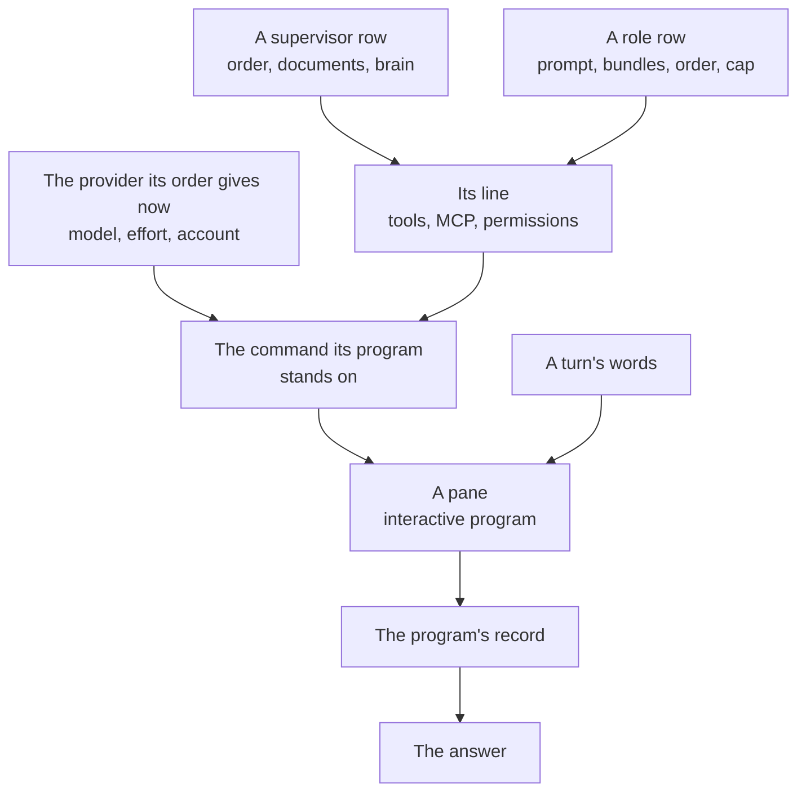
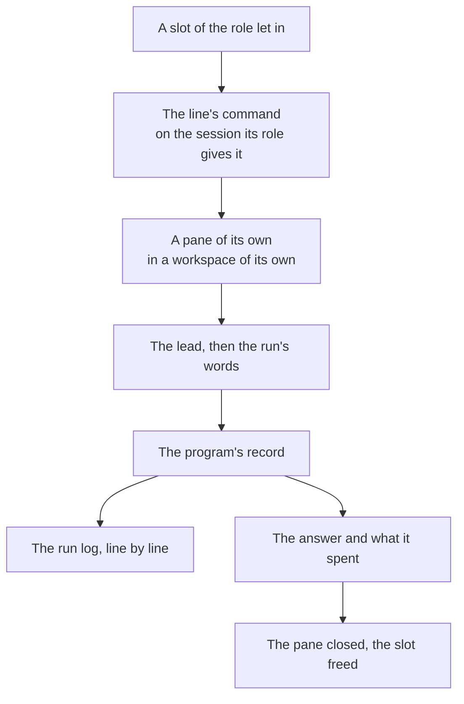

# Agents

What runs in agency, along two axes and no other: the supervisors, who own rooms and talk with people,
and the roles, everything that executes. Where executing work happens is a third thing, the repository,
which is a place and never an agent. This document names the axes and says how every agent is reached
through one interface. A supervisor's row is `docs/supervisors.md`, a role's row is
`docs/agent-roles.md`, a repository's row is `docs/repositories.md`, how a run gets its provider and
model is `docs/provider-order.md`, how a role's runs are let in is `docs/role-slots.md`, and how a
program is spoken to is `docs/agent-control.md`.

## Two axes

- **A supervisor is one row of the `supervisors` table:** a conversational agent that answers in rooms,
  the chat agent and every companion alike. It keeps one resident program and its own settings: its
  provider order, its cache warming per provider, its compaction threshold, its documents and its brain
  (`docs/supervisors.md`).
- **A role is one row of the `roles` table:** what a run executing work is for. It holds a prompt, the
  tool bundles its runs are given, its provider order, the most of its runs that go at once, its session
  policy and its compaction threshold (`docs/agent-roles.md`). The job worker, the helper, the video
  producer, the searcher, the browser, the translator, the transliterator and every co-worker — builder,
  scout, screener, digest, verifier and any the owner adds — are roles.
- **Nothing else is an agent.** No row stands for a worker, a runner or a gate: a job's worker is a run of
  a role in a repository's checkout, a search is a run of the searcher role, and a co-worker is a run of a
  co-worker role. No code lists the supervisors or the roles or answers a question about one by its name;
  every reader takes the row the work names and reads what it says.
- **A repository is a place a run works in,** never an agent (`docs/repositories.md`). It keeps what is
  the repository's own — its prefix documents, the prompt that stands before a job's, its rules and the
  model it may pin — and any role may run in any repository's path.

## A run

- **A run is one piece of work of one role at one path,** on the provider and model the role's order
  gives it at that moment (`docs/provider-order.md`): a job's turn, a delegated task, a search, a
  translation, a co-work branch, a co-worker a run calls by its role's name.
- **A run occupies one slot of its role while it goes** (`docs/role-slots.md`). The role's cap is the only
  bound on how many of its runs go at once; nothing bounds them per provider, and runs do not take turns at
  a path.
- **A run is spawned when its work comes and closed when it ends.** No role keeps a standing program: each
  run stands the interactive program in a pane of its own and closes it with the run (「A run in a pane of
  its own」 below).
- **A run goes on in a kept session where one is valid** for its role, its path, its provider and its
  model, and opens a new one otherwise (`docs/sessions.md`, 「A role's session」).

## One interface

- **Every agent is reached the same way:** its provider stands the program its line describes in a pane,
  a turn is words put into that program, and the answer is read back out of the record the program writes
  (`docs/agent-control.md`, 「What a resident turn reads」).

- **The line is the work's, never the row's.** What a program is shown, kept from and allowed, the MCP
  configuration it is handed and the permission mode it runs in are the line's declaration
  (`docs/launch-lines.md`): the chat line for every supervisor, and for a role the line its row names.
- **The prompt is the row's, never the line's.** A supervisor's system prompt is composed from its own
  documents; a role's run opens on the platform's harness opening, `prompts/harness.md`, then the role's
  prompt, then what the work hands in — a repository's prompt and rules for a job (`docs/repositories.md`).
  Claude Code's own default prompt reaches no agent.
- **What a provider changes is the program and its endpoint,** read from its own declaration as the
  command is composed: Claude Code on an account agency chose, or Claude Code on the gateway under a
  member's or a registration's name.
- **Nothing branches on the provider or the model** to give a run fewer tools, another line or another
  session.

## No print mode

- **No agent runs a program in print mode.** Every run is the interactive program, standing in a pane of
  herdr where a person can watch it think and type into it; a turn is put into it and read back from its
  record. A turn that finds no pane to stand its program in fails as a transport failure and is run in no
  other shape.
- **No agent starts Claude Code itself.**
  - A supervisor's program carries a shell guard: a command that would start `claude` in any form the job
    guard reads one is refused before it runs, and the refusal tells it to hand the work over with its
    `task` tool or to put it on the TODO.
  - A job's guard refuses print mode outright, whatever the job has opened (`docs/live-claude-guard.md`).
- **The check:** a test reads this repository's code for a place that launches Claude Code in print mode,
  and fails on any it finds.
- **No agent reaches another unit's store.** A unit's database, its loopback port and its token files are
  its own: a supervisor knows what the system holds through its tools alone — the brain's `brain_list` and
  `brain_similar`, the gate's reference tools, and each unit's own tools — never its store. The same shell
  guard refuses, before it runs, a shell command that runs a database client (`psql`, `pg_dump`,
  `pg_restore`, `sqlite3` and their kin), names a `postgres://` or `postgresql://` address, reaches a
  loopback port a unit of the deployment answers on, reads the token files under the data root's `env/`,
  or handles the session's own token (`policy/shell-guard.toml`). Its refusal names the road instead. A
  role's run is held by the job guard.

## A run in a pane of its own

Every run of a role is one run of its line that Claude Code carries in a pane of the run's own: a job's
turn, a delegated task, a co-work branch, a search, a browse, a translation, the morning news page's
writer, a tool probe, and the turn the usage reader asks on a login found expired so the CLI renews it
(`docs/usage-windows.md`, 「The Claude account reader」).

- **Each run is the interactive program in a pane of its own,** opened for the run in a workspace of its
  own, labelled with what the run is, its role and its model, and closed with the run. Two runs of one role
  at once are two panes, so overlapping jobs, searches and branches never wait on each other's program.
- **Its command is its line's,** without print mode: the model and effort its order gives it, the tools
  shown and allowed, the MCP configuration, the permission mode and the system prompt, and the session its
  role's setting gives it.
- **Its role is the one the work names:** a job item's role, `worker` where the item names none; the role
  a delegation or a co-worker call names; the role a session's caller names. A run that stands for no
  piece of anyone's work holds the role the roles policy names for it — the usage reader's renewal turn
  `upkeep` (`policy/roles.toml`).
- **What goes in** is a typed lead saying the paste after it is the run's task, then the run's words
  (`docs/agent-control.md`, 「The order for putting in one turn and waiting for it to end」).
- **What comes back is read off the program's record:** the answer, the tokens and the money its account
  line settles as it ends, and the background work it left running. Every line the record gains is handed
  to the run as it is written — into its run log, and to a caller that reads the pages its run opened or
  the pictures it looked at.
- **A run log opens and closes the run itself,** since the record names neither: a start line with the
  role, the path and the model the run went out on, and an end line with its answer or what ended it,
  which the console reads a run's spend against.
- **A person watches the program itself:** its thinking and its tool calls on its own screen, while the
  pane stands, and may type into it.
- **Its stop is the door's:** a run carries no clock and lasts until it ends, and a stop — a cancellation
  over the run's names, or its caller told to stop — is put to the run as its door words it
  (`docs/agent-control.md`, 「Stopping, falling back and standing up again」); once the run has ended its
  pane is closed, its record standing for what it wrote, and its slot is freed.
- **Its life is its program's:** the program is the process whose command line carries the run's
  session, and the run ends `program-lost` once that process is gone with its record not closing the
  turn, `vanished` once herdr says its pane is gone, and `silent-peer` where no such process can be found
  and the pane shows none while nothing the program writes moves (`docs/agent-control.md`, 「Telling that
  a turn's program is gone」). Its liveness row says which of these it last read.
- **Its tool token is its own,** issued as the run is composed and taken back once it ends.
- **A run on a registration** is the same program on the gateway under the registration's name, its record
  under the registration's home (`docs/own-llm.md`, 「Claude Code in the pane」).
- **A caller outside agency's server** runs its run through a verb of the `bmo-agency` binary, which asks
  the slot, opens the pane, runs the turn and prints what came back.
- **herdr down stops every run,** as it stops every supervisor's turn: with no pane to open, the run fails
  as a transport failure.

## A supervisor's program stands

- **A supervisor keeps one resident program,** in the head pane of its own workspace, started on the chat
  line's command for the session its turn goes on in (`docs/supervisors.md`, 「One runner」). Its turns
  follow one another on that program, and its keepalive pings and folds go into it.
- **It is the only resident program agency keeps.** A role's runs are spawned per run, so nothing of a
  role stands between its runs and nothing of a role is warmed (`docs/keepalive-schedule.md`).

## Adding a supervisor, a role and a repository

- **A supervisor:** the console's supervisor tab adds one — its name, label, provider order and the
  repository its TODO items go to — with a room of the web console's own that it answers alone
  (`docs/companions.md`, 「Where a companion and its rooms come from」), or `POST /supervisors`
  (`docs/api.md`, 「supervisors」). One added is given its own brain as it is registered.
- **A role:** the console's role tab, or `POST /roles` (`docs/agent-roles.md`, 「Changing the roles」).
- **A repository:** the console's repository tab, or `POST /repositories` (`docs/repositories.md`).
- **A model:** the console's registered-models tab adds a registration with its addresses through the
  registry route (`docs/own-llm.md`, 「Registered models」); the model-files tab keeps the files the
  deployment's own engines serve (`docs/model-catalogue.md`). Every run reads the registry as it starts.
- **Each is a row:** added with no commit, no deployment and no restart, and read from the next run on.
- **Removing what the deployment seeds** is not offered: a seeded supervisor stands again at the next
  start, and a seeded role is given again only to a store that never held it.
