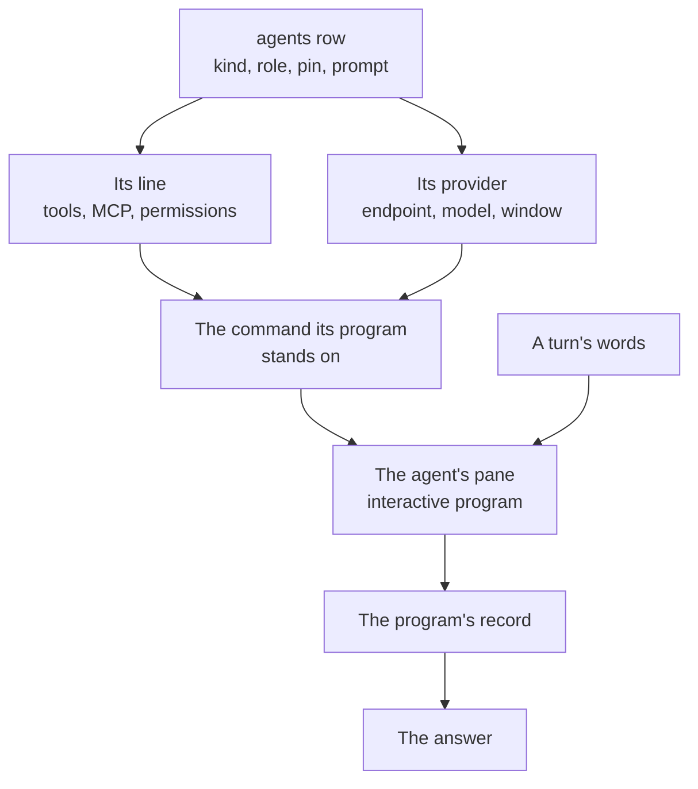
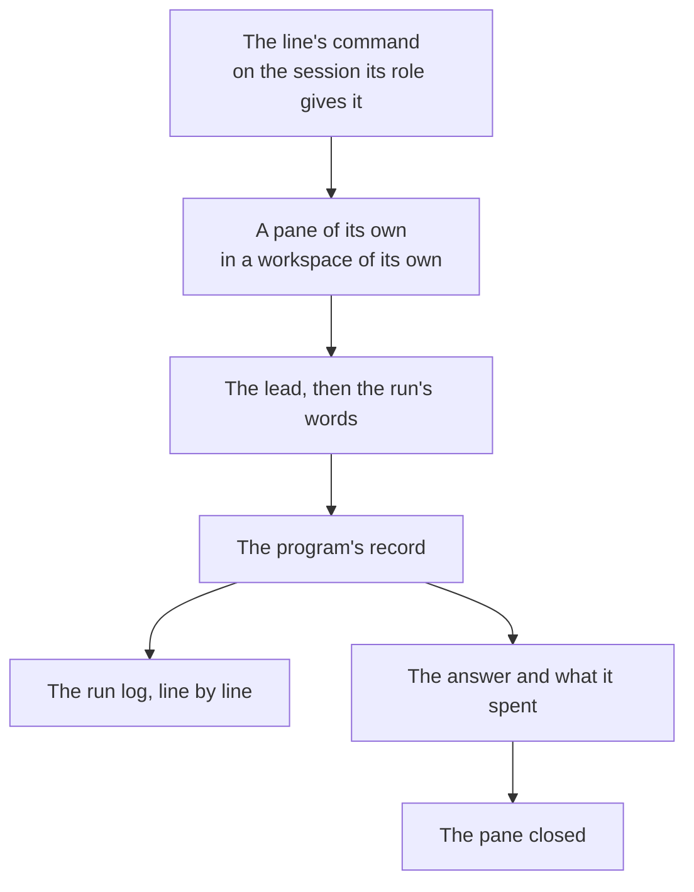

# Agents

What an agent is, how every one of them is reached through one interface, and where each kind of
agent stands on the way there. What each agent owns apart from the others is `docs/agent-ownership.md`, what it may do is `docs/agent-roles.md`, and how its
program is spoken to is `docs/agent-control.md`.

## What an agent is

- **An agent is one row of the `agents` table.** The chat agent, a companion, a worker, a gate and a runner
  are rows of the same table, and the row is the agent's whole declaration: nothing in the code lists the agents
  or answers a question about one by its name.
- **What a row declares:**
  - its name and its label, the words that call it and the window it keeps in a room;
  - its owner: the login account it belongs to, or none for the administrator's;
  - its kind: the machinery that carries its turns — a conversation in rooms, a worker's jobs, a gate's
    judgements, a runner line's runs;
  - its role: the function bundles its turns are given (`docs/agent-roles.md`);
  - its pin, its own fixed model: a provider and one model of it — a catalogue model, a road's member or a
    registration — at the head of the walk its turns go out on, a worker's jobs, standing program and
    direct turns among them (`docs/model-tiers.md`, 「An agent's own model」);
  - its own prompt: the documents and settings its system prompt is composed from;
  - its folder, the worker its TODO items go to, its thinking and effort;
  - for a conversational agent, its session's scope, its turn's shape and whether it answers the rooms
    that name nobody (「One runner」 below).
- **A position and a model are two settings.** A companion is a conversational position set to a
  registration of the model registry; a worker is a worker position set to `flash-next-coder`. Any
  model may be set on any position, and the position decides how the agent runs, which tools it holds
  and how it is spoken to, whatever the model.
  - What a model changes is its provider's declaration alone: the endpoint, the context window, the
    answer ceiling, the request wait, the sampling it is sent, the home its program keeps records
    under, and for a conversation how its session is handed over, the limits that cut a turn and the
    wait for an engine a job holds (`docs/own-llm.md`, 「How requests go」; 「What a provider declares
    for a conversation」 below).
  - Nothing branches on the provider or the model to give an agent fewer tools, another line or
    another session.
- **A new agent is a new row.** Any agent, its model's registration and the room it answers are added
  on the console, with no commit, no deployment and no restart (「Adding a model and an agent」 below).

## One interface

- **Every agent is reached the same way:** its pin's provider stands the program its line describes in
  the agent's own pane, a turn is words put into that program, and the answer is read back out of the
  record the program writes (`docs/agent-control.md`, 「One standing pane per agent」, 「What a resident
  turn reads」).

- **The line is the kind's, never the agent's.** What a program is shown, kept from and allowed, the
  MCP configuration it is handed and the permission mode it runs in are the line's declaration
  (`docs/launch-lines.md`), the same for every agent of that kind.
- **The prompt is the agent's, never the line's.** Each agent's system prompt is composed from its own
  documents and settings and handed to its program as one whole file in place of the program's own: the
  one thing in front of every agent on Claude Code is the platform's harness opening,
  `prompts/harness.md`, or the base prompt that stands in its place (`docs/base-prompts.md`); Claude
  Code's own default prompt reaches no agent, and no agent's documents are read for another.
- **What a provider changes is the program and its endpoint,** read from its own declaration as the
  command is composed: Claude Code on the account agency chose, or Claude Code on the gateway under a
  registration's name.

## No print mode

- **No agent runs a program in print mode.** Every run is the interactive program, standing in a pane
  of herdr where a person can watch it think and type into it; a turn is put into it and read back
  from its record. A turn that finds no pane to stand its program in fails as a transport failure
  and is run in no other shape.
- **No agent starts Claude Code itself.**
  - A conversational agent's program carries a shell guard: a command that would start `claude` in any
    form the job guard reads one is refused before it runs, and the refusal tells it to hand the work
    over with its `task` tool or to put it on the TODO.
  - A job's guard refuses print mode outright, whatever the job has opened (`docs/live-claude-guard.md`).
- **The check:** a test reads this repository's code for a place that launches Claude Code in print
  mode, and fails on any it finds.
- **No agent reaches another unit's store.** A unit's database, its loopback port and its token files are
  its own: a conversational agent knows what the system holds through its tools alone — the brain's
  `brain_list` and `brain_similar`, the gate's reference tools, and each unit's own tools — never its
  store. The same shell guard refuses, before it runs, a shell command that runs a database client
  (`psql`, `pg_dump`, `pg_restore`, `sqlite3` and their kin), names a `postgres://` or `postgresql://`
  address, reaches a loopback port a unit of the deployment answers on, reads the token files under
  the data root's `env/`, or handles the session's own token (`policy/shell-guard.toml`). Its refusal names the road instead: the brain
  through its tools or `bmo use bmo/brain_*`, a document or a rule through the gate's reference tools, a
  unit through its own tools. A job's worker is no conversational agent and its shell is held by its own
  guard.

## Runs apart

A run apart is one run of a line Claude Code carries in a pane of the run's own rather than in a standing
program: a turn of an apart session on the search or browse line, a translation, the morning news page's
writer, a tool probe, a judging batch of the gate project's claude road, and the turn the usage reader asks
on a login found expired so the CLI renews it (`docs/usage-windows.md`, 「The Claude account reader」).
Whether a run apart goes on in the session an earlier run left or opens a new one is the setting of the role
it holds, never a fact of its line or its kind (`docs/agent-roles.md`, 「A role's sessions」).

- **Each run is the interactive program in a pane of its own,** opened for the run in a workspace of
  its own, labelled with what the run is and its model, and closed with the run. Two runs of one line
  at once are two panes, so overlapping searches, batches and branches never wait on each other.
- **Its command is its line's,** without print mode: the same model, effort, tools shown and allowed,
  MCP configuration, permission mode and system prompt, and the session its role's setting gives it.
- **Its role is its agent's,** read from the agent's row as the run starts; a run whose agent stands no
  row holds the role the roles policy names for it — the usage reader's renewal turn `renewal`, the gate
  project's judging batch `judging` (`policy/roles.toml`).
- **Its session is its role's to keep or not,** the role row's `sessions`:
  - `fresh`: the run opens a session id of its own, which no later run resumes;
  - `keep`: the run resumes the session the last answered run of the same agent left on the same
    command, while that session is warm, and opens a new one otherwise; the session it answers on is
    kept for the next (`docs/sessions.md`, 「A run apart's kept session」);
  - a role the store does not hold keeps nothing, as `fresh`.
- **What goes in** is a typed lead saying the paste after it is the run's task, then the run's words,
  the way a pane of a run's own takes any turn (`docs/agent-control.md`, 「The order for putting in one
  turn and waiting for it to end」).
- **What comes back is read off the program's record:** the answer, the tokens and the money its
  account line settles as it ends, and the background work it left running. Every line the record
  gains is handed to the run as it is written — into its run log, and to a runner that reads the
  pages its run opened or the pictures it looked at.
- **A run log opens and closes the run itself,** since the record names neither: a start line with the
  model the run went out on, and an end line with its answer or what ended it, which the console reads
  a run's spend against.
- **A person watches the program itself:** its thinking and its tool calls on its own screen, while
  the pane stands.
- **Its stop is the door's:** a run apart carries no clock and lasts until it ends, and a stop
  — a cancellation over the run's names, or its runner told to stop — interrupts the program and closes
  its pane, its record standing for what it wrote by then.
- **Its tool token is its own,** issued as the run is composed and taken back once it ends.
- **A run on a registration** is the same program on the gateway under the registration's name, its
  record under the registration's home (`docs/own-llm.md`, 「Claude Code in the pane」).
- **A login's failure is read as a resident turn's:** a full window or a gone login in the program's
  own error is the walk's failure, and the next login the line's key is offered takes the run.
- **A caller outside agency's server** — the gate project's judging road — runs its run through a verb of
  the `bmo-agency` binary, which opens the pane, runs the turn and prints what came back (the gate project's
  `gate-data.md`, 「The claude road」).
- **herdr down stops runs apart,** as it stops every resident turn: with no pane to open, the run fails
  as a transport failure.

## Conversational agents

- **The chat agent and every companion go out on one line, the chat line** (`docs/launch-lines.md`, 「What is
  fixed」):
  - the same tools shown and allowed — the shell, the file tools and the program's two resource tools,
    with the whole of the system's own MCP server — in don't-ask mode;
  - the same MCP configuration, `chat.mcp.json`, beside the strict flag that keeps every other server
    out;
  - the same shell guard;
  - the same record on the tool host: the chat line's capability and the chat role's bundles, so the
    tool list each is shown is the whole catalogue, the resident tools through the `bmo`, `web` and `gate`
    servers `chat.mcp.json` names and the rest with `bmo use` (the tool host's `mcp-host.md`).
- **Every tool acts as the agent whose turn calls it:** its memories, notes and reminders are its
  own, a send goes out under its own name into a room it answers and nowhere else, and an item it
  files goes to its own worker (`docs/agent-roles.md`, `docs/companions.md`, 「Filing a TODO item」).
  The tool host's grant lock judges an acting call the same way for every agent
  (`mcp-host.md`, 「The grant lock」).
- **What stays each agent's own:** its system prompt, its pin, its folder, its gates' switches, its
  sampling, and the three settings of its row below.
- **Its program stands in its own pane.** One program per agent, in the head pane of the agent's
  workspace, started on its line's command for the session its turn goes on in.

### One runner

- **Every conversational agent is a row of the kind `chat`, and one runner carries all of them.** A
  caller (the receiver) hands the words that woke an agent, and the quiet instructions queued for it, to the runner
  the same way for every agent; the runner reads the agent's row for every turn and runs it by what the
  row says. No path is chosen by an agent's name or by a kind of its own: a row an older writer left
  without settings is read by the kind it was written under, in the one reader of the settings, until
  the archive's contraction folds the kind `companion` into `chat`.
- **What the runner does the same for every agent:**
  - the room's queue: words gathered for the queue's delay, the window that keeps it listening,
    and quiet instructions taken into the next turn; in a turn of the window shape, a wait the session
    asks for and words said while the turn works put into it where its provider takes them;
  - one turn at a time per agent, since an agent's turns go into its one program;
  - the session the turn goes on in, kept by the agent's session scope;
  - the turn run in the agent's resident program on its road: a turn of the window shape on its work
    key's road, the walk or the provider the key is set to, and one of the pieces shape on the agent's
    pin; on every provider whose program keeps a session the turn goes on in the scope's session;
  - the answer sent into the room under the agent's own identity, and handed back to the receiver as
    any word filed there;
  - the session handed over at the mark in the way its provider declares (「What a provider declares
    for a conversation」 below).
- **What each agent's row says:**

  | Setting | What it says | The chat agent | A companion added on the console |
  |---|---|---|---|
  | `session_scope` | `agent`: one session across every room it answers, each turn carrying its room's block; `room`: one session in each room | `agent` | `room` |
  | `turn_shape` | `window`: the chat documents as its system prompt, the window's round prompt and the re-asks after an answer (`bmo-window.md`); `pieces`: its base prompt, the companion role and its persona as its system prompt, its new words as its turn and no re-ask (`docs/companions.md`, 「What a turn is given」) | `window` | `pieces` |
  | `default_answerer` | whether it answers every room that names no answerer | yes | no |

- **The scope and the shape go together:** a turn of the window shape goes on in the one session of the
  `agent` scope, and one of the pieces shape in the session of its room; a row names both, the chat
  agent's the first pair and a companion's the second.
- **The chat agent** is the conversational agent whose row says it is the default answerer: the agent
  people talk to where a room names nobody. A **companion** is any other
  conversational agent.

### The session's scope

- **An agent of the `agent` scope keeps one session across every room,** each turn carrying its room's
  block (`unified-bmo.md`).
- **An agent of the `room` scope keeps one session in each room it answers** (`docs/companions.md`,
  「The session」). Its one program goes on in the session of the room the turn is for: a turn for
  another room changes the command's session, and the program is started again on it in the same
  pane, as any changed command is (`docs/agent-control.md`, 「The interactive surface a provider
  declares」).
- **One turn at a time per agent,** whatever its scope: an agent's turns in two rooms take its own lock
  in turn, since they go into one program.

### What a provider declares for a conversation

- **How a full session is handed over:** `fold`, the program's own fold put into it as a turn
  (Claude Code's `/compact`); or `handoff`, the session asked for a note in one more turn and a new
  generation opening with it (`docs/companions.md`, 「Its limit」). The registry's provider hands over;
  Claude Code's folds.
- **Its default fold ratio:** the share of the window a session on it may fill before it is folded or
  handed over, where the fold-ratio table holds no row for the session's tier (`docs/sessions.md`,
  「Session compaction」). DeepSeek and OpenRouter declare 0.5; a provider declaring none reads 0.85.
- **The limits that cut a turn going nowhere,** where the provider declares them: a turn whose tool
  calls repeat or fail again and again, or that runs past its calls or its time, is cut
  (`docs/companions.md`, 「A turn that goes nowhere」). The registry's provider declares them.
- **The wait for an engine a job holds:** a turn on a registration an open job runs on waits until the
  job ends (`docs/companions.md`, 「The engine it shares」). The registry's provider declares it.
- **Nothing else in a conversation turns on the provider or the model:** no provider whose program
  keeps a session opens a new one for each turn, and no turn of a conversation goes out as a request of its own outside the
  agent's program.

## Adding a model and an agent

- **A model:** the console's model registry screen adds a registration with its addresses through the
  registry route (`docs/own-llm.md`, 「Registered models」; `docs/api.md`); every run reads the registry as it starts.
- **A conversational agent:** the console's companions tab adds one — its name, label, pin and the worker
  its items go to — with a room of the web console's own that it answers alone. Agency writes the
  agent's row and the room's consumer the room's half (`docs/companions.md`, 「Where a companion and its
  rooms come from」).
  - The same tab removes a companion it added, with everything the companion kept of its own, and
    nothing of it is left standing; the rooms it answered stay with their whole record.
- **Any agent:** the agent screen registers one of any kind through `POST /agents` and ends one through
  `DELETE /agents/{agentName}` (`docs/api.md`, 「agents」), each owned by the login account the caller
  names. One of the `chat` kind or holding the chat role is given its own brain as it is registered;
  ending a registration leaves the brain standing unless the caller asks it let go, since the brain is
  data.
- **Removing what the deployment seeds** is not offered: a seeded agent stands again at the next start.

## The stages

Each kind of agent comes onto the interface in its own stage; this table is where each stands.

| Stage | What it moves | State |
|---|---|---|
| 1 | Companions onto the chat line, as resident programs in their own pane; the shell guard and the job guard's print-mode refusal; the print-mode check; adding and removing a companion and its room on the console | Done |
| 2 | The search and browse runners and their branches, the news page's writer, their keepalive pings, the tool probe and the gate project's judging road on Claude: each run apart, an interactive program in a pane of its own read back from its record (「Runs apart」) | Done |
| 3 | Gates on Claude Code: a pool of standing interactive programs per gate, a judgement put into a free one and its conversation cleared after it, so overlapping judgements for several rooms are taken at once (`gates.md`, 「A gate on Claude Code」) | Done |
| 4 | The chat agent's turns and its fold only in its resident program, a turn with no pane failing as a transport failure; the TypeScript lines interactive alone, and a gate a verb under `scripts/` asks on Claude Code handed to the service binary's gate run and its pool | Done |
| 5 | One runner for every conversational agent, the chat agent's included: its session's scope, its turn's shape and whether it answers unnamed rooms settings of its row, the kinds `chat` and `companion` one kind, no path chosen by the chat agent's name or a kind, a provider's handover, turn limits and engine wait its own declaration, and the results and job endings an agent set going told to that agent (「One runner」) | Done |
