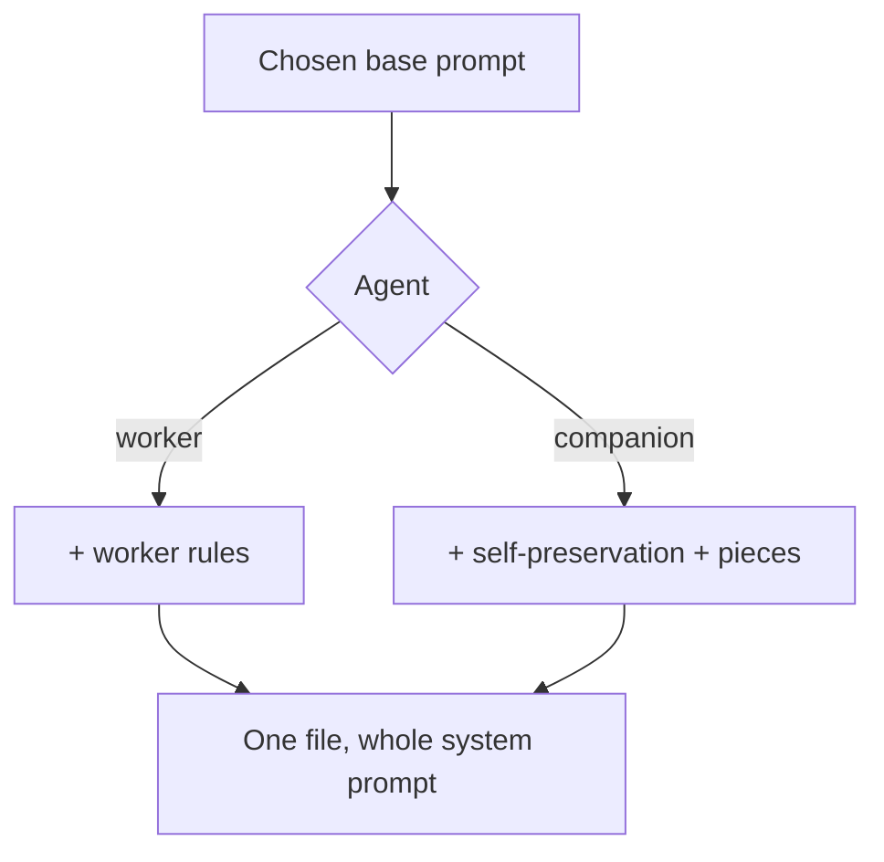

# Base prompts

## What a base prompt is

- **A whole text an agent's system prompt opens with, in place of its harness's own** — the base
  prompt on the console. It is the agent's harness prompt as the owner keeps it: what the program
  around the model is told about itself, its tools and how it works, written out in full rather
  than made by cutting passages out of the program's own prompt as each request goes.
- **Several are kept, each under a name and a label,** and each agent chooses one of them or none.
  Changing an agent's mind is choosing another — a prompt written for another harness, pasted in
  whole — with nothing of the harness or the gateway rewritten.
- **None is the harness's own:** a worker that chooses none runs on its harness's own prompt with
  the worker's rules appended (`docs/launch-lines.md`); a companion that chooses none is sent its
  pieces alone (`docs/companions.md`, 「What a turn is given」).

## What each agent is sent

- **A worker** that chooses one is handed one file as its whole system prompt: the chosen prompt,
  then the worker's rules — the owner's standing rules, the rulebook against destroying the system and
  its own rules where it has them — joined by a blank line (`docs/launch-lines.md`).
  - A support worker takes its base's choice, as it takes its base's own rules.
  - Its co-workers' prompts are as on any worker: the role's own, closed by the same rules.
- **A companion** that chooses one is sent the chosen prompt, then the self-preservation rulebook,
  then the pieces its settings list (`docs/companions.md`, 「What a turn is given」).
- **The other lines read no base prompt:** the chat agent's turns, the gates, the runners and the editors are
  composed as they are.

## What the harness still adds around it

- **On Claude Code, measured on 2.1.288,** a run handed its whole system prompt as a file still
  sends, around that file:
  - a first system block of its own naming the program, `You are a Claude agent, built on
    Anthropic's Claude Agent SDK.`, in place of the one it opens its own prompt with; no flag takes
    it away;
  - the tools' definitions, each with the instructions for calling it;
  - a system turn at the head of the conversation with the environment — working directory, whether
    it is a git repository, platform, shell, OS version, the model's name — the co-worker types and
    skills the run is given, and today's date;
  - the checkout's `CLAUDE.md` as a reminder in the first user turn, where the line reads its
    setting sources.
- **So the prompt holds no value of a run of its own:** the environment reaches the model through
  the program, whichever prompt is chosen.

## Values filled in as a run is composed

- **A prompt may name a value a run differs by,** written as `{{name}}`, which is filled in as the
  run is composed:
  - `{{cwd}}` — the folder the run works in;
  - `{{date}}` — today's date on this machine, as `YYYY-MM-DD`;
  - `{{platform}}` — the operating system's platform word, `linux`;
  - `{{os_version}}` — the operating system's name and release;
  - `{{shell}}` — the shell's name;
  - `{{model}}` — the model the run is started on.
- **The names are agency's policy's** (`policy/base-prompts.toml`): the console lists them beside a
  prompt's text as the policy declares them, and the side that composes a run answers each with its
  own reading of the run.
- **Any other `{{word}}` stays as written.**
- **A filled-in value is part of the prompt:** one that changes — the date — changes what the run is
  handed, and with it the program a worker stands in its pane.

## The seed

- **`claude-code`, labelled Claude Code based:** Claude Code's own system prompt as 2.1.288 wrote it
  for a worker on a registered model, less five passages the owner took out of it:
  - the security caution opening `IMPORTANT: Assist with authorized security testing`;
  - the three lines of its environment about Anthropic's newest models, Claude Code's apps and its
    fast mode, with the heading they stood under;
  - the sentence `If you are weighing a choice, give a recommendation, not an exhaustive survey`.
- **What stays** is what the program needs to run: its opening line, the harness and its tools, the
  rules on confirming and reporting, the session guidance and the context management.
- **Its text is the seed file `prompts/base/claude-code.md`,** read once as the archive's base
  prompt table is made; from then on the archive's copy is the owner's, and the file is not read
  again.
- **Who starts on it:** the agents the policy names for the seed, each given the choice once as the
  table is made; the agents are the deployment's, named in its configuration.
- **The deployment declares the seed in agency's policy** (`policy/base-prompts.toml`):
  its name, label, seed file and the agents given it, with no code naming any of them.

## Where it is kept

- **In agency's store** (`base_prompts`, `agent_base_prompts`, `base_prompt_changes`):
  - the base prompts: name, label, text, and when and by whom each was last saved;
  - each agent's choice, one row per agent that chooses one, the agent's row being no part of it.
- **A save overwrites:** a prompt saved replaces its label and text, a prompt removed is gone, and
  an agent's choice changed replaces the one it held. No earlier value is kept anywhere, so nothing
  can be shown or put back from one.
- **Read afresh for every run,** so a save reaches the next run with no deployment.

## Saving

- **Who may change them:** the owner, on the console's general tab, through the base-prompt routes
  (`docs/api.md`, 「Agents」).
- **What a save is held to,** each refusal a status code with one English sentence and nothing of that save
  written; the name's pattern and the bounds are the policy's:
  - a name of lowercase letters, digits and hyphens beginning with a letter, at most 40 characters,
    unique, and fixed once made;
  - a label of 1 to 60 characters;
  - a text of 1 to 200,000 characters;
  - a prompt an agent chooses is not removed, and the refusal names the agents;
  - an agent's choice names a prompt that is kept, or none.
- **A save starts each agent concerned afresh:** a prompt's text saved, or an agent's choice
  changed, asks a reset of every session each agent concerned holds (`docs/session-resets.md`) — a
  worker's sessions and its support workers', a companion's room sessions — so no conversation goes
  on under a prompt it was not begun with. A label alone changes nothing a run is sent and resets nothing.
  - The save and the asks it makes are written together, or neither is.
- **A worker's program is started again on the next turn,** since its line names the file by what
  it holds: the program standing in its pane was started on the old text.
