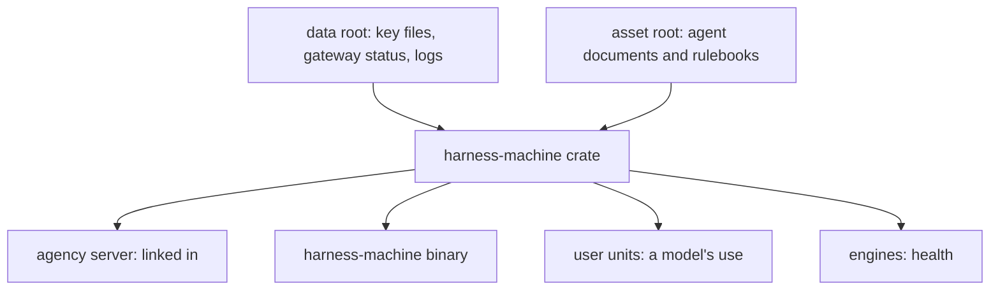

# What the harness reads, writes and starts on this machine

## What it is

- **The machine's part of the registry, the model catalogue and the companions,** done in Rust by the
  `harness-machine` crate for every side that needs it:
  - the registered models' key files, written, taken away and checked;
  - the gateway's status, as its launcher last wrote it;
  - an engine's health, asked at a registration's addresses;
  - a model's use on its engine: the unit it runs in, the engine's installer and its log;
  - a companion's system prompt, composed out of the agent documents.
- **Agency's server links the crate.** It builds a binary of the same name as well, which answers the
  same questions from a shell.
- **Nothing in it reads the store.** The server reads agency's store and hands the crate what the rows
  hold: an address's key file, a companion's settings, the base prompt it chooses.

## The keys

- **Where a key agency was given lives:** `env/registered/<registration>-<node>.key` under the data root,
  at `0600`, in a directory made at `0700` where none stands. It is written beside its place and moved
  into it, so a reader finds the old key or the new one and never half of one.
- **What a key may be:** one line with no whitespace, at most 4,096 characters, trimmed of the space
  around it. Anything else is refused with "A key must be one line with no whitespace." and nothing is written.
- **Which key file is usable:** a file of its own, at exactly `0600`, not empty. A file with looser
  permissions counts as none.
- **A key file is taken away only where agency wrote it;** a file an address names that agency did not
  write is left where it is.
- **A key reaches the binary on standard input alone,** never as an argument, and nothing the crate
  answers carries one: a write answers the file's name as the address row keeps it.

## The gateway's status

- **What the gateway's launcher last wrote of itself,** under the data root's `llm-gateway/`: the table
  it serves, the one starting, how many old children are still finishing, and when (`docs/own-llm.md`,
  「The gateway」).
- **A file missing or unreadable is no status,** and a field missing reads as none, nothing starting,
  no child finishing and time zero.

## An engine's health

- **Asked at each of a registration's addresses in order,** the address's origin with `/health`, under
  the bearer key its key file holds, three seconds to each. The first that answers with an object is
  the health; an address with no readable key is passed over.
- **What it reads of the answer:** the context of the cards it holds now, the model file it serves,
  the requests it has in hand, and why it stands aside and until when. A value of the wrong shape
  reads as none.
- **No address answering is no health,** which every caller reads as nothing known.

## A model's use on its engine

- **The unit:** `bmo-model-use-<engine>`, a transient user unit started by `systemd-run`, collected
  once it ends, so a second choice for the same engine is refused while the first stands
  (`docs/model-catalogue.md`, 「Choosing a model for an engine」).
  - It is handed the PATH, the source root and the working directory its caller names, and runs the
    catalogue verb's `run-use` with the choice's number and the archive it was made in, on the bun its
    caller names, and the catalogue verb is agency's (`bmo-agency model`).
  - The user bus is reached as every spawn that asks systemd reaches it: the runtime directory named
    where it is missing, and a disabled session bus address taken off.
  - A start that fails answers what systemd said, which the caller records as the choice's failure.
- **The installer:** the engine's own install script, `<engine>-install.ts --model <entry>`, in the
  engine's source root, run with
  bun and handed the archive the choice was made in. Its standing output and error are written into
  the choice's log as they come, and the run answers whether it ended well with its last line that
  was not empty. An engine with no installer is a failure naming the installer's path.
- **The log a screen is shown:** the last twenty lines of the choice's log, none where it is missing.

## A companion's system prompt

- **Composed exactly as a turn sends it** (`docs/companions.md`, 「What a turn is given」): the base
  prompt it chooses at the head, the self-preservation rulebook, then the pieces its settings list in
  their order, joined by a blank line.
- **Read out of the asset root for every call:** the rulebooks under `prompts/rules/`, the companion
  frame, turn and hands under `prompts/agents/companion/`, and the companion's own `persona.md`.
- **What the caller hands it:** the companion, its settings' pieces, own pieces and persona,
  the text of the base prompt it chooses or none, and the model it is pinned to.
- **The base prompt's values are filled in here** (`docs/base-prompts.md`, 「Values filled in as a run
  is composed」): the folder it stands in, today's local date, the operating system's name, its
  kernel's name and release, the shell's name and the model. A value the policy names that the
  prompt does not carry changes nothing, and any other `{{word}}` stays as written.
- **The folder:** each companion's own under the data root's `companion-homes/`. The crate names the
  folder; the runner that starts a turn makes it.
- **The persona:** its settings' text, its own file, or none where it holds neither, as a companion added
  on the console starts.

## The binary

- **`harness-machine key write <registration> <node>`** reads a key from standard input and prints the
  key file's name; **`key remove <file>`** takes away a key file agency wrote; **`key states`** reads key
  file names from standard input and prints whether each is usable, none or named but not usable.
- **`harness-machine gateway`** prints the gateway's status, or `null`.
- **`harness-machine health`** reads a registration's addresses from standard input and prints the
  health, or `null`.
- **`harness-machine model-use start`** starts a choice's unit, **`model-use install`** runs an engine's
  installer into a log, and **`model-use log`** prints a log's last lines.
- **`harness-machine companion-system`** reads a companion's settings and the base prompt it chooses
  from standard input and prints the composed system prompt; **`companion-persona <agent>`** prints
  the persona its own file holds, or nothing where it has none.
- **Every answer is one line of JSON on standard output.** A refusal the owner reads ends with status
  2 and its field and sentence as JSON on standard error; any other failure ends with status 1 and
  its reason there.
- **`--data-root` and `--asset-root`** name the roots it reads; the bun side hands its own.

## Stand-ins

- **A test stands the machine in by what it holds, never by replacing a function:**
  - key files written, or not, under the test's scratch data root;
  - a health answered by a stand-in engine on the loopback;
  - a stand-in `systemd-run` on the `PATH`, and a stand-in installer under a scratch source root;
  - agent documents under the test home's asset root.
