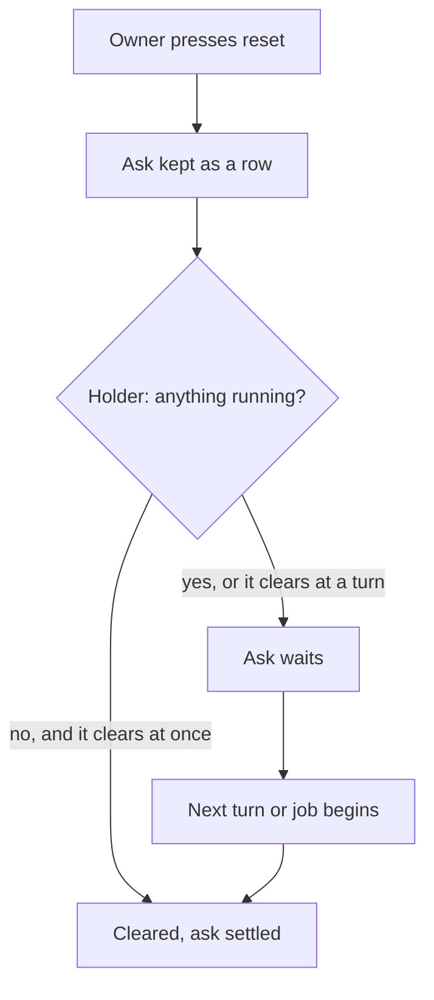

# Clearing an agent's session

## What a reset is

- **An ask to start an agent's session afresh,** made by the owner. It is kept as a row of
  agency's `session_resets` table: the agent, the room where the session is one room's, who asked,
  when and why, and when it was carried out.
- **It never cuts a turn.** A session is cleared by its own holder at a point where nothing of it
  runs: where a turn or a job of it is running, the reset waits for that one to end and is carried
  out as the next one begins.
- **One ask waits for a session at a time.** An ask for a session that already has one waiting is
  the same ask, and adds no row.
- **The old session is kept, never deleted:** the program's own record of it stays where the
  program wrote it, and whatever the holder keeps of its turns stays under it. Only a companion's
  reset of its conversation deletes sessions, and that is a reset of its own (below).

## Who holds a session, and how each clears it

- **Each kind of agent that holds a session answers for it:** which sessions it holds now, with what
  a reset of each would clear, and how it carries a reset out. Nothing outside it knows where a kind
  keeps its sessions.
- **The session routes are agency's** (`docs/api.md`, 「Sessions」): its control routes read the list
  and write the asks, and agency, which holds every program standing in a pane, carries them out.

- **The chat agent:** the one session every room's rounds go on in (`unified-bmo.md`).
  - A reset is the chat's forced replacement: the next round closes the session and opens a new one,
    nothing of the old one carried into it, as with any replaced session (`docs/sessions.md`,
    「Session replacement」).
  - That round settles the ask.
- **A worker:** the sessions recorded for it, one for each model and login it ran on.
  - Where no job of its runs, a reset removes those records at once and is settled, so its next job
    opens a new session.
  - Where one runs, the ask waits, and the worker's next job removes them as it starts and settles
    it.
  - Agency carries a worker's reset out, since it holds the program standing in the worker's pane
    and knows which jobs run: once an ask is written, every waiting ask whose worker
    runs nothing is carried out before the route answers, and so is it on a script's
    `session-resets` word (`docs/api.md`, 「Events」).
- **A companion in a room:** that room's session, cleared by the next turn there
  (`docs/companions.md`, 「Clearing it」).
  - Its resident program standing on that session is taken down as the ask is written, where no
    turn of the companion holds it, so the cleared session is not what its pane holds while the ask
    waits (`docs/companions.md`, 「The program on an ended session」).
  - Agency does this too, as it holds the companion's program: once an ask is written,
    and on a script's `session-resets` word, every waiting ask of a companion's room session has
    the program on that session taken down.

## A session boundary is what applies a new chat tool

- **A restart is not a tool-list boundary.** A deployment or a receiver restart leaves the standing
  chat session as it is. The console's reset of that chat session (`POST /session-reset`) closes the
  conversation and opens a new one, but a program already standing in the pane keeps the MCP servers
  it was started with; on dsh the tool list belongs to that program.
- **What really applies a newly named server is the chat program stood again:** its pane process
  ends and the next turn stands a new one from the configuration. A session reset alone does not
  replace the program, and neither does restarting the receiver; the program is what reads the
  server list.

## Where it is asked

- **The console:** the agent settings' session list holds every session there is, one row each, and
  the companion's settings hold a reset for each of its rooms, both read from agency's session
  routes. Before anything is
  asked, a confirmation says in one line what the reset clears and whether it waits for a running
  turn or job.
- **A companion's generation settings** ask it of every room session of that companion as they are
  saved (`docs/companions.md`, 「Its generation settings」).
- **A companion's reset with its conversation range** ends that companion's room sessions itself,
  and records each as an ask carried out at that moment, settling any ask still waiting for it
  (`docs/companions.md`, 「Starting it afresh」).
- **A base prompt** asks it of every session of each agent that chooses it, as its text is saved,
  and an agent's change of choice asks it of that agent's (`docs/base-prompts.md`, 「Saving」).
- **Who may ask:** the owner, signed in to the console; the ask is recorded under the owner's name.

## What the record shows

- **Every ask stays,** waiting or carried out. The session list shows a waiting ask on its session,
  and the last time each session was cleared.
